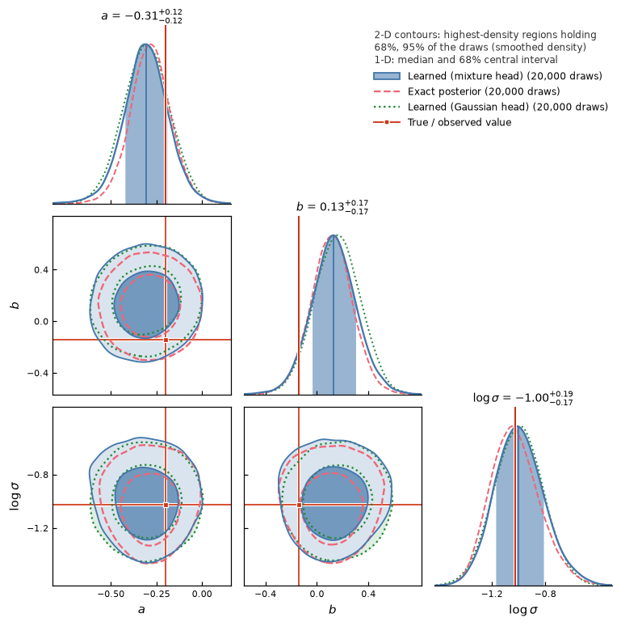
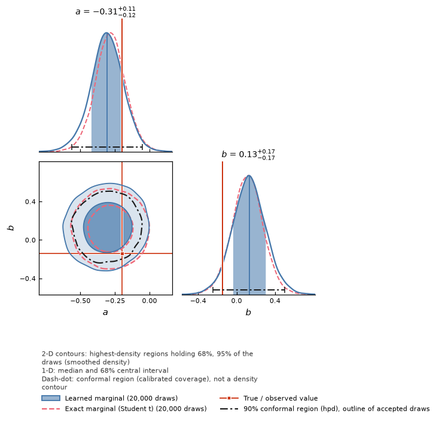

# Coming from MCMC and HMC

This page is for readers who sample posteriors with Stan, PyMC, NumPyro, emcee or
dynesty and read corner plots every day. It maps what you already do onto
[`torchregress.joint`](joint-regression.md), says where the two differ in kind,
and works through a problem whose posterior is known exactly, so that every
number can be checked. If you have never fitted a joint model, start with
[New to Joint Prediction](joint-quickstart.md); its [glossary](joint-quickstart.md#glossary)
defines *credible region*, *confidence set* and *prediction region*, three
different objects that this page keeps apart.

The library is not a sampler. It trains a network once on pairs
$(\text{data}, \theta)$ and then returns, for any new data set, a normalised
distribution over $\theta$ that you can sample, evaluate and calibrate in one
call. When the pairs are simulated from a prior and a likelihood, that
distribution approximates the posterior; this is neural posterior estimation,
and the [SBI page](joint-for-sbi-users.md) covers it from that community's side.

---

## 1. Concept map

| You know (MCMC) | Here | What changes |
|:--|:--|:--|
| Posterior draws, `[chain, draw, param]` | `dist.sample(S)`: `[n, S, d]`, $S$ draws for each of $n$ data sets | Independent draws: no warm-up, no thinning, no autocorrelation |
| Unnormalised log posterior | `dist.log_prob(theta)`: `[n, d]` to `[n]`, or `[n, S, d]` to `[n, S]` | Normalised, so comparable across data sets and models |
| Credible and HPD regions | `dist.hpd_level(theta)` (the learned mass of the HPD region whose edge passes through `theta`); the contours of `plot_corner_plot` | Same object: the model's own probability |
| Marginalising a nuisance parameter (drop its column) | `dist.marginal(dims)`; dropping columns of `sample` also works | `marginal` keeps a normalised density when the head allows it ([nuisance targets](joint-regression.md#6-targets-of-interest-and-nuisance-targets)) |
| Corner plots: `corner`, `getdist`, `chainconsumer` | [`plot_corner_plot`](../methods/visualization.md#corner-plots) | Default contours hold 68% and 95% of the mass, as `getdist`. `corner` draws $k\sigma$ levels of a 2-D Gaussian (11.8%, 39.3%, 67.5%, 86.5% for $k = 0.5, 1, 1.5, 2$); `chainconsumer` uses the 1-D masses 68.3% and 95.4% unless `sigma2d=True`. `level_convention="sigma"` reproduces `corner` |
| Posterior predictive checks | PIT and pre-rank histograms on held-out pairs ([diagnostics](joint-regression.md#8-diagnostics)) | A PPC tests the model against the data; these test the learned distribution against held-out true values |
| $\hat R$, ESS, divergences | Seed-to-seed spread of refits, the validation log score (`validation_log_score_`, in data units), calibration diagnostics on held-out pairs | No analogue of mixing: draws are exact draws from the *learned* distribution; the error is in what was learned (training and amortisation), not in sampling it |
| LOO, ELPD | Mean `log_prob` of held-out pairs | A direct held-out estimate, not PSIS: the estimator keeps its own validation split |
| Stacking of predictive distributions | `JointRegressor()` stacks its heads by held-out log score (`weights_`) | Same objective as Yao et al. (2018), on a validation split ([stacking](joint-regression.md#4-heads-and-stacking)) |
| Simulation-based calibration | [`metrics.sbi`](../metrics/calibration.md#simulation-based-calibration-sbc-and-tarp) (SBC ranks, TARP) and [`hpd_calibration`](../api/joint.md#diagnostics) | The same test; it is cheap here because each data set costs one forward pass |

---

## 2. What is the same, and what is different in kind

**One fit per data set, or one map for all data sets.** A sampler fits one
posterior per data set. `JointRegressor` learns a map from data to a
distribution over $\theta$ (*amortisation*): training costs seconds to minutes,
then each new data set costs one forward pass. The price is an *amortisation
gap*: the learned distribution for a given data set is close to the posterior
on average over data sets, and can be detectably off for a particular one
(section 3.4 measures it).

**A prior and a likelihood, or pairs.** You write $p(\theta)$ and
$p(x \mid \theta)$. Here you supply pairs $(x_i, \theta_i)$. If you simulate
them from your prior and likelihood, the learned map targets your posterior.
If they are labelled real data, the distribution of the labels plays the role
of the prior, whether or not you meant it to: a predictive trained on a skewed
population pulls rare cases towards the bulk
([Neyman confidence sets](../methods/neyman.md) shows the effect and the fix).

**Credible regions, or prediction regions.** A *credible region* holds a
stated share of the posterior for one data set; its meaning rests on the prior
and likelihood being right. `model.region(...)` returns a *prediction region*
whose level is calibrated on held-out pairs: over many pairs drawn like the
calibration pairs, at least 90% of the true $\theta$ fall inside their region.
That frequency statement holds even if the learned distribution is wrong, but
it is an average over the pairs (over $x$, and over $\theta$ as drawn by the
prior), not a statement for each data set and not for each $\theta$. Coverage
at every $\theta$ is what a *confidence set* gives
([`NeymanConfidenceSet`](../methods/neyman.md)).

**When sampling is the right tool, and this library is not.**

- One data set with an explicit likelihood, where an exact posterior is
  affordable: run the sampler.
- You need the posterior under a specific prior and cannot simulate many
  thousands of pairs from it.
- Hierarchical models whose structure changes with the data (group counts,
  data set sizes), or data that do not fit one fixed-size input.
- Marginal likelihoods and Bayes factors: nothing here estimates evidence.
- You need guarantees for each data set rather than on average over many.

!!! warning "Common mistake: running $\hat R$ or ESS on amortised draws"
    Draws from `dist.sample` are independent by construction, so $\hat R$ is 1
    and the ESS equals the number of draws, whatever the quality of the fit.
    These numbers say nothing here. Check the learned distribution against held-out
    simulations (section 3.3) and, for a data set you care about, against a
    sampler (section 4).

---

## 3. Worked example with an exact answer

A straight line $y_i = a + b\,t_i + \varepsilon_i$ observed at ten points
$t_i \in [-1, 1]$, with unknown noise $\varepsilon_i \sim \mathcal N(0, \sigma^2)$
and the conjugate prior

$$
\sigma^2 \sim \text{Inv-Gamma}(3, 0.5), \qquad (a, b) \mid \sigma \sim \mathcal N(0, \sigma^2 I_2).
$$

The posterior of $\theta = (a, b, \log\sigma)$ is Normal-Inverse-Gamma in
closed form. With design matrix $X = [\mathbf 1, \mathbf t]$,
$V_n = (I_2 + X^\top X)^{-1}$, $m_n = V_n X^\top y$, $\alpha_n = 3 + 10/2$ and
$\beta_n = 0.5 + \tfrac12 (y^\top y - m_n^\top V_n^{-1} m_n)$,

$$
\sigma^2 \mid y \sim \text{Inv-Gamma}(\alpha_n, \beta_n), \qquad (a, b) \mid \sigma, y \sim \mathcal N(m_n, \sigma^2 V_n),
$$

and with $\log\sigma$ integrated out, $(a, b) \mid y$ is a bivariate Student $t$
with $2\alpha_n$ degrees of freedom, location $m_n$ and scale matrix
$(\beta_n / \alpha_n) V_n$. The posterior of $\log\sigma$ is skewed and the
spread of $(a, b)$ depends on $\sigma$, so a Gaussian is close but not exact.

The whole example runs in about 35 s on a laptop CPU. Run the blocks in order.

### 3.1 The problem and its exact posterior

```python
import math

import numpy as np
import torch
from scipy.special import gammaln

T = np.linspace(-1.0, 1.0, 10)
X_DESIGN = np.stack([np.ones_like(T), T], axis=1)  # [10, 2]: intercept a, slope b
A0, B0 = 3.0, 0.5  # sigma^2 ~ InvGamma(3, 0.5);  (a, b) | sigma ~ N(0, sigma^2 I)


def simulate(n: int, seed: int) -> tuple[np.ndarray, np.ndarray]:
    """Draw (a, b, log sigma) from the prior, then 10 noisy points on the line a + b t."""
    rng = np.random.default_rng(seed)
    sigma = np.sqrt(B0 / rng.gamma(A0, 1.0, size=n))
    beta = sigma[:, None] * rng.standard_normal((n, 2))
    data = beta @ X_DESIGN.T + sigma[:, None] * rng.standard_normal((n, 10))
    theta = np.column_stack([beta, np.log(sigma)])
    return data.astype(np.float32), theta.astype(np.float32)


def exact_posterior(data: np.ndarray) -> tuple[np.ndarray, np.ndarray, float, np.ndarray]:
    """Normal-Inverse-Gamma posterior of each row of data [n, 10] (conjugate)."""
    data = data.astype(np.float64)
    prec = np.eye(2) + X_DESIGN.T @ X_DESIGN
    cov = np.linalg.inv(prec)
    loc = data @ X_DESIGN @ cov  # [n, 2]
    shape = A0 + X_DESIGN.shape[0] / 2
    rate = B0 + 0.5 * ((data**2).sum(1) - np.einsum("ni,ij,nj->n", loc, prec, loc))
    return loc, cov, shape, rate


def exact_log_prob(theta: np.ndarray, data: np.ndarray) -> np.ndarray:
    """log p(a, b, log sigma | data) for theta [n, 3]."""
    loc, cov, shape, rate = exact_posterior(data)
    beta, s = theta[:, :2].astype(np.float64), theta[:, 2].astype(np.float64)
    sigma2 = np.exp(2 * s)
    r = beta - loc
    quad = np.einsum("ni,ij,nj->n", r, np.linalg.inv(cov), r) / sigma2
    log_normal = -0.5 * quad - np.log(2 * np.pi * sigma2) - 0.5 * np.log(np.linalg.det(cov))
    log_inv_gamma = (
        shape * np.log(rate) - gammaln(shape) - (shape + 1) * np.log(sigma2) - rate / sigma2
    )
    return log_normal + log_inv_gamma + np.log(2.0) + 2 * s  # + log |d sigma^2 / d log sigma|


def exact_marginal_log_prob(ab: np.ndarray, data: np.ndarray) -> np.ndarray:
    """log p(a, b | data) with log sigma integrated out: a bivariate Student t."""
    loc, cov, shape, rate = exact_posterior(data)
    nu, scale = 2 * shape, (rate / shape)[:, None, None] * cov  # [n, 2, 2]
    r = ab.astype(np.float64) - loc
    quad = np.einsum("ni,nij,nj->n", r, np.linalg.inv(scale), r)
    log_det = np.log(np.linalg.det(scale))
    return (
        gammaln((nu + 2) / 2) - gammaln(nu / 2) - np.log(nu * np.pi) - 0.5 * log_det
        - (nu + 2) / 2 * np.log1p(quad / nu)
    )


def exact_sample(data: np.ndarray, n_samples: int, seed: int) -> np.ndarray:
    """Exact posterior draws [n, n_samples, 3]."""
    rng = np.random.default_rng(seed)
    loc, cov, shape, rate = exact_posterior(data)
    sigma2 = rate[:, None] / rng.gamma(shape, 1.0, size=(data.shape[0], n_samples))
    z = rng.standard_normal((data.shape[0], n_samples, 2)) @ np.linalg.cholesky(cov).T
    beta = loc[:, None] + np.sqrt(sigma2)[..., None] * z
    return np.concatenate([beta, 0.5 * np.log(sigma2)[..., None]], axis=-1)


torch.manual_seed(0)  # draws below use torch's global generator
```

### 3.2 Train on simulated pairs

Simulate 20,000 pairs from the prior and the likelihood and train on
data $\to$ parameters. Two heads: a multivariate normal per data set
(`"gaussian"`) and a mixture of five Gaussians (`"mixture"`).

```python
from torchregress.joint import JointRegressor

data, theta = simulate(20_000, seed=0)  # 20,000 (data, parameters) pairs
data_obs, theta_obs = simulate(2_000, seed=1)  # fresh simulations to check against

gaussian = JointRegressor("gaussian", device="cpu").fit(data, theta)
mixture = JointRegressor("mixture", device="cpu").fit(data, theta)
```

### 3.3 Distance to the exact posterior, and calibration over many data sets

For simulated pairs $(\theta, y)$, the mean of
$\log p(\theta \mid y) - \log q(\theta \mid y)$ at the true $\theta$ estimates
$\mathbb E_y\,\mathrm{KL}\big(p(\cdot \mid y)\,\Vert\, q(\cdot \mid y)\big)$,
the expected Kullback–Leibler divergence from the exact posterior $p$ to the
learned $q$, in nats. It needs only the normalised $\log q$ that `log_prob`
returns and the exact $\log p$.

```python
from torchregress.joint import hpd_calibration
from torchregress.metrics.sbi import sbc_uniformity_pvalue, simulation_based_calibration_ranks

exact = exact_log_prob(theta_obs, data_obs)
for name, model in (("gaussian", gaussian), ("mixture", mixture)):
    post = model.predict(data_obs)  # 2,000 amortised posteriors in one call
    gap = exact - post.log_prob(theta_obs).double().numpy()  # log p - log q at the truth
    hpd = hpd_calibration(post.hpd_level(theta_obs))
    ranks = simulation_based_calibration_ranks(post.sample(255), theta_obs)
    sbc = sbc_uniformity_pvalue(ranks)
    print(
        f"{name:<9} gap {gap.mean():.3f} +- {gap.std() / np.sqrt(gap.size):.3f} nats, "
        f"HPD KS p = {float(hpd.p_value):.2g}, SBC min p = {sbc['min_p_value']:.2g}"
    )
```

```text
gaussian  gap 0.133 +- 0.014 nats, HPD KS p = 1.1e-05, SBC min p = 0.006
mixture   gap 0.058 +- 0.009 nats, HPD KS p = 0.29, SBC min p = 0.23
```

- The **gap** is 0.13 nats for the Gaussian head and 0.06 for the mixture.
- **HPD calibration** tests whether the learned HPD regions hold their stated
  mass over the 2,000 data sets (the joint version of "do my 90% credible regions
  contain the truth 90% of the time when the model is right"). It rejects the
  Gaussian head and accepts the mixture.
- **SBC** ranks each parameter's true value among 255 draws (Talts et al. 2018)
  and tests one parameter at a time; it agrees, less strongly.

The layout `[n, S, d]` of `sample` is the one `metrics.sbi` expects, so no
reshaping is needed.

### 3.4 One data set: overlay with the exact posterior

Row 17 is a typical data set: among the first 40 rows (we checked), its KL
divergence is close to the median for both heads.

```python
from torchregress.viz import plot_corner_plot

row = 17
post = mixture.predict(data_obs)
reference = exact_sample(data_obs[row : row + 1], 20_000, seed=2)[0]  # [20000, 3]
for name, model in (("gaussian", gaussian), ("mixture", mixture)):
    log_q = model.predict(data_obs[row : row + 1]).log_prob(reference[None])
    log_p = exact_log_prob(reference, np.repeat(data_obs[row : row + 1], 20_000, axis=0))
    print(f"{name:<9} KL(exact || learned), row {row}: {(log_p - log_q[0].double().numpy()).mean():.3f} nats")
fig = plot_corner_plot(
    post,
    row=row,
    n_samples=20_000,
    label="Learned (mixture head)",
    others={"Exact posterior": reference, "Learned (Gaussian head)": gaussian.predict(data_obs)},
    true_vals=theta_obs[row],
    param_names=["$a$", "$b$", r"$\log\sigma$"],
    return_figure=True,
)
```

```text
gaussian  KL(exact || learned), row 17: 0.161 nats
mixture   KL(exact || learned), row 17: 0.063 nats
```



`log_prob` accepts `[1, S, 3]`: the density of one data set at $S$ points, here
the 20,000 exact draws, so their mean log ratio is the KL divergence for this data
set. In the figure both learned posteriors have the right location and
orientation, both are slightly wider than the exact one in $(a, b)$, and both
sit slightly high in $\log\sigma$. The figure cannot tell the two heads apart;
the KL divergence can.

### 3.5 Integrating out a nuisance parameter

Suppose only the line matters and $\sigma$ is a nuisance. MCMC users drop the
$\log\sigma$ column of the draws. `marginal` does that and, for this head,
also keeps a normalised density, which the exact Student $t$ marginal can be
compared with.

```python
ab = post.marginal([0, 1])  # (a, b) with log sigma integrated out
gap_ab = exact_marginal_log_prob(theta_obs[:, :2], data_obs) - ab.log_prob(theta_obs[:, :2]).double().numpy()
print(f"marginal of (a, b): gap {gap_ab.mean():.3f} +- {gap_ab.std() / np.sqrt(gap_ab.size):.3f} nats")
region_ab = mixture.region(data_obs, alpha=0.1, interest=[0, 1])
print(f"90% region for (a, b) covers {region_ab.contains(theta_obs[:, :2]).float().mean():.3f}")
fig = plot_corner_plot(
    ab,
    row=row,
    n_samples=20_000,
    label="Learned marginal",
    others={"Exact marginal (Student t)": reference[:, :2]},
    region=region_ab,
    true_vals=theta_obs[row, :2],
    param_names=["$a$", "$b$"],
    return_figure=True,
)
```

```text
marginal of (a, b): gap 0.026 +- 0.006 nats
90% region for (a, b) covers 0.897
```



The marginal gap (0.026 nats) is smaller than the joint one (0.058): part of the
error was in $\log\sigma$. `region(..., interest=[0, 1])` integrates
$\log\sigma$ out *before* calibrating, so it gives a 90% prediction region for
$(a, b)$ alone, covering 0.897 of the 2,000 simulated pairs. It is a
prediction region over the simulated population, not a credible region for row
17: its dash-dot outline need not match any posterior contour. Dropping
columns of `dist.sample` gives the same marginal draws for any head; `marginal`
is needed for densities and regions
([nuisance targets](joint-regression.md#6-targets-of-interest-and-nuisance-targets)).

---

## 4. Cross-checking against a sampler you trust

For a data set you care about, run your sampler on it and ask whether its draws
look like draws from the learned distribution. A useful test needs only the
learned density: if $q$ equals the posterior, the HPD level under $q$ of each
sampler draw is uniform on $[0, 1]$. Here a random-walk Metropolis sampler
stands in for Stan or emcee.

```python
def log_target(th: np.ndarray, y: np.ndarray) -> float:
    """Unnormalised log posterior of (a, b, log sigma): what you would give a sampler."""
    a, b, s = th
    sigma2 = math.exp(2 * s)
    log_lik = -0.5 * ((y - a - b * T) ** 2).sum() / sigma2 - len(y) * s
    log_prior = -0.5 * (a * a + b * b) / sigma2 - 2 * s  # (a, b) | sigma ~ N(0, sigma^2 I)
    log_prior += -(A0 + 1) * 2 * s - B0 / sigma2 + 2 * s  # InvGamma(sigma^2), Jacobian
    return log_lik + log_prior


rng = np.random.default_rng(3)
current = theta_obs[row].astype(np.float64)
log_cur, chain = log_target(current, data_obs[row]), []
for step in range(60_000):  # random-walk Metropolis; keep every 25th draw after burn-in
    proposal = current + 0.15 * rng.standard_normal(3)
    log_prop = log_target(proposal, data_obs[row])
    if math.log(rng.random()) < log_prop - log_cur:
        current, log_cur = proposal, log_prop
    if step >= 10_000 and step % 25 == 0:
        chain.append(current.copy())
draws = np.asarray(chain)  # [2000, 3] from the sampler you trust
for name, model in (("gaussian", gaussian), ("mixture", mixture)):
    q = model.predict(data_obs[row : row + 1])  # the learned posterior of this data set
    levels = q.hpd_level(draws[None], n_samples=4096)[0]  # where each draw sits in q
    print(f"{name:<9} sampler draws vs learned: HPD KS p = {float(hpd_calibration(levels).p_value):.2g}")
print(f"sampler mean {draws.mean(0).round(3)}, exact mean {reference.mean(0).round(3)}")
print(f"sampler sd   {draws.std(0).round(3)}, exact sd   {reference.std(0).round(3)}")
```

```text
gaussian  sampler draws vs learned: HPD KS p = 6.1e-08
mixture   sampler draws vs learned: HPD KS p = 3.4e-05
sampler mean [-0.287  0.108 -1.025], exact mean [-0.283  0.115 -1.023]
sampler sd   [0.108 0.168 0.184], exact sd   [0.112 0.165 0.182]
```

The sampler agrees with the exact posterior to two decimals. Both learned
posteriors are detectably different from it for this data set, the mixture
much less so (its KL divergence here is 0.063 nats, section 3.4): with 2,000
draws the test resolves differences far smaller than the plot shows. This is
the amortisation gap of section 2. Calibration over many data sets (section
3.3) passed for the mixture; agreement for each data set is not something
amortisation promises.

Practical recipe:

1. Pick a few data sets that matter (the real observation, the edges of the
   prior) and sample them with your usual tool.
2. Overlay: `plot_corner_plot(model.predict(x_obs), others={"Stan": draws})`.
3. Test: HPD levels of the sampler draws under `q`, as above (thin the chain
   first: the test assumes independent draws).
4. If you also have the normalised posterior (conjugate models, nested
   sampling evidence), the mean of $\log p - \log q$ on its draws is the KL
   divergence, as in section 3.4.

`hpd_level` accepts `[n, S, d]`: here one data set and the $S = 2{,}000$
sampler draws, which share 4,096 reference draws from $q$.

---

## 5. Handing draws to ArviZ, corner and getdist

Draws are plain tensors; convert one data set's draws to NumPy and pass the
layout each tool expects. Not run here (none of the three is a dependency):

```text
draws = dist.sample(10_000)[row].cpu().numpy()   # [S, d] for data set `row`

corner.corner(draws, labels=names)               # corner: [n_samples, n_dim]
MCSamples(samples=draws, names=keys, labels=names)  # getdist: [n_samples, n_params]
draws[None]                                      # ArviZ: leading (chain, draw) dims, one chain
```

ArviZ expects arrays with leading `(chain, draw)` dimensions; its converters
changed between versions 0.x and 1.x, so check yours. Its $\hat R$ and ESS are
meaningless on these draws (section 2).

---

## 6. References

| # | Reference |
|:-:|:----------|
| 1 | Gelman, A. and Rubin, D. B. "Inference from iterative simulation using multiple sequences." *Statistical Science* 7(4), 457–472, 1992. |
| 2 | Hoffman, M. D. and Gelman, A. "The No-U-Turn Sampler: adaptively setting path lengths in Hamiltonian Monte Carlo." *JMLR* 15, 1593–1623, 2014. |
| 3 | Cook, S. R., Gelman, A. and Rubin, D. B. "Validation of software for Bayesian models using posterior quantiles." *J. Comput. Graph. Stat.* 15(3), 675–692, 2006. |
| 4 | Talts, S., Betancourt, M., Simpson, D., Vehtari, A. and Gelman, A. "Validating Bayesian inference algorithms with simulation-based calibration." [arXiv:1804.06788](https://arxiv.org/abs/1804.06788), 2018. |
| 5 | Vehtari, A., Gelman, A. and Gabry, J. "Practical Bayesian model evaluation using leave-one-out cross-validation and WAIC." *Statistics and Computing* 27, 1413–1432, 2017. |
| 6 | Yao, Y., Vehtari, A., Simpson, D. and Gelman, A. "Using stacking to average Bayesian predictive distributions." *Bayesian Analysis* 13, 2018. |
| 7 | Papamakarios, G. and Murray, I. "Fast ε-free inference of simulation models with Bayesian conditional density estimation." *NeurIPS*, 2016. |
| 8 | Gelman, A., Meng, X.-L. and Stern, H. "Posterior predictive assessment of model fitness via realized discrepancies." *Statistica Sinica* 6, 733–807, 1996. |
| 9 | Foreman-Mackey, D. "corner.py: scatterplot matrices in Python." *JOSS* 1(2), 24, 2016. |
| 10 | Lewis, A. "GetDist: a Python package for analysing Monte Carlo samples." [arXiv:1910.13970](https://arxiv.org/abs/1910.13970), 2019. |
| 11 | Lei, J., G'Sell, M., Rinaldo, A., Tibshirani, R. J. and Wasserman, L. "Distribution-free predictive inference for regression." *JASA* 113, 2018. |

---

## Next steps

- [Joint Multi-Target Regression](joint-regression.md): heads, regions,
  recalibration and diagnostics in full.
- [Coming from simulation-based inference](joint-for-sbi-users.md): the same
  tools seen from NPE, with a two-moons example and a confidence set.
- [Likelihood-ratio inference](../methods/likelihood_inference.md) and
  [Neyman confidence sets](../methods/neyman.md): frequentist profiles and
  confidence sets for parameters.
- [Joint API](../api/joint.md) and [corner plots](../methods/visualization.md#corner-plots).
