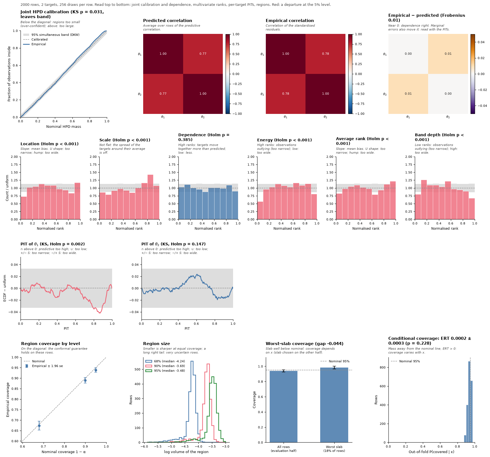
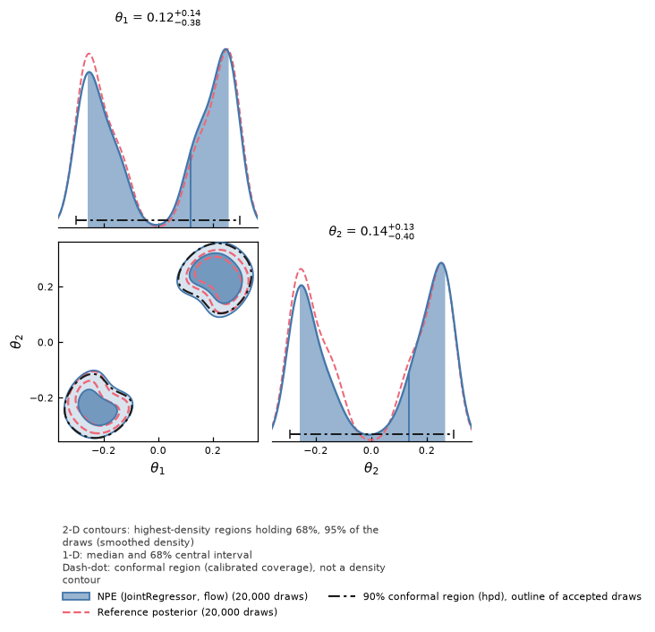

# Coming from Simulation-Based Inference

This page is for users of `sbi`, BayesFlow or LtU-ILI who train posterior
estimators on simulations. Training
[`JointRegressor`](../api/joint.md#estimator) on simulated pairs
(data $\to$ parameters) is neural posterior estimation (NPE); what the library
adds is around the estimator: prediction regions calibrated on simulations,
recalibration that keeps a density, diagnostics, and frequentist confidence
sets. The page maps the vocabulary, says plainly what is missing, and works
through the two-moons task end to end. The terms *credible region*,
*confidence set* and *prediction region* are used as defined in the
[glossary](joint-quickstart.md#glossary); they are three different objects.

---

## 1. Concept map

| SBI | Here | Notes |
|:--|:--|:--|
| NPE: a conditional density $q(\theta \mid x)$ trained on simulations | `JointRegressor(method).fit(x_sim, theta_sim)` | `"flow"`: a conditional neural spline flow (NPE with an NSF density estimator). `"mixture"`: a mixture density network, as in the first NPE papers (Papamakarios and Murray 2016). `"gaussian"`: one full-covariance Gaussian. `"auto"`: these plus a marginals-and-copula head, stacked ([heads](joint-regression.md#4-heads-and-stacking)). Parameters are standardised internally, so wide priors need no manual z-scoring |
| NLE: a conditional density $q(x \mid \theta)$ | A flow head trained on $(\theta \to x)$ ([`NormalizingFlowLoss`](../losses/nflows.md)), turned into a score by `flow_score` and maximised or profiled with [`inference.likelihood`](../methods/likelihood_inference.md) | No MCMC over the learned likelihood; the outputs are maximum-likelihood estimates and profile intervals |
| NRE (NRE-A, NRE-B, contrastive NRE) | [`NeuralRatioLoss`](../losses/nre.md) (`criterion="bce"`, `"multiclass"`, `"cnre"`), then `ratio_classifier_score` with `maximize_score` and `profile_interval` | Same objectives; posterior samples need reweighting or a grid ([`inference.ratio`](../api/inference.md#likelihood-ratio-posterior-reweighting-inferenceratio)) |
| Embedding (summary) networks | Features you supply: `fit` takes `x` as `[N, p]` | No built-in CNN, RNN or set encoder, and no joint training of an embedding with the posterior head |
| Posterior ensembles | `JointRegressor()` stacking (`weights_`); [`DensityEnsemble`](../api/ensemble.md) wrapped by `ConditionalModelJoint` | A mixture weighted by held-out log score: not a posterior over networks, and its spread is not calibrated epistemic uncertainty |
| SBC | [`metrics.sbi`](../metrics/calibration.md#simulation-based-calibration-sbc-and-tarp): `simulation_based_calibration_ranks`, `sbc_uniformity_pvalue` | Draws `[N, S, D]`, the layout `dist.sample` returns |
| Expected coverage of HPD regions | [`hpd_calibration`](../api/joint.md#diagnostics)`(dist.hpd_level(theta))` | With a simultaneous band and a Kolmogorov–Smirnov test |
| TARP | `metrics.sbi.tarp_coverage` | Reference points drawn from the prior |
| L-C2ST (local diagnostics) | Not implemented. Related: `worst_slab_coverage` and `conditional_coverage_gap` test whether region coverage depends on $x$; pre-rank histograms test calibration on average | |
| LF2I, WALDO | [`inference.NeymanConfidenceSet`](../methods/neyman.md) with `CriticalValueRegressor`; [`WaldoConformal`](../methods/waldo.md) | Any test statistic, including one from the learned posterior (section 4.7) |
| Nuisance parameters | Marginalise: `dist.marginal(dims)`. Profile: `profile_interval`, or a profile statistic with a Neyman construction (section 4.7). Conformalise a sub-vector: `region(x, interest=dims)` | Three different answers ([nuisance targets](joint-regression.md#6-targets-of-interest-and-nuisance-targets)) |

---

## 2. What the library adds, and what it does not have

**Adds:**

- **Prediction regions with finite-sample coverage over the simulated
  population.** `model.region` (after `model.calibrate(x_sim, theta_sim)` on
  fresh simulations, or on the estimator's own held-out split) and
  `JointConformal` calibrate a region on simulations the estimator never saw: over pairs $(\theta, x)$ drawn from the
  prior and the simulator, $P(\theta \in R(x)) \ge 1 - \alpha$, whatever the
  quality of the estimator. The estimator decides only the region's size and
  shape ([coverage statement](joint-regression.md#51-the-coverage-statement)).
- **Recalibration that keeps a density.**
  [`LatentRecalibrator`](joint-regression.md#72-latent-recalibration-latentrecalibrator)
  corrects the over- or under-dispersion of a flow posterior and returns a
  distribution you can still sample and evaluate.
- **Missing parameters or targets.** With the Gaussian and mixture heads, a
  `NaN` in the training parameters is integrated out exactly, so labelled
  data with incomplete labels can be used as they are
  ([missing targets](joint-regression.md#510-missing-targets)).
- **Frequentist confidence sets with learned critical values**
  (`NeymanConfidenceSet`), with conditional-coverage diagnostics over
  parameter space, and **re-scored critical values for count data**
  (`CriticalValueRegressor(method="knn", statistic_fn=...)`)
  ([discrete statistics](../methods/neyman.md#discrete-statistics-and-noisy-critical-values)).

**Does not have:**

- Sequential or multi-round inference (SNPE, TSNPE, truncation): every
  estimator here is amortised over the prior.
- Built-in embedding networks for images, time series or sets.
- The breadth of `sbi`'s inference methods and samplers (MCMC and variational
  inference over learned likelihoods and ratios, rejection samplers,
  restriction estimators).

!!! info "How the flow compares with other SBI estimators"
    The external-software parity harness runs the sbibm tasks against `sbi` in
    its `sbi_parity` suite. On that comparison the library's spline flow was not
    the best method on any task. Use this library for what surrounds the
    estimator (regions, recalibration, diagnostics, confidence sets); an
    estimator trained elsewhere can be wrapped with `ConditionalModelJoint`
    when it exposes `log_prob(context, theta)` and `sample(context, n)`.

---

## 3. Coverage words, precisely

| Statement | Object | Over what | Holds when |
|:--|:--|:--|:--|
| "90% of the posterior mass" | Credible region (`hpd_level`, corner contours) | The learned distribution of one observation | Only as well as the estimator matches the posterior |
| "At least 90% of simulated pairs" | Prediction region (`model.region`, `JointConformal`) | Pairs $(\theta, x)$ from the prior and the simulator, exchangeable with the calibration simulations | Always, given exchangeability; averaged over $x$ and over $\theta$ |
| "At least 90% at every $\theta$" | Confidence set (`NeymanConfidenceSet`) | Repeated data at a fixed $\theta$ | Up to the error of the learned critical value; check with `binned_conditional_coverage` |

!!! warning "Common mistake: reading a calibrated posterior as coverage at each parameter"
    SBC, TARP and HPD calibration check coverage **on average over the
    prior**. A posterior estimator that passes them can still under-cover in a
    part of parameter space that the prior rarely visits; section 4.7 shows
    one. Coverage at each $\theta$ needs a confidence set.

---

## 4. Worked example: two moons

The two-moons simulator (Greenberg et al. 2019; one of the sbibm tasks of
Lueckmann et al. 2021) has a uniform prior on $[-1, 1]^2$ and a crescent-shaped,
bimodal posterior, because the simulator depends on $|\theta_1 + \theta_2|$.
The reference posterior for one observation is obtained exactly by inverting the
simulator. The example takes about 140 s on a laptop CPU, 40 s of it training
the flow and 55 s the region checks of section 4.4. Run the blocks in order.

### 4.1 Simulator and reference posterior

```python
import math

import numpy as np
import torch

from torchregress.joint import JointRegressor


def simulate(n: int, seed: int) -> tuple[np.ndarray, np.ndarray]:
    """Two moons: theta ~ U(-1, 1)^2, x in R^2 (Greenberg et al. 2019)."""
    rng = np.random.default_rng(seed)
    theta = rng.uniform(-1.0, 1.0, size=(n, 2))
    a = rng.uniform(-math.pi / 2, math.pi / 2, size=n)
    r = rng.normal(0.1, 0.01, size=n)
    p = np.column_stack([r * np.cos(a) + 0.25, r * np.sin(a)])
    shift = np.column_stack([-np.abs(theta.sum(1)), theta[:, 1] - theta[:, 0]]) / math.sqrt(2)
    return (p + shift).astype(np.float32), theta.astype(np.float32)


def reference_posterior(x_obs: np.ndarray, n_samples: int, seed: int) -> np.ndarray:
    """Exact posterior draws for one observation x_obs [2], by inverting the simulator."""
    rng = np.random.default_rng(seed)
    kept, total = [], 0
    while total < n_samples:
        a = rng.uniform(-math.pi / 2, math.pi / 2, size=n_samples)
        r = rng.normal(0.1, 0.01, size=n_samples)
        p = np.column_stack([r * np.cos(a) + 0.25, r * np.sin(a)])
        u = (x_obs - p) * math.sqrt(2)  # u = (-|theta_1 + theta_2|, theta_2 - theta_1)
        s = -u[:, 0] * rng.choice([-1.0, 1.0], size=n_samples)  # the sign is not identified
        th = np.column_stack([(s - u[:, 1]) / 2, (s + u[:, 1]) / 2])
        th = th[(u[:, 0] <= 0) & (np.abs(th) <= 1).all(1)]  # inside the prior box
        kept.append(th)
        total += len(th)
    return np.concatenate(kept)[:n_samples].astype(np.float32)


torch.manual_seed(0)  # draws below use torch's global generator
```

### 4.2 Amortised posterior

```python
x_train, theta_train = simulate(20_000, seed=0)
npe = JointRegressor("flow", device="cpu").fit(x_train, theta_train)  # data -> parameters
names = [r"$\theta_1$", r"$\theta_2$"]
print(
    f"simulations: {npe.n_train_} train, {npe.n_val_} early stopping, "
    f"{npe.n_recal_} recalibration, {npe.n_conformal_} region calibration"
)
```

```text
simulations: 12000 train, 3000 early stopping, 2000 recalibration, 3000 region calibration
```

`fit` holds out 40% of the simulations. With a simulator you can replace the
region-calibration split with fresh simulations later (`calibrate`, section 4.4).

### 4.3 Calibration over fresh simulations

```python
from torchregress.joint import hpd_calibration
from torchregress.metrics.sbi import (
    sbc_uniformity_pvalue,
    simulation_based_calibration_ranks,
    tarp_coverage,
)
from torchregress.viz import plot_joint_diagnostics

x_test, theta_test = simulate(2_000, seed=2)  # fresh simulations
truth = torch.as_tensor(theta_test)
post = npe.predict(x_test)  # 2,000 amortised posteriors
draws = post.sample(256)  # [2000, 256, 2]: the layout SBC and TARP expect
sbc = sbc_uniformity_pvalue(simulation_based_calibration_ranks(draws, truth))
tarp = tarp_coverage(draws, truth, torch.rand(2_000, 2) * 2 - 1)  # references from the prior
hpd = hpd_calibration(post.hpd_level(truth))  # expected coverage of the HPD regions
print(
    f"SBC min p {sbc['min_p_value']:.2g} (Bonferroni {sbc['bonferroni_min_p_value']:.2g}), "
    f"TARP error {float(tarp['tarp_error']):.3f}, "
    f"HPD KS {float(hpd.ks_statistic):.3f} (p {float(hpd.p_value):.2g})"
)
region = npe.region(x_test, alpha=[0.32, 0.1, 0.05])
fig = plot_joint_diagnostics(
    post, truth, x=x_test, region=region, target_names=names, return_figure=True
)
```

```text
SBC min p 0.00027 (Bonferroni 0.00053), TARP error 0.024, HPD KS 0.033 (p 0.027)
```



The estimator is close but detectably miscalibrated at 2,000 simulations. The
TARP error (0.024) is of the size expected from sampling noise at this $N$
([TARP caveats](../metrics/calibration.md#caveats)) and the HPD calibration
curve stays close to the diagonal, but it leaves its band (KS p = 0.027
printed, 0.031 in the panel, which draws its own samples with `seed=0`). SBC
rejects uniformity (smallest per-parameter p = 0.00027), the PIT of $\theta_1$
leaves its band near 0.85, and five of the six pre-rank histograms are red; the
dependence pre-rank and the correlation panels find nothing. The bottom row
reads the regions: their coverage tracks the nominal levels and neither the
worst slab of $x$ nor the ERT shows coverage that depends on $x$.

### 4.4 Prediction regions: coverage and size

```python
from torchregress.joint import JointConformal, LatentScore

x_cal, theta_cal = simulate(5_000, seed=6)  # fresh simulations for the regions
npe.calibrate(x_cal, theta_cal)  # replaces the held-out calibration split
default = npe.region(x_test, alpha=0.1)
latent = JointConformal(LatentScore(), alpha=0.1).calibrate(npe.predict(x_cal), theta_cal)
for name, r in ((f"default ({default.score.name})", default), ("latent", latent.region(post))):
    print(
        f"{name:<13} 90% region: coverage {r.contains(theta_test).float().mean():.3f}, "
        f"median log area {r.log_volume()[0].median():.2f}"
    )
x_more, theta_more = simulate(20_000, seed=5)
covered = npe.region(x_more, alpha=[0.32, 0.1, 0.05]).contains(theta_more)
print(f"default regions, 20,000 simulations: {covered.float().mean(0).numpy().round(3)}")
```

```text
default (hpd) 90% region: coverage 0.899, median log area -3.67
latent        90% region: coverage 0.879, median log area -2.36
default regions, 20,000 simulations: [0.674 0.904 0.954]
```

- **With a simulator, calibrate on fresh simulations.** `npe.calibrate` swaps
  the 3,000 held-out simulations for 5,000 new ones; every later `region`
  call uses them. They must not have been used to train or recalibrate.
- **Coverage holds although the estimator is miscalibrated.** On 20,000 further
  simulations the 68%, 90% and 95% regions cover 0.674, 0.904 and 0.954. On the
  2,000 test simulations the 90% region covers 0.899; one calibration set and
  2,000 test pairs fluctuate by about a point, and the guarantee is an average
  over both.
- **The score sets the size.** For a flow the default score is the HPD level
  (`region.score.name` is `"hpd"`): the region is the highest-density set of
  each posterior, two crescents here. The latent score
  (`JointRegressor(score=LatentScore())`, or `JointConformal` as above) is
  faster, needing no reference draws, but its region is the image of a ball in
  the flow's base space, which for a bimodal posterior also contains the
  low-density bridge between the modes: a median area
  $e^{-2.36 + 3.67} \approx 3.7$ times larger, for the same nominal coverage
  (0.879 here, within the fluctuation above)
  ([which score when](joint-regression.md#511-which-score-when)).

### 4.5 One observation against the reference posterior

```python
from torchregress.viz import plot_corner_plot

x_obs = np.zeros((1, 2), dtype=np.float32)  # the observation x = (0, 0)
fig = plot_corner_plot(
    npe.predict(x_obs),
    n_samples=20_000,
    label="NPE (JointRegressor, flow)",
    others={"Reference posterior": reference_posterior(x_obs[0], 20_000, seed=1)},
    region=npe.region(x_obs, alpha=0.1),
    param_names=names,
    return_figure=True,
)
```



Both crescents are found, with the right orientation; the learned modes are a
little wider than the reference and the lower-left one carries slightly less
mass. The dash-dot line is the 90% prediction region of this observation, with
the default HPD score calibrated on the fresh simulations of section 4.4. It
follows the two modes because its score does, but its 90% is the frequency over
simulated pairs of section 4.4, not 90% of this posterior's mass.

### 4.6 Recalibration that keeps a density

```python
from torchregress.joint import LatentRecalibrator, latent_calibration_error, prerank_histograms

x_rc, theta_rc = simulate(2_000, seed=3)
recal = LatentRecalibrator().fit(npe.predict(x_rc), torch.as_tensor(theta_rc))
post_rc = recal.transform(post)
hpd_rc = hpd_calibration(post_rc.hpd_level(truth))
print(
    f"L-ECE {latent_calibration_error(post, truth):.3f} -> {latent_calibration_error(post_rc, truth):.3f}, "
    f"HPD KS {float(hpd.ks_statistic):.3f} -> {float(hpd_rc.ks_statistic):.3f} (p {float(hpd_rc.p_value):.2g}), "
    f"log score {post.log_prob(truth).mean():.3f} -> {post_rc.log_prob(truth).mean():.3f}"
)
for name, p in (("before", post), ("after", post_rc)):
    pr = prerank_histograms(p.sample(256), truth)
    print(f"pre-rank Holm p {name:<6}", {k: round(float(v), 4) for k, v in zip(pr.names, pr.p_values_holm)})
```

```text
L-ECE 0.047 -> 0.010, HPD KS 0.033 -> 0.025 (p 0.17), log score 3.469 -> 3.487
pre-rank Holm p before {'location': 0.0011, 'scale': 0.0, 'dependence': 0.125, 'energy': 0.0, 'average_rank': 0.002, 'band_depth': 0.0}
pre-rank Holm p after  {'location': 0.0006, 'scale': 0.0528, 'dependence': 0.0528, 'energy': 0.0, 'average_rank': 0.0001, 'band_depth': 0.0007}
```

The recalibrator remaps the radius of the flow's base space so that the latent
norm has the distribution seen on 2,000 new simulations. The latent calibration
error falls to 0.010 (about $0.31/\sqrt{n} = 0.007$ is expected for a
calibrated estimator), the HPD curve is no longer rejected (p = 0.17), the
held-out log score improves slightly, and the scale pre-rank no longer rejects
(the dependence pre-rank did not reject before either). Location, energy, average-rank and
band-depth departures remain: a radial map cannot fix where the mass is, only
how spread out it is ([what latent recalibration fixes](joint-regression.md#72-latent-recalibration-latentrecalibrator)).
The result is still a distribution with a density and draws.

### 4.7 A confidence set for one parameter, the other profiled

Suppose $\theta_1$ is of interest and $\theta_2$ a nuisance, and you want
coverage at every value of the parameters rather than on average over the prior.
Use the learned posterior only as a test statistic, profiled over $\theta_2$,

$$
\lambda(\theta_1; x) = -\max_{\theta_2} \log q(\theta_1, \theta_2 \mid x),
$$

and calibrate its critical value $C(\theta_1, \theta_2)$ by quantile regression on
simulations (the Neyman construction of LF2I). The set
$\{\theta_1 : \lambda(\theta_1; x) \le \max_{\theta_2} C(\theta_1, \theta_2)\}$
contains the true $\theta_1$ with probability at least 90% at every
$(\theta_1, \theta_2)$, up to the error of $\hat C$: taking the maximum over the
nuisance makes it valid whatever $\theta_2$ is, at the price of some
over-coverage.

```python
from torchregress.inference import NeymanConfidenceSet, binned_conditional_coverage

grid = torch.linspace(-1.0, 1.0, 101)


def profile_statistic(pred, theta_1: torch.Tensor) -> torch.Tensor:
    """lambda(theta_1; x) = -max over theta_2 of log q(theta_1, theta_2 | x), per row."""
    n, k = len(theta_1), grid.numel()
    candidates = torch.stack([theta_1[:, None].expand(n, k), grid.expand(n, k)], dim=-1)
    return -pred.log_prob(candidates).amax(dim=1)  # log_prob of [n, k, 2] is [n, k]


x_nc, theta_nc = simulate(10_000, seed=4)  # calibration simulations
theta_nc = torch.as_tensor(theta_nc)
lam_nc = profile_statistic(npe.predict(x_nc), theta_nc[:, 0])
cs = NeymanConfidenceSet.calibrate(theta_nc, lam_nc, alpha=0.1)  # C(theta_1, theta_2)
c_max = cs.critical_value(torch.cartesian_prod(grid, grid)).reshape(101, 101).amax(dim=1)


def critical(theta_1: torch.Tensor) -> torch.Tensor:  # max over theta_2, on the grid
    return c_max[((theta_1 + 1) * 50).round().long().clamp(0, 100)]


neyman = profile_statistic(post, truth[:, 0]) <= critical(truth[:, 0])
q = post.sample(1000)[..., 0].quantile(torch.tensor([0.05, 0.95]), dim=1)
credible = (q[0] <= truth[:, 0]) & (truth[:, 0] <= q[1])  # central 90% credible interval
print(f"coverage of theta_1: Neyman {neyman.float().mean():.3f}, credible {credible.float().mean():.3f}")
for name, cov in (("Neyman", neyman), ("credible", credible)):
    by_theta_1 = binned_conditional_coverage(truth, cov, nominal=0.9, bins=4)[0]
    print(
        f"{name:<8} by theta_1 quarter: {by_theta_1.coverage.numpy().round(3)}, "
        f"flagged {by_theta_1.under_covered.tolist()}"
    )
lam_obs = profile_statistic(npe.predict(np.repeat(x_obs, 101, axis=0)), grid)
accepted = grid[lam_obs <= c_max]
print(f"90% confidence set for theta_1 at x = (0, 0): {accepted.numpy().round(2)}")
```

```text
coverage of theta_1: Neyman 0.937, credible 0.896
Neyman   by theta_1 quarter: [0.909 0.948 0.957 0.933], flagged [False, False, False, False]
credible by theta_1 quarter: [0.844 0.927 0.908 0.904], flagged [True, False, False, False]
90% confidence set for theta_1 at x = (0, 0): [-0.28 -0.26 -0.24 -0.22 -0.2  -0.18 -0.16 -0.14 -0.12  0.12  0.14  0.16
  0.18  0.2   0.22  0.24  0.26  0.28]
```

- The central 90% **credible interval** of the learned marginal covers 0.896
  of the pairs on average, but only 0.844 for $\theta_1 \in [-1, -0.5)$, and
  `binned_conditional_coverage` flags that quarter (its Wilson interval lies
  below 0.9).
- The **confidence set** covers 0.937 on average and at least 0.909 in every
  quarter; nothing is flagged. The over-coverage is the cost of the maximum over
  $\theta_2$.
- For the observation $x = (0, 0)$ the set is two intervals,
  $[-0.28, -0.12] \cup [0.12, 0.28]$ on a grid of step 0.02: the sign ambiguity
  of the simulator survives into the frequentist answer.

The statistic is any function of $(\theta, x)$; the learned posterior only
makes it informative. `NeymanConfidenceSet` never trusts it: the critical value
comes from simulations at each $\theta$ ([Neyman confidence sets](../methods/neyman.md)).

---

## 5. References

| # | Reference |
|:-:|:----------|
| 1 | Papamakarios, G. and Murray, I. "Fast ε-free inference of simulation models with Bayesian conditional density estimation." *NeurIPS*, 2016. |
| 2 | Papamakarios, G., Sterratt, D. and Murray, I. "Sequential neural likelihood: fast likelihood-free inference with autoregressive flows." *AISTATS*, 2019. |
| 3 | Hermans, J., Begy, V. and Louppe, G. "Likelihood-free MCMC with amortized approximate ratio estimators." *ICML*, 2020. |
| 4 | Greenberg, D., Nonnenmacher, M. and Macke, J. "Automatic posterior transformation for likelihood-free inference." *ICML*, 2019. |
| 5 | Lueckmann, J.-M., Boelts, J., Greenberg, D., Gonçalves, P. and Macke, J. "Benchmarking simulation-based inference." *AISTATS*, 2021. |
| 6 | Cranmer, K., Brehmer, J. and Louppe, G. "The frontier of simulation-based inference." *PNAS* 117(48), 30055–30062, 2020. |
| 7 | Talts, S., Betancourt, M., Simpson, D., Vehtari, A. and Gelman, A. "Validating Bayesian inference algorithms with simulation-based calibration." [arXiv:1804.06788](https://arxiv.org/abs/1804.06788), 2018. |
| 8 | Lemos, P., Coogan, A., Hezaveh, Y. and Perreault-Levasseur, L. "Sampling-based accuracy testing of posterior estimators for general inference." *ICML*, 2023. |
| 9 | Linhart, J., Gramfort, A. and Rodrigues, P. L. C. "L-C2ST: local diagnostics for posterior approximations in simulation-based inference." *NeurIPS*, 2023. |
| 10 | Dalmasso, N., Masserano, L., Zhao, D., Izbicki, R. and Lee, A. B. "Likelihood-free frequentist inference: bridging classical statistics and machine learning for reliable simulator-based inference." *Electronic Journal of Statistics*, 2024 ([arXiv:2107.03920](https://arxiv.org/abs/2107.03920)). |
| 11 | Masserano, L., Dorigo, T., Izbicki, R., Kuusela, M. and Lee, A. B. "Simulator-based inference with WALDO: confidence regions by leveraging prediction algorithms and posterior estimators for inverse problems." *AISTATS*, 2023. |
| 12 | Izbicki, R., Shimizu, G. and Stern, R. B. "CD-split and HPD-split: efficient conformal regions in high dimensions." *JMLR* 23, 2022. |
| 13 | Dheur, V. and Ben Taieb, S. "Multivariate latent recalibration for conditional normalizing flows." *NeurIPS*, 2025 ([arXiv:2505.16636](https://arxiv.org/abs/2505.16636)). |
| 14 | Tejero-Cantero, A. et al. "sbi: a toolkit for simulation-based inference." *JOSS* 5(52), 2505, 2020. |

---

## Next steps

- [Joint Multi-Target Regression](joint-regression.md): heads, regions,
  recalibration and diagnostics in full.
- [Coming from MCMC and HMC](joint-for-mcmc-users.md): a problem with an exact
  posterior, the KL divergence to it, and cross-checks against a sampler.
- [Neyman confidence sets](../methods/neyman.md),
  [Likelihood-ratio inference](../methods/likelihood_inference.md),
  [Neural ratio estimation](../losses/nre.md).
- [SBC and TARP](../metrics/calibration.md#simulation-based-calibration-sbc-and-tarp)
  and the [Joint API](../api/joint.md).
