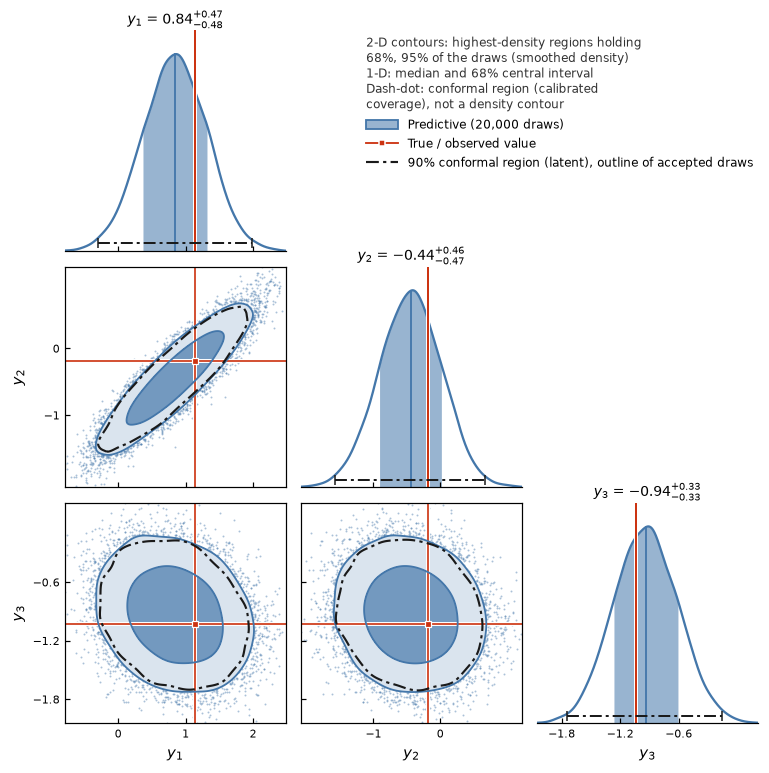
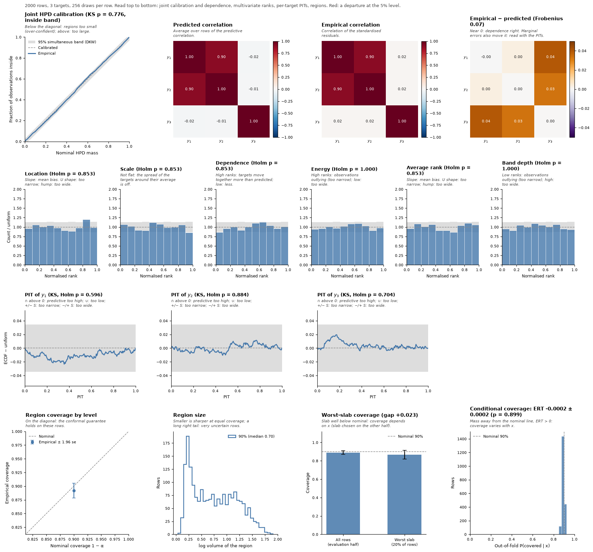
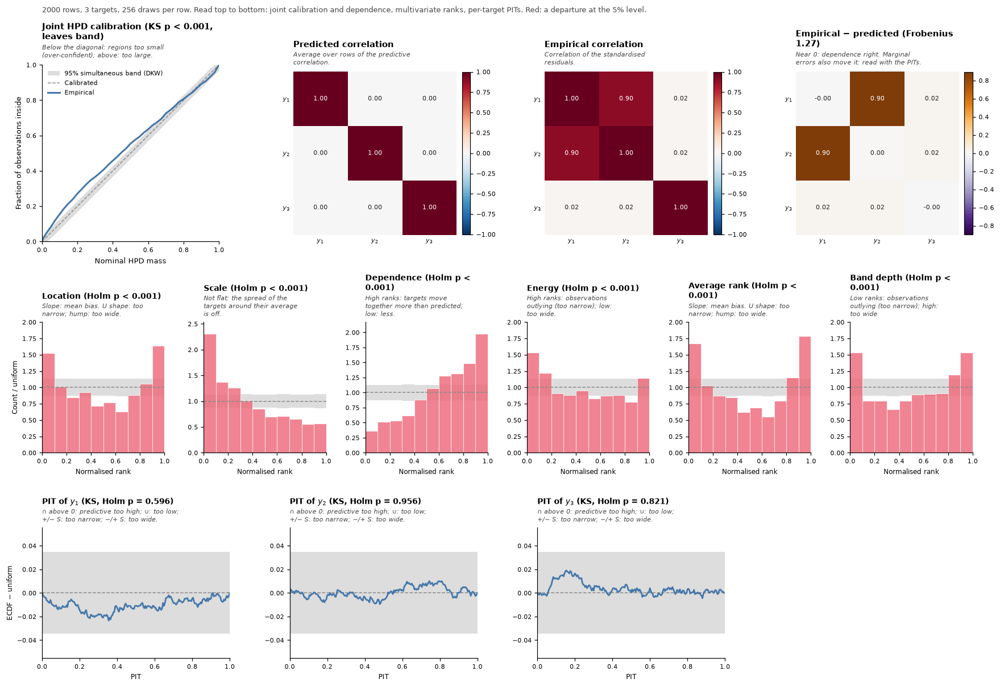

# New to Joint Prediction

You know regression: features in, a prediction out, perhaps with an error bar.
This page is for the case where there are **several targets** to predict for each
row, and you want to say how they vary *together*. It needs no background
beyond regression. Terms in *italics* are defined in the
[glossary](#glossary) at the end.

One small example runs through the whole page. It is synthetic, seeded, and
every block runs in a few seconds on a laptop CPU; the numbers printed below
each block are the real output (torch 2.14.1, Python 3.13, CPU). Run the blocks
in order in one session.

!!! info "Install"
    `pip install "torchregress[viz]"` (the plots need matplotlib). The
    reference for everything used here is the
    [Joint Multi-Target Regression guide](joint-regression.md); this page links
    to its sections instead of repeating them.

---

## 1. The example

Two features $x_1, x_2$ and three targets $y_1, y_2, y_3$. Think of three
measurements taken on the same object. $y_1$ and $y_2$ share most of their
noise, so when $y_1$ comes out higher than expected, $y_2$ usually does too.
The noise is larger near the edges of $x_1$. $y_3$ has its own, independent
noise.

```python
import torch

from torchregress.joint import JointRegressor


def simulate(n: int, seed: int) -> tuple[torch.Tensor, torch.Tensor]:
    """Two features, three targets; y1 and y2 share most of their noise."""
    g = torch.Generator().manual_seed(seed)
    x = torch.rand(n, 2, generator=g) * 4 - 2  # uniform on [-2, 2]^2
    noise = 0.3 + 0.2 * x[:, 0].abs()  # noisier at the edges of x1
    e = torch.randn(n, 3, generator=g)
    y = torch.empty(n, 3)
    y[:, 0] = torch.sin(x[:, 0]) + noise * e[:, 0]
    y[:, 1] = 0.5 * x[:, 1] + noise * (0.9 * e[:, 0] + 0.44 * e[:, 1])
    y[:, 2] = x[:, 0] * x[:, 1] + 0.3 * e[:, 2]
    return x, y


torch.manual_seed(0)  # the draws below use torch's global generator
```

---

## 2. Fit and predict in five lines

```python
x, y = simulate(8000, seed=0)  # training data
x_new, y_new = simulate(2000, seed=1)  # new rows, never seen by fit

model = JointRegressor("gaussian", device="cpu").fit(x, y)  # 1. fit
dist = model.predict(x_new)  # 2. one joint distribution per new row
draws = dist.sample(1000)  # 3. [2000, 1000, 3] plausible target vectors
region = model.region(x_new, alpha=0.1)  # 4. a 90% prediction region per row
inside = region.contains(y_new)  # 5. [2000] booleans: is the truth inside?

print(f"rows: {model.n_train_} train, {model.n_val_ + model.n_recal_ + model.n_conformal_} held out")
print(f"mean of row 0:         {dist.mean()[0].numpy().round(2)}")
print(f"corr(y1, y2) in row 0: {torch.corrcoef(draws[0].T)[0, 1]:.2f}")
print(f"joint region covers:   {inside.float().mean():.3f} of the new rows")
```

```text
rows: 4800 train, 3200 held out
mean of row 0:         [ 0.84 -0.45 -0.93]
corr(y1, y2) in row 0: 0.89
joint region covers:   0.892 of the new rows
```

What each line gives you:

| Line | Object | What it is | Shape |
|:-:|:--|:--|:--|
| 1 | `JointRegressor` | Trains a network on `(x, y)`. It keeps 40% of the rows aside (`n_val_`, `n_recal_`, `n_conformal_`) to stop training, recalibrate and calibrate regions; `n_train_` rows train it. | — |
| 2 | `JointPredictive` | A *joint predictive distribution* for each new row: which combinations of $(y_1, y_2, y_3)$ are plausible, and how plausible. | `n` rows, `d` targets |
| 3 | draws | Samples from it: complete, plausible target vectors | `[n, S, d]` |
| 4 | `JointRegion` | A *prediction region* per row, calibrated so that 90% of new truths fall inside | `n` regions |
| 5 | membership | Is each true vector inside its row's region? | `[n]` |

The distribution of row 0 is not three separate bell curves: its draws of
$y_1$ and $y_2$ have a correlation of 0.89, because the model learned that the
two move together. `dist.log_prob(y)` gives its log density at any target
vector, `dist.mean()` and `dist.covariance()` its first two moments, and
`dist.marginal([0, 2])` the distribution of a subset of targets.
`"gaussian"` asks for a multivariate normal per row (fast, and right for this
example); `JointRegressor()` without it fits and combines several more flexible
models ([heads and stacking](joint-regression.md#4-heads-and-stacking)).

---

## 3. Why three error bars are not a joint statement

The usual practice is one interval per target. Each can be exactly right and
the three together still wrong:

```python
per_target = [model.region(x_new, alpha=0.1, interest=[j]) for j in range(3)]
each = torch.stack([r.contains(y_new[:, [j]]) for j, r in enumerate(per_target)], dim=1)
print(f"each 90% interval covers its own target: {each.float().mean(0).numpy().round(3)}")
print(f"all three intervals cover at once:       {each.all(1).float().mean():.3f}")
wider = [model.region(x_new, alpha=0.1 / 3, interest=[j]) for j in range(3)]
each_w = torch.stack([r.contains(y_new[:, [j]]) for j, r in enumerate(wider)], dim=1)
print(f"all three 96.7% intervals cover at once: {each_w.all(1).float().mean():.3f}")
```

```text
each 90% interval covers its own target: [0.896 0.899 0.894]
all three intervals cover at once:       0.766
all three 96.7% intervals cover at once: 0.915
```

Each interval does its job: about 90% of the time it contains its own target.
But a new object has three measurements, and all three are inside their
intervals only 77% of the time. If the three errors were independent it would be
$0.9^3 = 0.73$; it is a little higher here because $y_1$ and $y_2$ tend to miss
together. Widening each interval to $1 - 0.1/3$ (Bonferroni) brings the joint
rate back above 90%, at the price of a box that ignores the dependence and is
larger than it needs to be.

The joint region of section 2 makes the statement you usually want ("the
whole vector is inside") and covers 89% of the new rows, a 90% statement
(section 5 explains why 0.892 is consistent with it).

!!! warning "Common mistake: reporting per-target intervals as a joint guarantee"
    "Each of the $d$ targets has a 90% interval" does not mean "the vector is in
    the box with 90% probability". With $d$ targets the joint rate can be as low as
    $1 - d \times 0.1$. Use a joint region, or `MaxResidualScore` for a box with a
    joint guarantee ([per-target bounds](joint-regression.md#56-box-with-a-joint-guarantee-maxresidualscore)).

---

## 4. Reading a corner plot

A *corner plot* shows one row's joint distribution: every target alone on the
diagonal, every pair below it.

```python
from torchregress.viz import plot_corner_plot

fig = plot_corner_plot(
    dist,  # the predictive of the 2000 new rows...
    row=0,  # ...of which we look at the first
    n_samples=20_000,
    true_vals=y_new[0],  # what actually happened
    region=region,  # its 90% prediction region
    param_names=["$y_1$", "$y_2$", "$y_3$"],
    return_figure=True,
)
```



Panel by panel:

- **Diagonal (one target at a time).** The curve is the distribution of that
  target alone, its *marginal*. The shaded band holds the central 68%, the
  vertical line is the median, and the title reads
  "median, plus and minus the distance to the band's edges":
  $y_1 = 0.84^{+0.47}_{-0.48}$.
- **Below the diagonal (pairs).** Each panel is the distribution of a pair of
  targets. The dark contour encloses 68% of the draws, the light one 95%; the
  dots are draws outside the 95% contour. The $(y_1, y_2)$ panel is a tilted,
  narrow ellipse: the two targets move together, so "$y_1$ high and $y_2$ low"
  is implausible even though each value alone is plausible. The panels with
  $y_3$ are round: no dependence.
- **Red lines and square.** The true values of this row. Here they sit inside
  the 68% contours.
- **Dash-dot line.** The 90% prediction region of this row, seen from each pair
  of axes (the outline of its shadow on that plane); the bars on the diagonal
  are its extent along each target. It is not a contour of the plot: its level
  comes from calibration on held-out rows (section 5), not from the model's
  own probabilities. The two agree here because the model is right.

!!! tip "Which levels are drawn?"
    The figure always states its levels in the legend. Plotting packages
    differ: `corner` draws "sigma" levels that enclose 39% and 86%, not 68% and
    95% ([conventions](../methods/visualization.md#corner-plots)). Pass
    `level_convention="sigma"` to match it.

---

## 5. What "90%" promises, and what it does not

`model.region(x_new, alpha=0.1)` builds, for each row, a region whose size is
set on rows that the model did not train on (the *conformal calibration*
split). The promise is about **many rows**: if new rows come from the same
source as those calibration rows, then on average at least 90% of new true
vectors fall inside their own region. This holds even when the model is wrong
(a poor model gives larger regions, not fewer hits), and it holds on average
over rows, not for each row separately.

```python
noisy = x_new[:, 0].abs() > 1  # the noisier half of the inputs
log_volume, _ = region.log_volume()
print(f"coverage, all rows:  {inside.float().mean():.3f}")
print(f"coverage, |x1| > 1:  {inside[noisy].float().mean():.3f}")
print(f"coverage, |x1| <= 1: {inside[~noisy].float().mean():.3f}")
print(
    f"median log volume:   {log_volume[noisy].median():.2f} (|x1| > 1), "
    f"{log_volume[~noisy].median():.2f} (|x1| <= 1)"
)
```

```text
coverage, all rows:  0.892
coverage, |x1| > 1:  0.893
coverage, |x1| <= 1: 0.891
median log volume:   1.11 (|x1| > 1), 0.32 (|x1| <= 1)
```

- **0.892 is a 90% result.** The guarantee is an average over calibration sets
  and new rows. With 1,200 calibration rows and 2,000 test rows, one run
  fluctuates by about a point around 0.90.
- **Regions adapt.** Rows with noisy inputs get regions about
  $e^{1.11 - 0.32} \approx 2.2$ times larger in volume, and both halves are
  covered about 90% of the time. This is because the model learned the noise
  level; it is *not* part of the promise.

| "90%" promises | "90%" does not promise |
|:--|:--|
| At least 90% of new rows, on average, have their true vector inside their region | 90% for every row, or for every kind of row (the two halves above match because the model is good, not because of the guarantee) |
| This even if the model is misspecified: errors make regions bigger, not rarer hits | Anything if new rows differ from the calibration rows (a new instrument, a new population) |
| One statement for the whole vector of targets | Smallest possible regions: size depends on the model |

The reasoning and the exact statement are in
[the coverage statement](joint-regression.md#51-the-coverage-statement).

---

## 6. Checking calibration

Coverage is one number. Whether the *distribution* is right, its centre, spread,
shape and dependence, is checked by comparing many truths with their predictions.
One call draws every check:

```python
from torchregress.viz import plot_joint_diagnostics

fig = plot_joint_diagnostics(dist, y_new, x=x_new, region=region, return_figure=True)
```



Read it top to bottom; blue means no departure detected, red means a departure
at the 5% level.

1. **Joint HPD calibration** (top left): for each mass $a$, the fraction of
   true vectors inside the model's own most-probable region of mass $a$. On the
   diagonal: the model's probabilities can be taken at face value. **Correlation
   matrices**: predicted against observed dependence between targets, and their
   difference.
2. **Rank histograms** (second row): how each true vector ranks among the
   draws, summarised six ways (*pre-ranks*). Flat: no problem detected.
3. **PIT curves** (third row): the same check for each target alone.
4. **Regions** (bottom row): coverage, region sizes, and two searches for
   inputs where coverage is worse than average.

Everything is blue here. Now break the model on purpose: keep each target's
distribution but drop the dependence between targets, as separate per-target
models would.

```python
from torchregress.joint import GaussianJoint, JointConformal, LatentScore

variances = dist.covariance().diagonal(dim1=-2, dim2=-1)
independent = GaussianJoint.from_covariance(dist.mean(), torch.diag_embed(variances))
fig = plot_joint_diagnostics(independent, y_new, return_figure=True)

x_cal, y_cal = simulate(2000, seed=3)  # fresh rows to calibrate both regions on
cal = model.predict(x_cal)
cal_independent = GaussianJoint.from_covariance(
    cal.mean(), torch.diag_embed(cal.covariance().diagonal(dim1=-2, dim2=-1))
)
for name, p_cal, p_new in (("full", cal, dist), ("independent", cal_independent, independent)):
    r = JointConformal(LatentScore(), alpha=0.1).calibrate(p_cal, y_cal).region(p_new)
    print(
        f"{name:<12} coverage {r.contains(y_new).float().mean():.3f}, "
        f"median log volume {r.log_volume()[0].median():.2f}"
    )
```

```text
full         coverage 0.892, median log volume 0.71
independent  coverage 0.890, median log volume 1.54
```



The three per-target PIT curves are still blue: each target's distribution is
right. The joint checks are red: the predicted correlation of $y_1$ and $y_2$
is 0 against an observed 0.90, the dependence histogram rises to the right
(the targets move together more than predicted), and the HPD curve sits above
the diagonal (regions too large). Its calibrated region still covers 89% of the
rows, but it is $e^{1.54 - 0.71} \approx 2.3$ times larger in volume: the
calibration protected the 90%, the model paid in size.

What to do when a panel is red:

| Red panel | What it says | What to try |
|:--|:--|:--|
| HPD curve below the diagonal | Regions of the model too small: over-confident | A more flexible head (`JointRegressor()`), more data; recalibrate ([recalibration](joint-regression.md#7-recalibration)) |
| HPD curve above the diagonal | Too cautious, or the wrong shape | Check the correlation panels and pre-ranks; a better dependence model |
| Correlation difference far from 0 | Dependence between targets wrong | A joint head instead of per-target models; `JointRegressor()` tries several |
| `location` or `average_rank` sloped | Predictions biased high or low | More capacity or data for the mean; check feature preprocessing |
| `location` or `average_rank` U-shaped | Too narrow, or (as above) averages of correlated targets vary more than predicted | Read with the correlation panels |
| One PIT curve outside its band | That target's own distribution is off | Fix that target first (tails, skew): `"mixture"` or `"flow"` heads |
| Worst-slab bar or ERT red | Coverage depends on the inputs | A model whose spread follows the inputs; Mondrian groups ([weights and groups](joint-regression.md#59-weights-and-groups)) |

!!! warning "Blue does not prove calibration"
    The checks average over rows. All blue means that these 2,000 rows show no
    departure these tests can detect, not that every prediction is right. In
    our runs, training on 4,000 instead of 8,000 rows turned three of the six
    rank histograms red (location, dependence, average rank): with less data the
    model is learned less well. More rows make the tests more sensitive, so check on as many
    held-out rows as you can.

---

## 7. Missing targets

Real tables have holes. Mark a missing target with `NaN`; the model integrates
it out instead of dropping the row.

```python
y_holes = y.clone()
hide = torch.rand(8000, generator=torch.Generator().manual_seed(2)) < 0.3
y_holes[hide, 2] = float("nan")  # y3 not measured for 30% of the training rows

model_h = JointRegressor("gaussian", device="cpu").fit(x, y_holes)
dist_h = model_h.predict(x_new)
region_h = model_h.region(x_new, alpha=0.1)
seen = torch.ones_like(y_new, dtype=torch.bool)
seen[:1000, 2] = False  # suppose y3 is missing for the first 1000 new rows
print(f"complete new rows covered:     {region_h.contains(y_new)[1000:].float().mean():.3f}")
print(
    f"rows without y3 covered:       "
    f"{region_h.contains(y_new, mask=seen)[:1000].float().mean():.3f}"
)
print(f"log p(y1, y2) of row 0, mask:     {dist_h.log_prob(y_new, mask=seen)[0]:.4f}")
print(f"log p(y1, y2) of row 0, marginal: {dist_h.marginal([0, 1]).log_prob(y_new[:, :2])[0]:.4f}")
```

```text
complete new rows covered:     0.890
rows without y3 covered:       0.889
log p(y1, y2) of row 0, mask:     0.2864
log p(y1, y2) of row 0, marginal: 0.2864
```

A `mask` is a boolean array of the targets' shape with `True` where a value is
observed. With a mask, `log_prob` returns the density of the observed targets
only, the missing ones integrated out: the same number as asking for the
marginal of $(y_1, y_2)$. `region.contains(y, mask=...)` checks the observed
part. The 90% statement then holds for rows whose targets go missing in the
same way as in the calibration rows; [missing
targets](joint-regression.md#510-missing-targets) gives the exact conditions.

!!! warning "Do not fill holes with zeros or means"
    A filled-in value is treated as observed: the model learns from invented
    targets and the checks count them as hits or misses. Use `NaN` in `fit` and
    `mask=` afterwards.

---

## 8. Where to go next

- [Joint Multi-Target Regression](joint-regression.md): the reference, with the
  models behind `JointRegressor`, every region shape, recalibration and the
  diagnostics in full.
- [Coming from MCMC and HMC](joint-for-mcmc-users.md): if you think in
  posteriors, chains and corner plots.
- [Coming from simulation-based inference](joint-for-sbi-users.md): if you
  train posterior estimators on simulations.
- [Joint predictive plots](../methods/visualization.md#4-joint-predictive-plots-corner-plots-and-diagnostics):
  every option of the corner plot and the diagnostics panel.
- [Joint API](../api/joint.md): every class and function.

---

## Glossary

**Calibration.** A predictive distribution is calibrated if events it calls
$p$-probable happen a fraction $p$ of the time, over many rows. Checked in
section 6.

**Confidence set.** A set of *parameter* values computed from data, built so
that it contains the true parameter with a stated probability over repeated
data sets, at every value of the parameter (a frequentist object). See
[Neyman confidence sets](../methods/neyman.md).

**Conformal calibration.** Setting the size of prediction regions from the
scores of held-out rows so that the coverage statement of section 5 holds.

**Corner plot.** A grid with each target's distribution on the diagonal and
each pair's distribution below it.

**Coverage.** The fraction of rows whose true value lies inside its region.

**Credible region.** A region holding a stated share of a Bayesian *posterior*
distribution for one data set, for example its 90% highest-density region. It
is a statement of the posterior's own probability, not of frequency over repeated
data.

**Draw (sample).** One simulated target vector from a predictive distribution.

**HPD (highest-density) region.** The smallest region holding a given share of
a distribution's probability: the area inside a contour of the corner plot.

**Joint predictive distribution.** For one row, a probability distribution over
all its targets together, including how they vary together.

**Marginal.** The distribution of one target, or of a subset, with the others
integrated out (`dist.marginal(dims)`).

**Mask.** A boolean array of the targets' shape, `True` where a value is
observed.

**Nuisance target.** A target you must model but do not report; it is
integrated out (`marginal`, or `region(interest=...)`).

**PIT (probability integral transform).** The predicted probability of falling
below the observed value. Uniform over rows for a calibrated predictive.

**Pre-rank.** A function that turns a target vector into one number, so that the
rank of the truth among the draws can be checked for uniformity.

**Prediction region.** A set of target vectors for one row, built so that over
many new rows a stated share of the true vectors fall inside their own region
(section 5). It covers future *observations*, not parameters.

---

## References

| # | Reference |
|:-:|:----------|
| 1 | Vovk, V., Gammerman, A. and Shafer, G. *Algorithmic Learning in a Random World.* Springer, 2005. |
| 2 | Lei, J., G'Sell, M., Rinaldo, A., Tibshirani, R. J. and Wasserman, L. "Distribution-free predictive inference for regression." *JASA* 113, 2018. |
| 3 | Gneiting, T., Balabdaoui, F. and Raftery, A. E. "Probabilistic forecasts, calibration and sharpness." *J. R. Stat. Soc. B* 69(2), 243–268, 2007. |
| 4 | Gneiting, T. and Raftery, A. E. "Strictly proper scoring rules, prediction, and estimation." *JASA* 102(477), 359–378, 2007. |
| 5 | Allen, S., Ziegel, J. and Ginsbourger, D. "Assessing the calibration of multivariate probabilistic forecasts." *QJRMS*, 2024 ([arXiv:2307.05846](https://arxiv.org/abs/2307.05846)). |
| 6 | Little, R. J. A. and Rubin, D. B. *Statistical Analysis with Missing Data.* Wiley, 2nd ed., 2002. |
