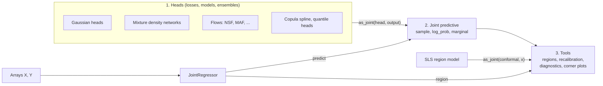
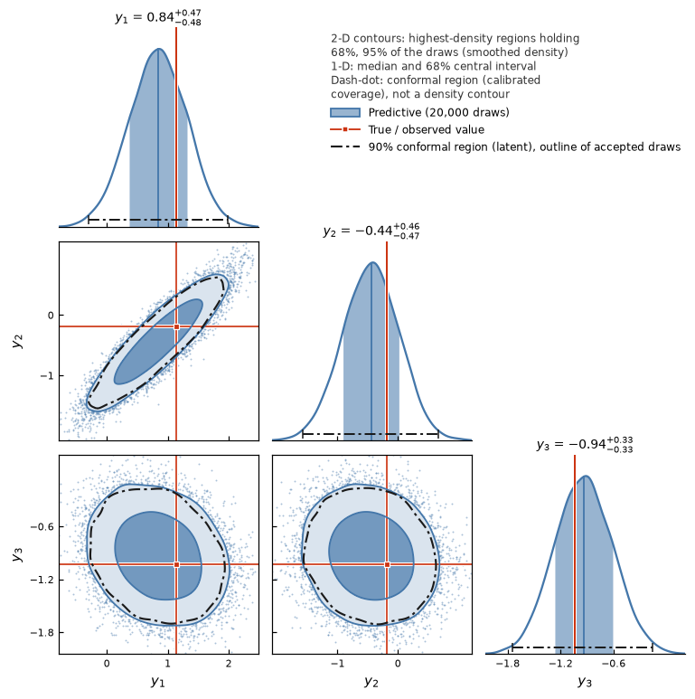
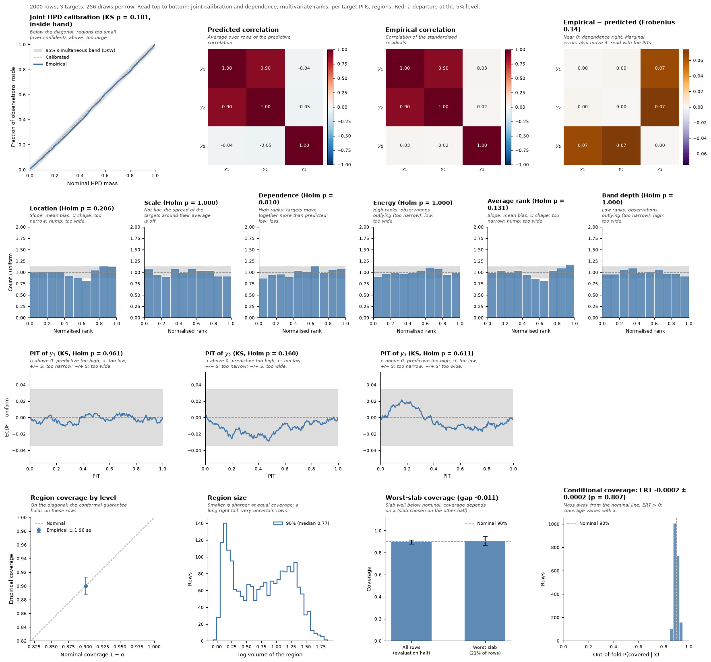
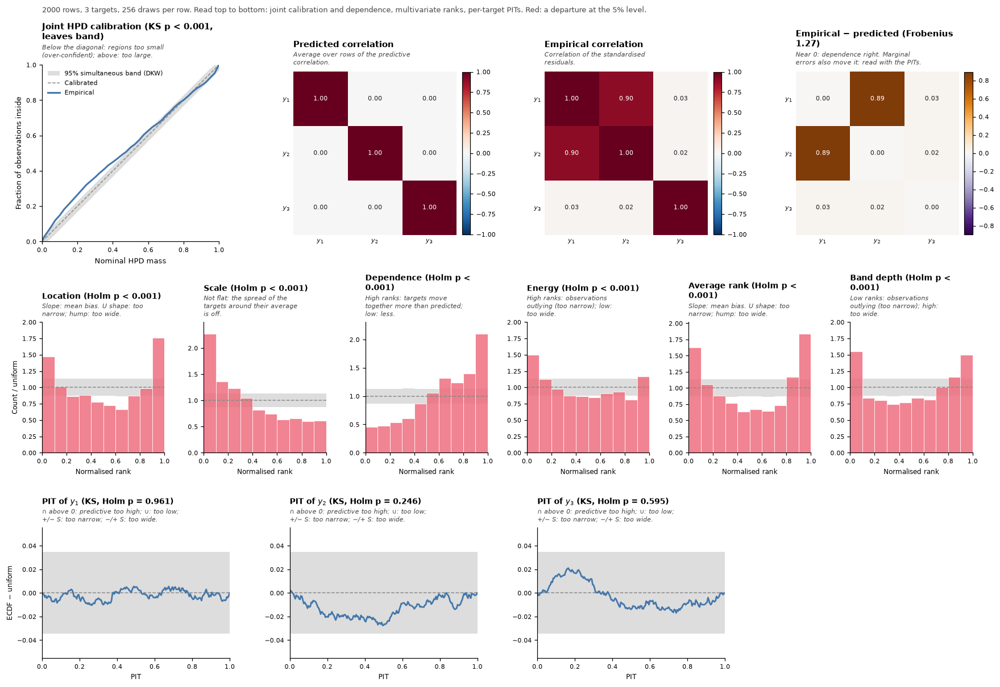
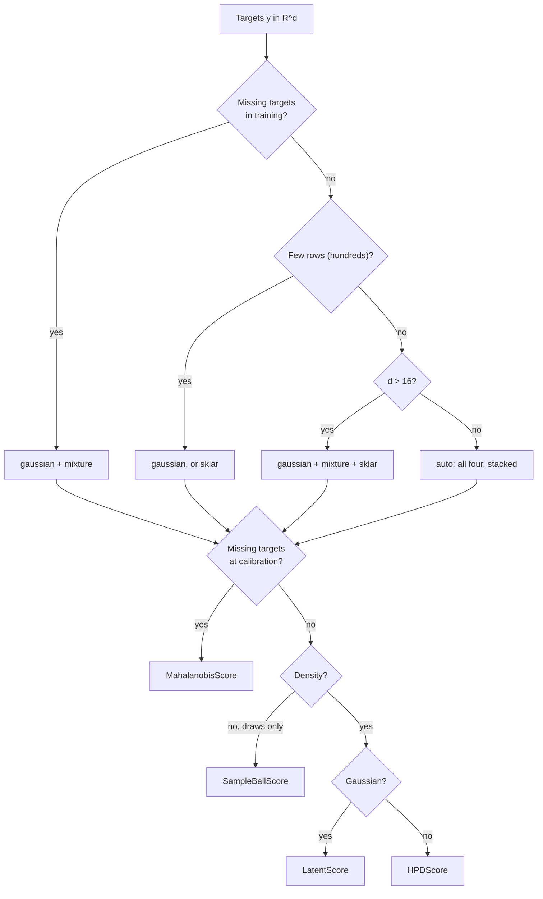
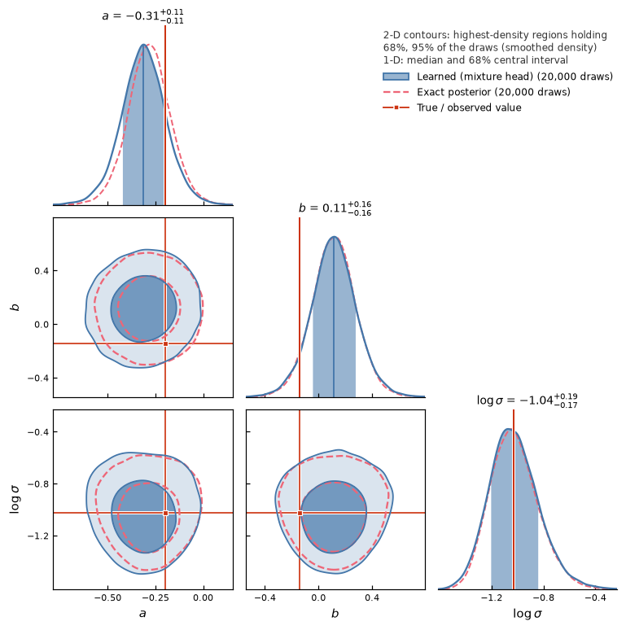

# Joint Multi-Target Regression

Some problems have several targets per row, $\mathbf y \in \mathbb R^d$. Then you
want one probability distribution over the whole vector, and regions that
contain the whole vector. This guide is read top to bottom: the picture, one
worked example, how it works, a section for readers who know MCMC or
simulation-based inference, and short recipes. Experts can skip the plain
explanations; the details are in collapsed blocks.

## 1. The picture: heads, joint predictives, tools

The library has three layers.

1. **Heads** model $p(\mathbf y \mid \mathbf x)$. A *head* is a network output
   plus the loss that trains it: Gaussian heads (`GaussianNLLLoss`,
   `MultivariateGaussianLoss`, `LowRankGaussianLoss`), mixture density networks
   (`MixtureDensityLoss`), normalizing flows (`NormalizingFlowLoss`: NSF, MAF,
   RealNVP and the other `create_flow_model` types), the copula spline head
   (`GaussianCopulaSplineHead`), quantile heads, and ensembles of these. They
   are described in [Multi-Target Regression](multi-target-regression.md).
2. **A joint predictive** is what a trained head predicts for $n$ rows, behind
   one interface: `sample` (draws `[n, S, d]`), `log_prob` (density), `marginal`
   (a subset of targets), `mean`, `covariance`. `as_joint(head, output)` turns
   any head into one.
3. **Tools** work on any joint predictive: *regions*, recalibration,
   diagnostics and corner plots. A *region* is a set of target vectors for one
   row, calibrated so that a stated share of new rows have their true vector
   inside.

`JointRegressor` is the shortcut: give it arrays, and it trains heads, combines
them, recalibrates, and calibrates regions for you.



!!! info "What the joint API is not"
    It does not replace the heads. NSF and the other flows, the mixture density
    network, the copula spline head, the Gaussian losses and SLS stay where
    they are and are trained as before; the joint API sits on top of them. It is
    not a training loop and not a sampler: a joint predictive is what a trained
    model predicts, not a posterior over its weights. SLS learns a region
    without a density, so `as_joint` turns it into a region directly.

### Five lines

```text
from torchregress.joint import JointRegressor

model = JointRegressor().fit(X, Y)        # X [N, p], Y [N, d]; NaN marks a missing target
dist = model.predict(X_new)               # joint predictive: one distribution per row
draws = dist.sample(1000)                 # [n, 1000, d] plausible target vectors
region = model.region(X_new, alpha=0.1)   # a 90% region per row
inside = region.contains(Y_new)           # [n] booleans: is the whole vector inside?
```



One row of the example of section 3: each target alone on the diagonal, each
pair below it, the true values in red, the 90% region dash-dotted.

## 2. I have X, call Y

`as_joint(obj, inputs)` is the default answer. It reads the type of `obj`,
returns the matching joint predictive (or region), and raises a `TypeError`
listing the supported types otherwise. Flags: **D** density, **M** exact masks
and marginals (missing targets integrated out), **L** latent map. Every row is
tested in `tests/joint/test_all_heads.py`: the density equals the head's own,
and a calibrated region covers fresh draws at the nominal level.

| I have | Call | I get |
|:--|:--|:--|
| Arrays `X`, `Y`, no model yet | `JointRegressor().fit(X, Y)` | `predict`, `region`, `calibrate` |
| A Gaussian head: `GaussianNLLLoss` (diagonal), `MultivariateGaussianLoss`, `LowRankGaussianLoss`, `KnownCovarianceGaussianNLL` | `as_joint(loss, (mean, log_var))`, `as_joint(loss, (mean, cov))`, `as_joint(loss, output, rank=r)`, `as_joint(loss, y_pred, known_covariance=C)` | `GaussianJoint`: D M L |
| A mixture density network: `MixtureDensityLoss`, `InputNoiseMDNLoss` | `as_joint(loss, output)`, `as_joint(loss, x_obs)` | D M |
| A normalizing flow (any `create_flow_model` type), `ContrastiveFlowLoss` | `as_joint(loss, context)` | `FlowJoint`: D L |
| `GaussianCopulaSplineHead` | `as_joint(head, context)` | `CopulaSplineJoint`: D M L |
| A quantile head (`MultiQuantileLoss`, `q` of shape `[n, Q, d]`), a one-feature `MixtureDensityLoss` applied per target (output `[n, d, 3K]`), or any `Marginals` | `as_joint(loss, q, dependence=copula)`, `as_joint(mdn, output, dependence=copula)` | `SklarJoint`; independent targets without `dependence` |
| `EvidentialRegressionLoss`, `JointBinnedDensityLoss`, `NoiseAwareDensityLoss` | `as_joint(loss, output)` | D (independent Student-t targets for the evidential loss; the clean predictive for the noise-aware loss) |
| A model with `log_prob(context, y)` and `sample(context, n)` (`MarginalContrastiveDensity`, `NormalizingFlowMap`) | `as_joint(model, context)` | `ConditionalModelJoint`: D |
| A generator with `sample(context, n)` and no `log_prob` (your own engression network) | `as_joint(model, context)` | `ConditionalModelJoint`, draws only (drawn on demand) |
| `FlowMatchingMLP` | `as_joint(model, context, n_samples=256, steps=32)` | draws only |
| Stored draws `[n, S, d]` (a sampler, a forest, a posterior on a candidate bank) | `SampleJoint(draws)` | draws only |
| An ensemble of density heads: `DensityEnsemble`, `MDNEnsembleModel`, `HeteroscedasticEnsembleModel`, `HeteroscedasticBatchEnsembleModel`, `HeteroscedasticBNN` | `as_joint(ensemble, x)` | `MixtureJoint` of the members |
| A `torch.distributions` object with batch `[n]`, event `[d]` | `as_joint(dist)` | `DistributionJoint` |
| `MarginalRatioEstimator` (`torchregress.inference`) | `as_joint(estimator, x, prior_samples=prior_draws, marginal=(0, 1), prior_log_prob=log_p)` | `RatioPosterior`: importance-resampled prior draws, a Monte-Carlo-normalised density, `effective_sample_size()` and `normalisation()` |
| A calibrated `SLSConformal` | `as_joint(conformal, x)` | `SLSRegion`: a region, no density |
| Means and covariances as tensors | `GaussianJoint.from_covariance(mu, cov)`, then `JointConformal(MahalanobisScore())` | the regions of `MultivariateScoreConformal` (same thresholds) |
| `ConformalizedDensity`, `ContrastiveFlowConformal` | `JointConformal(DensityScore())` on the head's joint predictive | the same score, plus masks, volumes and draws |
| Per-target intervals (`MultiTargetConformal`, `MonteCarloConformal`) | `JointConformal(MaxResidualScore())` | a box with a joint guarantee |
| Point ensembles, SWAG, Laplace, MC dropout, `BayesianNeuralNetwork` | not supported: they give the spread of $f(\mathbf x)$, not a predictive of $\mathbf y$ | `as_joint` raises |

| Route | Use it when | You give up |
|:--|:--|:--|
| `JointRegressor` | You have arrays and want a calibrated joint predictive and regions with few decisions | Control of the architecture and training loop |
| Your own head, `as_joint`, then `JointConformal` | You already train a head, or need one `JointRegressor` does not fit | You choose the calibration rows yourself |
| Single-target tools (`SplitConformal`, `MultiTargetConformal`) | Each target is reported on its own | Any statement about the whole vector |

## 3. A worked example

Two features $x_1, x_2$ and three targets $y_1, y_2, y_3$, like three
measurements of one object. $y_1$ and $y_2$ share most of their noise: when $y_1$
comes out high, $y_2$ usually does too. The noise grows near the edges of $x_1$.
Run the blocks of sections 3 to 6 in order in one session; outputs are real
(torch 2.14.1, Python 3.13, CPU; section 3 takes about 10 s). `pip install
"torchregress[viz]"` for the plots.

```python
import torch

from torchregress.joint import JointRegressor


def simulate(n: int, seed: int) -> tuple[torch.Tensor, torch.Tensor]:
    """Two features, three targets; y1 and y2 share most of their noise."""
    g = torch.Generator().manual_seed(seed)
    x = torch.rand(n, 2, generator=g) * 4 - 2  # uniform on [-2, 2]^2
    noise = 0.3 + 0.2 * x[:, 0].abs()  # noisier at the edges of x1
    e = torch.randn(n, 3, generator=g)
    y = torch.empty(n, 3)
    y[:, 0] = torch.sin(x[:, 0]) + noise * e[:, 0]
    y[:, 1] = 0.5 * x[:, 1] + noise * (0.9 * e[:, 0] + 0.44 * e[:, 1])
    y[:, 2] = x[:, 0] * x[:, 1] + 0.3 * e[:, 2]
    return x, y


torch.manual_seed(0)  # draws use torch's global generator
x, y = simulate(8000, seed=0)  # training rows
x_new, y_new = simulate(2000, seed=1)  # new rows, never seen by fit

model = JointRegressor("gaussian", device="cpu").fit(x, y)
dist = model.predict(x_new)  # joint predictive of the new rows
draws = dist.sample(1000)  # [2000, 1000, 3]
region = model.region(x_new, alpha=0.1)  # a 90% region per row
inside = region.contains(y_new)  # [2000] booleans

print(f"rows: {model.n_train_} train, {model.n_val_ + model.n_recal_ + model.n_conformal_} held out")
print(f"corr(y1, y2) in row 0: {torch.corrcoef(draws[0].T)[0, 1]:.2f}")
print(f"joint region covers:   {inside.float().mean():.3f} of the new rows")
```

```text
rows: 6000 train, 2000 held out
corr(y1, y2) in row 0: 0.89
joint region covers:   0.900 of the new rows
```

`fit` trains on 75% of the rows and keeps the rest to stop training (10%),
recalibrate (5%) and calibrate regions (10%); for large data see the recipes. `"gaussian"` asks for one
multivariate normal per row, fast and right for this example; `JointRegressor()`
fits and combines more flexible heads (section 4.2). The draws of row 0 have
$\operatorname{corr}(y_1, y_2) = 0.89$: the model learned that the two move
together.

### 3.1 Per-target intervals are not a joint statement

```python
per_target = [model.region(x_new, alpha=0.1, interest=[j]) for j in range(3)]
each = torch.stack([r.contains(y_new[:, [j]]) for j, r in enumerate(per_target)], dim=1)
print(f"each 90% interval covers its own target: {each.float().mean(0).numpy().round(3)}")
print(f"all three intervals cover at once:       {each.all(1).float().mean():.3f}")
```

```text
each 90% interval covers its own target: [0.906 0.884 0.89 ]
all three intervals cover at once:       0.764
```

Each interval covers its own target, but all three hold together for only 76%
of the rows. With per-target intervals $C_j$ at level $1 - \alpha$, only the
union bound holds,

$$
P\Big(\bigcap_{j=1}^d \{Y_j \in C_j(\mathbf X)\}\Big) \;\ge\; 1 - d\alpha ,
$$

and for independent errors the joint rate is $(1 - \alpha)^d$, 0.73 here (a
little more is observed because $y_1$ and $y_2$ miss together). Bonferroni
($\alpha/d$ per target) restores $1 - \alpha$ with a box that ignores the
dependence. The joint region makes the statement about the whole vector.

!!! warning "Common mistake: reporting per-target intervals as a joint guarantee"
    Use a joint region, or `JointConformal(MaxResidualScore())` for a box with a
    joint guarantee (section 4.1).

### 3.2 Reading a corner plot

```python
from torchregress.viz import plot_corner_plot

fig = plot_corner_plot(
    dist, row=0, n_samples=20_000, true_vals=y_new[0], region=region,
    param_names=["$y_1$", "$y_2$", "$y_3$"], return_figure=True,
)
```

This draws the figure of section 1.

- **Diagonal: one target at a time** (its *marginal*). The shaded band holds the
  central 68%, the line is the median; the title reads $y_1 = 0.86^{+0.49}_{-0.50}$.
- **Below the diagonal: pairs.** The contours hold 68% and 95% of the draws. The
  $(y_1, y_2)$ panel is a narrow tilted ellipse: "$y_1$ high and $y_2$ low" is
  implausible although each value alone is plausible. Panels with $y_3$ are round.
- **Red lines:** the true values. **Dash-dot line:** the outline of the 90%
  region seen from each pair of axes. It is not a contour: its level comes from
  calibration on held-out rows, not from the model's own probabilities.

Contour conventions differ between packages (`corner` draws "sigma" levels
holding 39% and 86%); the legend states them, and
[corner plots](../methods/visualization.md#corner-plots) lists the options.

### 3.3 What "90%" promises

```python
noisy = x_new[:, 0].abs() > 1  # the noisier half of the inputs
print(f"joint region, |x1| > 1:  {inside[noisy].float().mean():.3f}")
print(f"joint region, |x1| <= 1: {inside[~noisy].float().mean():.3f}")
```

```text
joint region, |x1| > 1:  0.909
joint region, |x1| <= 1: 0.891
```

In plain words: on average over new rows from the same source as the
calibration rows, at least 90% have their true vector inside their region, even
for a wrong model (a poor model gives bigger regions, not rarer hits). It does
not promise 90% for every row or every kind of row: the two halves above match
because the model is good, not because of the guarantee. And it promises
nothing when new rows differ from the calibration rows.

The rule: for a *score* $s(\mathbf x, \mathbf y)$ (small means typical) and
calibration scores $s_1, \dots, s_n$,

$$
\hat t_\alpha = s_{(k)}, \quad k = \lceil (n + 1)(1 - \alpha) \rceil, \qquad R_\alpha(\mathbf x) = \{\mathbf y : s(\mathbf x, \mathbf y) \le \hat t_\alpha\},
$$

with $\hat t_\alpha = +\infty$ when $k > n$. **If** the calibration pairs and the
test pair are exchangeable and the score was fixed without looking at the
calibration rows, **then**

$$
1 - \alpha \;\le\; P\big(\mathbf Y_{n+1} \in R_\alpha(\mathbf X_{n+1})\big) \;\le\; 1 - \alpha + \frac{1}{n+1},
$$

the upper bound for almost surely distinct scores. The probability is over the
calibration set **and** the new pair: an average over $\mathbf x$, not a
statement at each $\mathbf x$ (Lei et al. 2018; Hoff 2023). With 800
calibration rows, one run moves by about a point: 0.900 above is a 90% result.

!!! warning "Keep calibration rows apart"
    Train and recalibrate on other rows, or the exchangeability is lost.

### 3.4 Checking calibration

A joint predictive is *calibrated* if the true vector behaves like one more draw
from it, on average over rows. One call draws every check:

```python
from torchregress.viz import plot_joint_diagnostics

fig = plot_joint_diagnostics(dist, y_new, x=x_new, region=region, return_figure=True)
```



Read top to bottom; red marks a departure at the 5% level. Everything is blue
here. Now break the model on purpose: keep each target's distribution and drop
the dependence, as separate per-target models would.

```python
from torchregress.joint import GaussianJoint, JointConformal, LatentScore

variances = dist.covariance().diagonal(dim1=-2, dim2=-1)
independent = GaussianJoint.from_covariance(dist.mean(), torch.diag_embed(variances))
fig = plot_joint_diagnostics(independent, y_new, return_figure=True)

x_cal, y_cal = simulate(2000, seed=3)  # fresh rows to calibrate both regions on
cal = model.predict(x_cal)
cal_independent = GaussianJoint.from_covariance(
    cal.mean(), torch.diag_embed(cal.covariance().diagonal(dim1=-2, dim2=-1))
)
for name, p_cal, p_new in (("full", cal, dist), ("independent", cal_independent, independent)):
    r = JointConformal(LatentScore(), alpha=0.1).calibrate(p_cal, y_cal).region(p_new)
    print(
        f"{name:<12} coverage {r.contains(y_new).float().mean():.3f}, "
        f"median log volume {r.log_volume()[0].median():.2f}"
    )
```

```text
full         coverage 0.903, median log volume 0.80
independent  coverage 0.888, median log volume 1.58
```



The per-target PIT curves stay blue: each target alone is right. The joint
checks are red: predicted correlation 0 against an observed 0.90, a rising
dependence histogram, an HPD curve above the diagonal. Its calibrated region
still covers 89% but is $e^{1.58 - 0.80} \approx 2.2$ times larger: calibration
protected the 90%, the model paid in size.

| Panel (function) | Statistic | If red, it says | Try |
|:--|:--|:--|:--|
| Joint HPD calibration (`hpd_calibration`) | $\hat F(a) = \frac1n \sum_i \mathbf 1[h_i \le a]$ of the HPD levels $h_i$, DKW band, KS test | below the diagonal: over-confident; above: too cautious or the wrong shape | a more flexible head, more data, recalibration (section 4.4) |
| Correlations (`dependence_error`) | predicted against empirical correlation of standardised residuals | wrong dependence (marginal errors also move it) | a joint head instead of per-target models |
| Pre-rank histograms (`prerank_histograms`) | rank of $\rho(\mathbf y)$ among $\rho(\mathbf Y'_k)$ for `location` $\bar x$, `scale` $\frac1d\sum_j (x_j - \bar x)^2$, `dependence` $\binom d2^{-1}\sum_{j<k} x_j x_k$, `energy`, `average_rank`, `band_depth`; $\chi^2$ tests, Holm adjustment (Allen et al. 2024) | slope: bias; U: too narrow; hump: too wide; rising `dependence`: targets move together more than predicted | fix the mean or the spread first |
| Per-target PIT | ECDF of the PIT minus uniform | that target's own distribution is off | `"mixture"` or `"flow"` heads |
| Region coverage and size | coverage per level (`coverage_by_mask` per missingness pattern); log volumes | coverage off the diagonal: calibration rows not exchangeable with new rows | check where the calibration rows come from |
| Worst slab (`worst_slab_coverage`), ERT (`conditional_coverage_gap`) | lowest coverage over slabs of $\mathbf x$ chosen on half the rows (Cauchois et al. 2021); excess risk of an out-of-fold coverage classifier (Braun et al. 2026) | coverage depends on $\mathbf x$ | a spread that follows $\mathbf x$; Mondrian groups (section 6) |

For Gaussian joint predictives, `nees_consistency` also tests the mean of
$(\mathbf y_i - \mathbf m_i)^\top \Sigma_i^{-1} (\mathbf y_i - \mathbf m_i)$ against its
$\chi^2_{Nd}/N$ band. The energy score is strictly proper but barely moves when
only the correlation is wrong (Pinson and Tastu 2013): read it next to the
`dependence` pre-rank.

!!! warning "Blue does not prove calibration"
    All checks are averages over rows, never a check at one $\mathbf x$. Per-target
    PITs are necessary, not sufficient, and a worst slab near nominal or an ERT
    near zero does not prove conditional coverage. In our runs, training on 4,000 instead
    of 8,000 rows turned the average-rank histogram red (Holm p = 0.03). Check on as many
    held-out rows as you can.

### 3.5 Missing targets

Mark a missing target with `NaN` in `fit`; afterwards pass a boolean *mask*
(`True` = observed). Missing targets are integrated out, not filled in.

```python
y_holes = y.clone()
y_holes[torch.rand(8000, generator=torch.Generator().manual_seed(2)) < 0.3, 2] = float("nan")
model_h = JointRegressor("gaussian", device="cpu").fit(x, y_holes)  # y3 missing in 30% of rows
seen = torch.ones_like(y_new, dtype=torch.bool)
seen[:1000, 2] = False  # y3 missing for the first 1000 new rows
region_h = model_h.region(x_new, alpha=0.1)
print(f"rows without y3 covered: {region_h.contains(y_new, mask=seen)[:1000].float().mean():.3f}")
print(f"complete rows covered:   {region_h.contains(y_new)[1000:].float().mean():.3f}")
```

```text
rows without y3 covered: 0.913
complete rows covered:   0.911
```

`log_prob(y, mask=seen)` returns the density of the observed targets.

!!! warning "Two meanings of a mask"
    Here a mask integrates targets out. In `MultivariateGaussianLoss` and
    `LowRankGaussianLoss` a mask only selects which entries enter the loss
    average; train with `known_covariance_gaussian_nll` to integrate them out.

??? info "Details: the guarantee with missing targets"
    With missing calibration targets the score uses the observed sub-vector
    $O$. `MahalanobisScore` maps its quadratic form through the $\chi^2_{|O|}$
    CDF so that rows with different numbers of observed targets share one scale
    (Braun et al. 2025):

    $$
    s(\mathbf x, \mathbf y) = F_{\chi^2_{|O|}}\big((\mathbf y_O - \mathbf m_O)^\top \Sigma_{OO}^{-1} (\mathbf y_O - \mathbf m_O)\big).
    $$

    The masked guarantee holds for rows whose missingness comes from the same
    mechanism as in calibration. It is **not** a guarantee for complete rows: in
    a $d = 6$ example with half the entries missing and the variance
    underestimated by a factor 2.56, complete rows were covered 0.81 at nominal
    0.90. So `JointRegressor.region` keeps two calibrations: `contains(y)` is
    calibrated on the complete calibration rows
    ($P(\mathbf Y \in R(\mathbf X) \mid \text{complete}) \ge 1 - \alpha$ when those
    rows are exchangeable, for example targets missing completely at random; a
    `ValueError` below $1/\alpha - 1$ complete rows), and `contains(y, mask=m)`
    uses the masked calibration of all rows. `coverage_by_mask` reports
    coverage per pattern.

### 3.6 Targets of interest and nuisance targets

Often only some targets $\mathbf y_I$ matter and the others $\mathbf y_N$ are
*nuisance targets*. `marginal(dims)` integrates them out of the joint
predictive; `region(..., interest=dims)` calibrates a region for $\mathbf y_I$
only.

```python
pair = dist.marginal([0, 1])  # joint predictive of (y1, y2), y3 integrated out
region_pair = model.region(x_new, alpha=0.1, interest=[0, 1])
print(f"log p(y1, y2) of row 0: {pair.log_prob(y_new[:, :2])[0]:.4f}")
print(f"(y1, y2) region covers: {region_pair.contains(y_new[:, :2]).float().mean():.3f}")
```

```text
log p(y1, y2) of row 0: 0.1907
(y1, y2) region covers: 0.895
```

| Tradition | Operation | Call | Answer |
|:--|:--|:--|:--|
| Predictive | $p(\mathbf y_I \mid \mathbf x) = \int p(\mathbf y_I, \mathbf y_N \mid \mathbf x)\, d\mathbf y_N$ | `dist.marginal(dims)` | a joint predictive of $\mathbf y_I$, calibrated only if the model is |
| Distribution-free | region for $\mathbf y_I$ after marginalising | `region(X, interest=dims)` | coverage for $\mathbf y_I$ whatever the model; usually smaller than the projection of the joint region |
| Frequentist | $\sup_{\mathbf y_N} p(\mathbf y_I, \mathbf y_N \mid \mathbf x)$, calibrated by Wilks or Neyman | [`profile_interval`](../methods/likelihood_inference.md), [`NeymanConfidenceSet`](../methods/neyman.md) | a confidence set for a parameter |

`marginal` keeps a density for Gaussian heads, mixture density networks, stacks
of them and Sklar joints with Gaussian rungs; for flows it integrates by
sampling and returns a draws-only joint predictive.

### 3.7 A head you already trained

Train a head as usual; `as_joint(loss, output)` gives its joint predictive, and
every tool works on it. Here a mixture density network, calibrated on rows it
never trained on and compared with the model above.

```python
from torch import nn

from torchregress.joint import HPDScore, as_joint
from torchregress.losses import MixtureDensityLoss

loss = MixtureDensityLoss(n_components=3, n_features=3)
net = nn.Sequential(nn.Linear(2, 64), nn.SiLU(), nn.Linear(64, 64), nn.SiLU(), nn.Linear(64, loss.expected_output_size))
opt = torch.optim.Adam(net.parameters(), lr=3e-3)
for step in range(1500):
    idx = torch.randint(0, len(x), (256,))
    opt.zero_grad()
    loss(net(x[idx]), y[idx]).backward()
    opt.step()

with torch.no_grad():
    mdn, mdn_cal = as_joint(loss, net(x_new)), as_joint(loss, net(x_cal))
region_mdn = JointConformal(HPDScore(), alpha=0.1).calibrate(mdn_cal, y_cal).region(mdn)
for name, d, r in (("gaussian (JointRegressor)", dist, region), ("MDN (as_joint)", mdn, region_mdn)):
    print(
        f"{name:<26} log score {d.log_prob(y_new).mean():.3f}, "
        f"coverage {r.contains(y_new).float().mean():.3f}, "
        f"median log volume {r.log_volume()[0].median():.2f}"
    )
```

```text
gaussian (JointRegressor)  log score -0.851, coverage 0.900, median log volume 0.77
MDN (as_joint)             log score -1.185, coverage 0.895, median log volume 1.05
```

Compare joint predictives by held-out log score and regions by size at equal
coverage: both cover 90%, and the Gaussian head, which matches how the data
were simulated, has the higher log score and $e^{1.05 - 0.77} \approx 1.3$ times
smaller regions. `plot_corner_plot(dist, others={"MDN": mdn})` overlays them.
Sample-based scores (`energy_score`, `variogram_score`) take draws sample first:
pass `dist.sample(S).movedim(1, 0)`.

## 4. How it works

### 4.1 Region scores

The score sets the shape and size of a region; calibration only sets its level.

| Score | $s(\mathbf x, \mathbf y)$ | Region | Needs | Masks | Use when |
|:--|:--|:--|:--|:-:|:--|
| `HPDScore` | $P_{\mathbf Y' \sim \hat p}\big[\hat p(\mathbf Y') > \hat p(\mathbf y)\big]$, from 256 draws | highest-density set, level adapts per row | density, draws | no | flows, mixtures, stacks, multimodal joint predictives: the `"auto"` choice for every non-Gaussian density |
| `LatentScore` | $\lVert T(\mathbf y; \mathbf x) \rVert_2$, $T$ the map to a standard-normal latent space | pre-image of a latent ball | latent map | no | Gaussian joint predictives (the `"auto"` choice); fast for flows but covers the space between modes |
| `DensityScore` | $-\log \hat p(\mathbf y \mid \mathbf x)$ | density level set, one level for all rows | density | with exact marginals | smallest regions when the model is good |
| `MahalanobisScore` | $\sqrt{(\mathbf y - \mathbf m)^\top \Sigma^{-1} (\mathbf y - \mathbf m)}$ | ellipsoid | mean, covariance | yes | missing calibration targets |
| `MaxResidualScore` | $\max_j \lvert y_j - m_j \rvert / \sqrt{\Sigma_{jj}}$ | box with a joint guarantee | mean, variances | yes | per-target bounds with one joint guarantee |
| `SampleBallScore` | $\min_{k \le K} \lVert \mathbf y - \hat{\mathbf Y}_k \rVert_2$, $\hat{\mathbf Y}_k \sim \hat p$ | union of $K$ balls | draws | no | draws-only joint predictives |

Here $\mathbf m$ and $\Sigma$ are the predictive mean and covariance.
`region.score.name` prints the score used.

??? info "Details: volumes and Monte Carlo"
    `JointRegion.log_volume()` returns $\log V$ and a standard error. Ellipsoid and
    box are closed form,
    $\log V_{\text{ellipsoid}} = \log \frac{\pi^{d/2}}{\Gamma(d/2 + 1)} + d \log \hat t + \tfrac12 \log\det\Sigma$
    and $\log V_{\text{box}} = \sum_j \log\big(2 \hat t \sqrt{\Sigma_{jj}}\big)$.
    Otherwise
    $\hat V = \frac1K \sum_k \mathbf 1[\mathbf Y_k \in R] / \hat p(\mathbf Y_k \mid \mathbf x)$
    with $\mathbf Y_k \sim \hat p$, unbiased for the volume of $R \cap \operatorname{supp}\hat p$
    but biased low when the region reaches far into the tails of a too-narrow
    joint predictive; joint predictives with a latent map therefore use a
    defensive mixture of latent normals with scales 1, 2 and 4. `HPDScore` is
    Monte Carlo: calibration and test must use the same `n_samples`, which is
    stored on the score. The max-rank variant of `MaxResidualScore`
    (Schlembach et al. 2026) is not implemented. References for the scores:
    HPD-split (Izbicki et al. 2022), latent and volume estimates (Dheur et al.
    2025), union of balls (Wang et al. 2023).

### 4.2 Heads inside `JointRegressor`

| `method` | Head | Missing targets | In `"auto"` |
|:--|:--|:--|:--|
| `"gaussian"` | $\mathcal N(\boldsymbol\mu(\mathbf x), L(\mathbf x) L(\mathbf x)^\top)$; low rank 8 plus diagonal beyond 32 targets | exact | always |
| `"mixture"` | mixture density network, 5 components; full covariances up to $d = 8$ | exact | always |
| `"flow"` | conditional neural spline flow | rows dropped | complete targets, $d \le 16$ |
| `"sklar"` | quantile- or mixture-network marginals, chosen on validation rows, joined by a dependence model (section 4.3) | complete rows for the dependence | complete targets |
| `"energy"` | engression generator $g(\mathbf x, \boldsymbol\varepsilon)$ trained by the energy score; draws only | energy score of the observed sub-vector | never |

The `"energy"` head (engression; Shen and Meinshausen 2024 [26]) assumes no
density family: a network takes the features and Gaussian noise
$\boldsymbol\varepsilon \sim \mathcal N(0, I_k)$ ($k = d$ by default,
`noise_dim`) and is trained to minimise the energy score (Gneiting and Raftery
2007 [27]) of $m = 2$ draws per row (`energy_draws`),

$$
\mathrm{ES}(\mathbf y) = \frac1m \sum_{j} \lVert \mathbf y - g_j \rVert
- \frac{1}{2m(m-1)} \sum_{j \ne k} \lVert g_j - g_k \rVert,
$$

an unbiased estimate of a proper score. It draws in one forward pass (1,000 rows
by 200 draws: 0.09 s at $d = 16$ against 15 s for the flow head on a 4-core
laptop CPU, 0.2 s at $d = 64$), so it scales to many targets. What it cannot do:
it has **no density**, so no log score, no HPD or latent region (`region` uses the
sample-ball score), no stacking in `"auto"`, and recalibration uses the variance
objective, kept only when it lowers the validation energy score
(`validation_energy_score_` reports that score; `validation_log_score_` has no
entry for this head). A network of Gaussian noise is Lipschitz in the noise, so
its draws have Gaussian-like tails: heavy-tailed targets are outside what it
represents. With missing targets the norms run over the observed coordinates,
which is the energy score of the observed sub-vector's marginal: a proper score
for that marginal, not for the joint.

`"auto"` trains each network head (Gaussian, mixture, flow) three times from
different initialisations and averages the copies with equal weights, a *deep
ensemble* (Lakshminarayanan et al. 2017 [28]; `n_members`, 1 for a single named
head). On three harness designs with known densities (4,000 rows) the copies
took the test log-score gap of the flow head from 0.38, 0.45 and 0.58 nats to
0.25, 0.34 and 0.42, and that of `"auto"` from 0.26, 0.37 and 0.41 to 0.21, 0.30
and 0.33, for two to three times the fit time. It then combines the head types
by *stacking*: with $p_k$ the (ensembled) heads and $V$ the validation rows, the
weights solve the concave problem

$$
\hat{\mathbf w} = \arg\max_{\mathbf w \in \Delta_K} \sum_{i \in V} \log \sum_{k=1}^K w_k\, p_k(\mathbf y_i \mid \mathbf x_i)
$$

over the simplex $\Delta_K$, by EM (Yao et al. 2018); `weights_` reports them.
Heads see standardised targets $\mathbf u = (\mathbf y - \mathrm{loc}) \oslash \mathrm{scale}$,
and the joint predictive is mapped back with the Jacobian,
$\log p_Y(\mathbf y) = \log p_U(\mathbf u) - \sum_j \log \mathrm{scale}_j$, so
results are in data units. **Caution:** `"auto"` costs much more than
`"gaussian"`, mostly through the flow and the draws of the HPD score; start with
`"gaussian"` and move on when the diagnostics reject it.



### 4.3 Per-target predictions joined by a dependence model

In plain words: any per-target model, plus a model of how the targets depend on
each other, gives a valid joint density. This is the `"sklar"` head and
`as_joint` of a quantile head.

By Sklar's theorem, continuous marginal CDFs $F_j(y_j \mid \mathbf x)$ and a
unique copula determine the joint CDF. The library works with *normal scores*
$z_j = \Phi^{-1}\big(F_j(y_j \mid \mathbf x)\big)$: for **any** density
$q(\mathbf z \mid \mathbf x)$,

$$
\log p(\mathbf y \mid \mathbf x) = \sum_{j=1}^d \log f_j(y_j \mid \mathbf x) + \log q(\mathbf z \mid \mathbf x) - \sum_{j=1}^d \log \varphi(z_j)
$$

is a normalised density ([`SklarJoint`](../api/joint.md#dependence)); when $q$
has standard-normal marginals the marginals of $p$ are exactly the $F_j$. The
dependence model $q$ is the lowest rung of a ladder that held-out data supports.

**Marginal engines.** The $F_j$ come from a marginal engine (`marginals=`). Two
are built in, each one network from $\mathbf x$ to per-target parameters with the
estimator's training budget and early stopping, missing targets left out of the
loss:

| Engine | Per target | Trained by | Marginals |
|:--|:--|:--|:--|
| [`QuantileNetworkEngine`](../api/joint.md#estimator) | 31 non-crossing quantiles | pinball loss | `QuantileMarginals`: piecewise-linear CDF, exponential tails |
| [`MixtureNetworkEngine`](../api/joint.md#estimator) | Gaussian mixture, `n_components` (5) components | $-\sum_j \log f_j(y_j \mid \mathbf x)$ | `MixtureMarginals`: closed-form CDF and density |

With `marginals=None` both are fitted once on the training rows and scored on the
complete validation rows $V$ (those the dependence ladder is chosen on) by

$$
S = \frac{1}{|V|} \sum_{i \in V} \sum_{j=1}^d \log \hat f_j(y_{ij} \mid \mathbf x_i);
$$

the larger $S$ wins (`marginal_scores_`, `marginal_engine_`), and only the chosen
engine is cross-fitted for the normal scores. The two engines are not nested, so
there is no simpler one to prefer. An engine you pass is used as is.

!!! info "When each engine won in our tests"
    Gap to the true marginal log density, nats per row on fresh test rows. On the
    bimodal problem of the [comparison example](../examples/joint_regression_comparison.md)
    (2,400 training rows) the mixture engine was at +0.09 and the quantile
    engine at +0.32, and only the mixture's PITs passed KS tests. On skewed,
    heavy-tailed targets (log-normal and Student-t with 3 degrees of freedom,
    scales depending on $\mathbf x$) the mixture engine won with 2,400 training
    rows (+0.12 against +0.19) and the quantile engine with 600 (+0.37 against
    +0.49). Mixtures tended to win once there were a few thousand rows; the
    quantile grid held up better on small samples with heavy tails. The
    validation score makes the choice per data set.

??? info "Details: the dependence ladder and its validation gate"
    | Rung | Model of $q(\mathbf z \mid \mathbf x)$ | Density | Enough when |
    |:-:|:--|:-:|:--|
    | 0 | `IndependenceDependence`: $\mathcal N(0, I)$ | yes | weak dependence, or few rows |
    | 1 | `SchaakeShuffle`: rank-normalised training scores (optionally the $k$ nearest rows in $\mathbf x$) | no | only draws are needed |
    | 0a | `IndependenceDependence(affine=True)`: $\mathcal N(\mathbf m, D^2)$ | yes | the marginals are globally biased or mis-scaled, no dependence |
    | 2 | `GaussianCopula`: $\mathcal N(0, R)$, $R$ shrunk towards $I$ (Ledoit–Wolf) | yes | constant, roughly elliptical dependence |
    | 2a | `GaussianCopula(affine=True)`: $\mathcal N(\mathbf m, D R D)$ | yes | the same, with globally biased or mis-scaled marginals |
    | 3 | `ConditionalGaussianCopula`: $\mathcal N\big(0, L(\mathbf x) D(\mathbf x)^2 L(\mathbf x)^\top\big)$, unit lower-triangular $L$ | yes | correlations that change with $\mathbf x$ |
    | 4 | `MixtureDependence`: $\sum_k \pi_k(\mathbf x)\,\mathcal N\big(\boldsymbol\mu_k(\mathbf x), L_k(\mathbf x) L_k(\mathbf x)^\top\big)$, 3 components | yes | dependence with a few regimes: targets that move together between modes; keeps exact marginals and masks |
    | 5 | `FlowDependence`: conditional spline flow initialised at the identity | yes | non-Gaussian dependence with enough rows |

    The affine rungs fit a per-target location $\mathbf m$ and scale $D$ of the
    normal scores, so a global miscalibration of the marginals is absorbed by a
    cheap rung and the conditional and flow rungs are kept for dependence only.
    `JointRegressor(method="sklar")` fits independence, affine independence,
    Gaussian copula, affine Gaussian copula, conditional Gaussian copula,
    conditional mixture and flow (`dependence_scores_` uses the names
    `affine_independence`, `affine_gaussian_copula`, `conditional_mixture`).
    Vine copulas are not implemented. `select_dependence` keeps the
    lowest rung $c$ with held-out mean log density $\bar\ell_c \ge \bar\ell_0$
    and $\bar\ell_{\max} - \bar\ell_c \le 2\,\mathrm{SE}$ (paired per-row
    differences). In the package's tests (ladder without the affine rungs) ($d = 3$, 4,000 training and 2,000
    validation rows), held-out negative log score in nats per row:

    | Simulated dependence | Independence | Gaussian copula | Conditional copula | Conditional mixture | Flow | Truth | Chosen |
    |:--|:-:|:-:|:-:|:-:|:-:|:-:|:--|
    | none | 4.2588 | 4.2591 | 4.2588 | 4.2675 | 4.2588 | 4.2588 | independence |
    | constant Gaussian | 4.3291 | 3.9576 | 3.9606 | 3.9623 | 3.9788 | 3.9566 | Gaussian copula |
    | correlation varying with $\mathbf x$ | 4.2233 | 4.1882 | 3.9516 | 3.9600 | 3.9991 | 3.9413 | conditional copula |
    | mixture over a hidden sign | 4.2394 | 3.7035 | 3.7079 | 3.4337 | 3.4790 | 3.4197 | conditional mixture |

    Fit the dependence on **out-of-fold** scores: scores from marginals fitted on
    the same rows are too uniform. `JointRegressor` cross-fits (`n_folds=3`);
    with `Dependence.fit` it is your job. Rungs 3 and 5 can move the score
    marginals away from standard normal; the density stays valid but its
    marginals are no longer the $F_j$ (`Dependence.marginal_drift`). PITs are
    clipped to $[10^{-6}, 1 - 10^{-6}]$, so $|z_j| \le 4.75$. Per-target inputs:
    `GaussianMarginals`, `MixtureMarginals` (quantiles by a safeguarded
    Newton–bisection root finder, tail scores from the survival function), and
    `QuantileMarginals`, `BinnedMarginals`, `SampleMarginals`, with exponential
    tails beyond the outer knots.

### 4.4 Recalibration

In plain words: fix a systematic miscalibration on held-out rows and keep a
joint predictive. Each recalibrator has `fit(predictive_cal, y_cal)` and
`transform(predictive)`; all correct on average over rows, not at each
$\mathbf x$.

| Recalibrator | Map | Fixes | Cannot fix |
|:--|:--|:--|:--|
| `ScaleRecalibrator` | $\mathbf Y' = \mathbf m(\mathbf x) + \mathbf s \odot (\mathbf Y - \mathbf m(\mathbf x))$, one $s_j$ per target, $\mathbf m$ the mean or (`about="center"`) the image of the latent origin | over- or under-dispersion per target (`JointRegressor` applies it, `scale_`) | mean, shape, dependence |
| `LatentRecalibrator` | radial map $R(\mathbf z) = r(\lVert \mathbf z \rVert)\,\mathbf z / \lVert \mathbf z \rVert$, $r(l) = \hat F_L^{-1}(F_{\chi_d}(l))$ (Dheur and Ben Taieb 2025) | over- or under-confidence of the whole vector, keeping a density | dependence; it leaves a `LatentScore` region unchanged (monotone in the old score) |
| `MarginalRecalibrator` | per target, a monotone map through $(u_{(k)}, k/(m+1))$ of the sorted calibration PITs (Vovk et al. 2019, 2020) | each target, with $P(V_j \le k/(m+1)) = k/(m+1)$ at the knots | dependence (kept from the base) |

`latent_calibration_error` is about $0.31/\sqrt n$ for a calibrated joint
predictive, not zero. `VarianceTemperatureScaler` and `PITCalibrator` are the
one-target versions.

## 5. If you know MCMC, HMC or simulation-based inference

Training on simulated pairs (data $\to$ parameters) makes the joint predictive
an approximate posterior: neural posterior estimation (NPE). The parameters are
the targets.

| You know | Here | Note |
|:--|:--|:--|
| Posterior draws `[chain, draw, param]` | `dist.sample(S)`: `[n, S, d]` for $n$ data sets | independent draws: no warm-up, thinning or autocorrelation |
| Unnormalised log posterior | `dist.log_prob(theta)` | normalised, comparable across data sets and models |
| Credible and HPD regions | `dist.hpd_level(theta)`, corner-plot contours | the learned distribution's own probability |
| Dropping a nuisance column | `dist.marginal(dims)` | keeps a density when the head allows it |
| `corner`, `getdist`, `chainconsumer` | `plot_corner_plot` | 68% and 95% mass by default, as `getdist`; `level_convention="sigma"` reproduces `corner` (39.3%, 86.5%); `chainconsumer` uses 68.3% and 95.4% |
| Posterior predictive checks | PIT and pre-rank histograms on held-out pairs | they test the learned distribution against held-out true values |
| SBC, TARP, expected coverage | [`metrics.sbi`](../metrics/calibration.md#simulation-based-calibration-sbc-and-tarp), `hpd_calibration` | draws `[N, S, D]`, the layout `sample` returns |
| $\hat R$, ESS, divergences | seed-to-seed spread of refits, `validation_log_score_`, the diagnostics of section 3.4 | no mixing to check: $\hat R$ is 1 and ESS equals $S$ whatever the fit |
| LOO, ELPD, stacking | mean held-out `log_prob`; `JointRegressor()` stacking | same stacking objective as Yao et al. (2018) |
| NPE | `JointRegressor(method).fit(x_sim, theta_sim)`, or your posterior head with `as_joint` | `"flow"`: spline flow; `"mixture"`: as in the first NPE papers (Papamakarios and Murray 2016) |
| NLE, NRE | a flow trained on $\theta \to x$ with `flow_score`, or [`NeuralRatioLoss`](../losses/nre.md) with `ratio_classifier_score`, then [`inference.likelihood`](../methods/likelihood_inference.md) | maximum likelihood and profile intervals, no MCMC; posterior draws on a candidate bank go into `SampleJoint` |
| LF2I, WALDO | [`NeymanConfidenceSet`](../methods/neyman.md), [`WaldoConformal`](../methods/waldo.md) | any test statistic, including the learned posterior |
| Marginal NRE (a few parameters among many) | [marginal ratio estimation](../losses/nre.md#marginal-ratio-estimation): `MarginalRatioEstimator`, then `as_joint` | see below |
| L-C2ST | not implemented; `worst_slab_coverage`, `conditional_coverage_gap` | |

**Three kinds of region**, never interchangeable:

| Term | Object | Statement | Holds when |
|:--|:--|:--|:--|
| *Credible region* | an HPD region of a posterior for one data set | holds a stated share of that posterior | only as well as the prior, likelihood and estimator are right |
| *Prediction region* | `model.region`, `JointConformal` | at least $1 - \alpha$ of new pairs drawn like the calibration pairs have their target inside, on average over $\mathbf x$ (and over $\theta$ as drawn by the prior) | always, given exchangeability |
| *Confidence set* | `NeymanConfidenceSet` | contains the true parameter with probability at least $1 - \alpha$ at **every** parameter value | up to the error of the learned critical value |

**A few parameters among many nuisances.** `MarginalRatioEstimator` learns
their marginal posteriors directly: the nuisances are integrated out by the
simulator, with no truncation or rounds. `RatioPosterior` (from `as_joint`)
turns a learned log ratio plus prior draws into a joint predictive, so regions,
`hpd_calibration` and corner plots apply.

**What differs in kind.** One trained map serves every data set
(*amortisation*): it is close to the posterior on average over data sets and can
be detectably off for one. The distribution of the training $\theta_i$ acts as
the prior: a model trained on a skewed population pulls rare cases towards the
bulk ([Neyman confidence sets](../methods/neyman.md) shows it and the fix).

**What the library does not do.** No sequential or multi-round inference, no
built-in embedding networks (`x` is `[N, p]` features you supply), no MCMC
samplers. The external-software parity harness runs the sbibm tasks against
`sbi` (its `sbi_parity` suite); there the library's spline flow was not the best
method on any task. Use a sampler for one data set with an affordable exact
posterior, for marginal likelihoods, or when you need guarantees per data set.

**Example with an exact answer.** A line $y_i = a + b\,t_i + \varepsilon_i$ at
ten points $t_i \in [-1, 1]$, $\varepsilon_i \sim \mathcal N(0, \sigma^2)$, with
$\sigma^2 \sim \text{Inv-Gamma}(3, 0.5)$ and $(a, b) \mid \sigma \sim \mathcal N(0, \sigma^2 I_2)$.
The posterior of $\theta = (a, b, \log\sigma)$ is Normal-Inverse-Gamma: with
$X = [\mathbf 1, \mathbf t]$, $V_n = (I_2 + X^\top X)^{-1}$, $m_n = V_n X^\top y$,
$\alpha_n = 8$, $\beta_n = 0.5 + \tfrac12 (y^\top y - m_n^\top V_n^{-1} m_n)$,
$\sigma^2 \mid y \sim \text{Inv-Gamma}(\alpha_n, \beta_n)$ and
$(a, b) \mid \sigma, y \sim \mathcal N(m_n, \sigma^2 V_n)$. The mean of
$\log p(\theta \mid y) - \log q(\theta \mid y)$ at the true $\theta$ of
simulated pairs estimates the expected Kullback–Leibler divergence from the
exact posterior $p$ to the learned $q$. About 25 s.

```python
import numpy as np
from scipy.special import gammaln

from torchregress.joint import hpd_calibration
from torchregress.metrics.sbi import sbc_uniformity_pvalue, simulation_based_calibration_ranks

T = np.linspace(-1.0, 1.0, 10)
X_LINE = np.stack([np.ones_like(T), T], axis=1)  # [10, 2]: intercept a, slope b


def simulate_line(n: int, seed: int) -> tuple[np.ndarray, np.ndarray]:  # (data, a b log sigma)
    rng = np.random.default_rng(seed)
    sigma = np.sqrt(0.5 / rng.gamma(3.0, 1.0, size=n))
    beta = sigma[:, None] * rng.standard_normal((n, 2))
    data = beta @ X_LINE.T + sigma[:, None] * rng.standard_normal((n, 10))
    return data.astype(np.float32), np.column_stack([beta, np.log(sigma)]).astype(np.float32)


def exact_posterior(data: np.ndarray):
    data = data.astype(np.float64)
    prec = np.eye(2) + X_LINE.T @ X_LINE
    loc = data @ X_LINE @ np.linalg.inv(prec)
    rate = 0.5 + 0.5 * ((data**2).sum(1) - np.einsum("ni,ij,nj->n", loc, prec, loc))
    return loc, prec, 8.0, rate


def exact_log_prob(theta: np.ndarray, data: np.ndarray) -> np.ndarray:  # log p(theta | data)
    loc, prec, shape, rate = exact_posterior(data)
    sigma2 = np.exp(2 * theta[:, 2].astype(np.float64))
    r = theta[:, :2] - loc
    log_normal = -0.5 * np.einsum("ni,ij,nj->n", r, prec, r) / sigma2 - np.log(2 * np.pi * sigma2)
    log_normal += 0.5 * np.log(np.linalg.det(prec))
    log_inv_gamma = shape * np.log(rate) - gammaln(shape) - (shape + 1) * np.log(sigma2) - rate / sigma2
    return log_normal + log_inv_gamma + np.log(2.0) + np.log(sigma2)  # Jacobian of sigma^2 = e^(2s)


def exact_sample(data: np.ndarray, n_samples: int, seed: int) -> np.ndarray:  # [n, S, 3]
    rng = np.random.default_rng(seed)
    loc, prec, shape, rate = exact_posterior(data)
    sigma2 = rate[:, None] / rng.gamma(shape, 1.0, size=(len(data), n_samples))
    z = rng.standard_normal((len(data), n_samples, 2)) @ np.linalg.cholesky(np.linalg.inv(prec)).T
    beta = loc[:, None] + np.sqrt(sigma2)[..., None] * z
    return np.concatenate([beta, 0.5 * np.log(sigma2)[..., None]], axis=-1)


data, theta = simulate_line(20_000, seed=0)  # simulated (data, parameters) pairs
data_obs, theta_obs = simulate_line(2_000, seed=1)  # fresh simulations to check against
heads = {m: JointRegressor(m, device="cpu").fit(data, theta) for m in ("gaussian", "mixture")}
exact = exact_log_prob(theta_obs, data_obs)
for name, npe in heads.items():
    post = npe.predict(data_obs)  # 2,000 amortised posteriors in one call
    gap = exact - post.log_prob(theta_obs).double().numpy()
    hpd = hpd_calibration(post.hpd_level(theta_obs))
    sbc = sbc_uniformity_pvalue(simulation_based_calibration_ranks(post.sample(255), theta_obs))
    print(
        f"{name:<9} KL {gap.mean():.3f} +- {gap.std() / np.sqrt(gap.size):.3f} nats, "
        f"HPD KS p = {float(hpd.p_value):.2g}, SBC min p = {sbc['min_p_value']:.2g}"
    )
fig = plot_corner_plot(
    heads["mixture"].predict(data_obs), row=17, n_samples=20_000, label="Learned (mixture head)",
    others={"Exact posterior": exact_sample(data_obs[17:18], 20_000, seed=2)[0]},
    true_vals=theta_obs[17], param_names=["$a$", "$b$", r"$\log\sigma$"], return_figure=True,
)
```

```text
gaussian  KL 0.119 +- 0.013 nats, HPD KS p = 0.00013, SBC min p = 0.00096
mixture   KL 0.069 +- 0.008 nats, HPD KS p = 0.77, SBC min p = 0.17
```



The mixture head is closer (0.07 against 0.12 nats) and its HPD regions hold
their stated mass over 2,000 data sets; the Gaussian head's do not, and SBC,
one parameter at a time, also rejects it (smallest p = 0.00096). For
data set 17 the learned posterior sits slightly low in $a$ and is otherwise
close to the exact one.
**Cross-check against your sampler:** overlay its draws with `others=`, and test
that their HPD levels under the learned posterior, `post.hpd_level(draws[None])`,
are uniform (`hpd_calibration`; thin the chain first). **Hand draws on:**
`dist.sample(S)[row]` is `[S, d]`, the layout of `corner.corner` and getdist's
`MCSamples`; ArviZ wants leading `(chain, draw)`, so pass `draws[None]`.

## 6. Recipes

→ See the [joint regression comparison](../examples/joint_regression_comparison.md) for every `JointRegressor` head scored against a known conditional density.

**Fresh calibration rows.** `calibrate(X, Y)` replaces the held-out calibration
split with rows you supply, for example fresh simulations; they must not have
been used for training or recalibration.

```python
model.calibrate(x_cal, y_cal)
print(f"{model.n_conformal_} calibration rows, coverage {model.region(x_new).contains(y_new).float().mean():.3f}")
```

```text
2000 calibration rows, coverage 0.903
```

**Weights and groups.** Options of `JointConformal`. Integer `groups=` (to
`calibrate` and `region`) give one threshold per group and
$P(\mathbf Y \in R(\mathbf X) \mid G = g) \ge 1 - \alpha$ for every group (a group
unseen in calibration gets $\hat t = +\infty$). For covariate shift, `weights=`
and `test_weights=` give $\ge 1 - \alpha$ when they are the **true** likelihood
ratio $dP_{\text{test}}/dP_{\text{cal}}(\mathbf x)$ (Tibshirani et al. 2019),
approximately with an estimate.

```python
g_cal, g_new = (x_cal[:, 0].abs() > 1).long(), (x_new[:, 0].abs() > 1).long()
cp = JointConformal(LatentScore(), alpha=0.1).calibrate(model.predict(x_cal), y_cal, groups=g_cal)
inside_g = cp.region(dist, groups=g_new).contains(y_new)
print([f"group {g}: {inside_g[g_new == g].float().mean():.3f}" for g in (0, 1)])
```

```text
['group 0: 0.893', 'group 1: 0.914']
```

**Recalibrate.** Here a joint predictive made too narrow on purpose (half the
covariance) and repaired by `ScaleRecalibrator`; the exact factor is
$\sqrt 2 = 1.41$.

```python
from torchregress.joint import ScaleRecalibrator

too_narrow = lambda d: GaussianJoint.from_covariance(d.mean(), 0.5 * d.covariance())  # noqa: E731
recal = ScaleRecalibrator().fit(too_narrow(model.predict(x_cal)), y_cal)
print(f"scale factors {recal.scale_.numpy().round(2)}")
for name, d in (("too narrow", too_narrow(dist)), ("recalibrated", recal.transform(too_narrow(dist)))):
    ks = float(hpd_calibration(d.hpd_level(y_new)).ks_statistic)
    print(f"{name:<12} HPD KS {ks:.3f}, log score {d.log_prob(y_new).mean():.3f}")
```

```text
scale factors [1.38 1.36 1.44]
too narrow   HPD KS 0.332, log score -1.352
recalibrated HPD KS 0.038, log score -0.853
```

**SLS regions.** A super-level-set model learns a region directly, without a
density; `as_joint(conformal, x)` makes it a region the tools accept (coverage,
volume, corner plots, the region panels; no HPD calibration without a density).

```python
from torchregress.losses import SLSConformal, SLSLoss

torch.manual_seed(0)
sls = SLSLoss(d=3, context_dim=2, K=1, tau=0.9, warmup_steps=300)  # features as context
opt = torch.optim.Adam(sls.parameters(), lr=1e-3)
for step in range(1500):
    idx = torch.randint(0, len(x), (256,))
    opt.zero_grad()
    sls(x[idx], y[idx]).backward()
    opt.step()
conformal = SLSConformal(sls, alpha=0.1)
conformal.calibrate(x_cal, y_cal)
region_sls = as_joint(conformal, x_new)
print(
    f"{type(region_sls).__name__}: coverage {region_sls.contains(y_new).float().mean():.3f}, "
    f"median log volume {region_sls.log_volume()[0].median():.2f}"
)
```

```text
SLSRegion: coverage 0.900, median log volume 0.89
```

**Inputs outside the training range.** `JointRegressor` clamps every feature to
the range of its training rows before it enters the networks (`clip_features=True`).
A network has no information beyond that range and extrapolates arbitrarily: on a
river-flow data set one test row had a feature 178 standard deviations out, and its
log density was $-10^{11}$ before the clamp. Rows inside the range are untouched,
and calibration and test rows are treated alike, so the coverage statement of
`region` is the same. A prediction for such a row is still only the prediction at
the edge of what the model has seen.

**Large data.** Held-out splits are capped at `max_holdout` rows each (20,000 by
default): more held-out rows add little, so with a million rows 94% of them
train the heads instead of 75%. With `batch_size="auto"` (the default) the batch
grows from 256 up to 4096 so that an epoch stays under about 400 steps;
`batch_size_` reports the size used. Below about 100,000 training rows nothing
changes. Scoring and regions need no draws for the scale recalibration, which
is taken about `center()`, a location without sampling.

```text
model = JointRegressor(max_holdout=20_000, batch_size="auto").fit(X, Y)  # the defaults
model.n_train_, model.batch_size_
```

**Plots.** `plot_corner_plot` and `plot_joint_diagnostics` take any joint
predictive or region; options, contour conventions and a gallery are in
[joint predictive plots](../methods/visualization.md#4-joint-predictive-plots-corner-plots-and-diagnostics).

## 7. What the library does not claim

- **No coverage at each $\mathbf x$.** Regions cover on average over rows; within
  subgroups only for groups declared in advance.
- **No posterior over models.** A stack of heads is a weighted joint predictive
  chosen by held-out log score; the spread between heads is not calibrated
  epistemic uncertainty.
- **No guarantee under shift** without weights equal to the true likelihood
  ratio, and none under label or concept shift.
- **No calibration from a good score.** A good log score, energy score or CRPS
  does not imply calibration or correct dependence.
- **No "best" head.** Weights and the dependence model are chosen per data set
  on held-out rows.

## 8. References

| # | Reference |
|:-:|:----------|
| 1 | Sklar, A. "Fonctions de répartition à n dimensions et leurs marges." *Publ. Inst. Statist. Univ. Paris* 8, 1959. |
| 2 | Vovk, V., Gammerman, A. and Shafer, G. *Algorithmic Learning in a Random World.* Springer, 2005. |
| 3 | Lei, J., G'Sell, M., Rinaldo, A., Tibshirani, R. J. and Wasserman, L. "Distribution-free predictive inference for regression." *JASA* 113, 2018. |
| 4 | Hoff, P. "Bayes-optimal prediction with frequentist coverage control." *Bernoulli* 29, 2023. |
| 5 | Yao, Y., Vehtari, A., Simpson, D. and Gelman, A. "Using stacking to average Bayesian predictive distributions." *Bayesian Analysis* 13, 2018. |
| 6 | Izbicki, R., Shimizu, G. and Stern, R. B. "CD-split and HPD-split: efficient conformal regions in high dimensions." *JMLR* 23, 2022. |
| 7 | Dheur, V., Fontana, M., Estievenart, Y., Desobry, N. and Ben Taieb, S. "Multi-output conformal regression: a unified comparative study with new conformity scores." *ICML*, 2025 ([arXiv:2501.10533](https://arxiv.org/abs/2501.10533)). |
| 8 | Wang, Z., Gao, R., Yin, M., Zhou, M. and Blei, D. "Probabilistic conformal prediction using conditional random samples." *AISTATS*, 2023. |
| 9 | Schlembach, F., Smirnov, E. and Winands, M. "Corrected max-rank multi-target conformal regions." *COPA*, 2026. |
| 10 | Tibshirani, R. J., Barber, R. F., Candès, E. and Ramdas, A. "Conformal prediction under covariate shift." *NeurIPS*, 2019. |
| 11 | Braun et al. "Multivariate standardized residuals for conformal prediction." [arXiv:2507.20941](https://arxiv.org/abs/2507.20941), 2025. |
| 12 | Clark, M. et al. "The Schaake shuffle: a method for reconstructing space–time variability in forecasted precipitation and temperature fields." *J. Hydrometeorology* 5, 2004. |
| 13 | Ledoit, O. and Wolf, M. "A well-conditioned estimator for large-dimensional covariance matrices." *J. Multivariate Anal.* 88, 2004. |
| 14 | Dheur, V. and Ben Taieb, S. "Multivariate latent recalibration for conditional normalizing flows." *NeurIPS*, 2025 ([arXiv:2505.16636](https://arxiv.org/abs/2505.16636)). |
| 15 | Vovk, V., Shen, J., Manokhin, V. and Xie, M. "Nonparametric predictive distributions based on conformal prediction." *Machine Learning* 108, 2019. |
| 16 | Vovk, V., Petej, I., Toccaceli, P., Gammerman, A., Ahlberg, E. and Carlsson, L. "Conformal calibrators." *COPA*, 2020. |
| 17 | Allen, S., Ziegel, J. and Ginsbourger, D. "Assessing the calibration of multivariate probabilistic forecasts." *QJRMS*, 2024 ([arXiv:2307.05846](https://arxiv.org/abs/2307.05846)). |
| 18 | Thorarinsdottir, T. L., Scheuerer, M. and Heinz, C. "Assessing the calibration of high-dimensional ensemble forecasts using rank histograms." *J. Comput. Graph. Stat.* 25, 2016. |
| 19 | Cauchois, M., Gupta, S. and Duchi, J. "Knowing what you know: valid and validated confidence sets in multiclass and multilabel prediction." *JMLR* 22, 2021. |
| 20 | Braun et al. "Excess risk of the target coverage." *ICML*, 2026 ([arXiv:2512.11779](https://arxiv.org/abs/2512.11779)). |
| 21 | Pinson, P. and Tastu, J. "Discrimination ability of the energy score." Technical University of Denmark, 2013. |
| 22 | Papamakarios, G. and Murray, I. "Fast ε-free inference of simulation models with Bayesian conditional density estimation." *NeurIPS*, 2016. |
| 23 | Talts, S., Betancourt, M., Simpson, D., Vehtari, A. and Gelman, A. "Validating Bayesian inference algorithms with simulation-based calibration." [arXiv:1804.06788](https://arxiv.org/abs/1804.06788), 2018. |
| 24 | Dalmasso, N., Masserano, L., Zhao, D., Izbicki, R. and Lee, A. B. "Likelihood-free frequentist inference: bridging classical statistics and machine learning for reliable simulator-based inference." *Electronic Journal of Statistics*, 2024 ([arXiv:2107.03920](https://arxiv.org/abs/2107.03920)). |
| 25 | Braun, Jordan, Bach. "Super-level-set conformal prediction." [arXiv:2605.06210](https://arxiv.org/abs/2605.06210), 2026. |
| 26 | Shen, X. and Meinshausen, N. "Engression: extrapolation through the lens of distributional regression." *JRSS-B*, 2024 ([arXiv:2307.00835](https://arxiv.org/abs/2307.00835)). |
| 27 | Gneiting, T. and Raftery, A. E. "Strictly proper scoring rules, prediction, and estimation." *JASA* 102, 2007. |
| 28 | Lakshminarayanan, B., Pritzel, A. and Blundell, C. "Simple and scalable predictive uncertainty estimation using deep ensembles." *NeurIPS*, 2017. |
