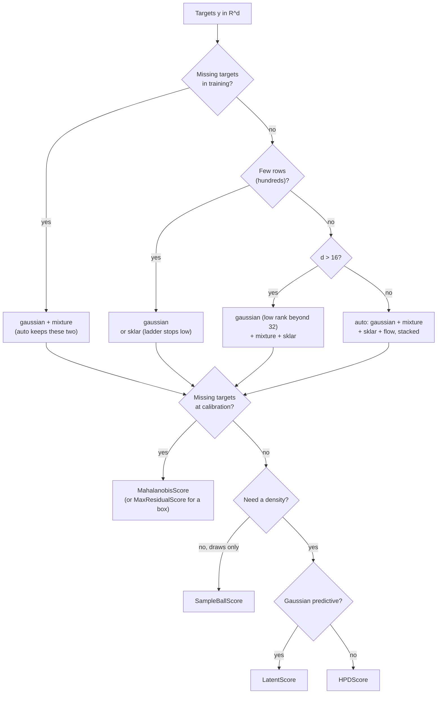

# Joint Multi-Target Regression

`torchregress.joint` predicts the **joint** conditional distribution
$p(\mathbf y \mid \mathbf x)$ of a vector of targets
$\mathbf y \in \mathbb R^d$, turns it into prediction regions with a
finite-sample coverage guarantee, recalibrates it, and checks it. This page
explains what each piece computes, the assumption behind each guarantee, and
how to choose between the options. For the per-head losses (full and low-rank
Gaussian, MDN, flows) see [Multi-Target Regression](multi-target-regression.md);
every symbol used here is listed in the [Joint API reference](../api/joint.md).

!!! tip "Where to start"
    This page is the reference. Three shorter pages lead into it, each with a
    worked example and real output:

    - [New to Joint Prediction](joint-quickstart.md): no background beyond
      regression; one example, corner plots, what "90%" promises, the
      diagnostics panel, missing targets, and a glossary.
    - [Coming from MCMC and HMC](joint-for-mcmc-users.md): chains, credible
      regions, SBC and corner plots mapped onto this package, checked against an
      exact posterior and a sampler.
    - [Coming from Simulation-Based Inference](joint-for-sbi-users.md): NPE,
      NRE, SBC, TARP and LF2I mapped onto this package, on the two-moons task.

    The plots are described in
    [Joint predictive plots](../methods/visualization.md#4-joint-predictive-plots-corner-plots-and-diagnostics).

---

## 1. Five lines

```python
from torchregress.joint import JointRegressor

model = JointRegressor().fit(X, Y)            # X [N, p], Y [N, d]; NaN marks a missing target
dist = model.predict(X_new)                   # JointPredictive: one distribution per row
dist.sample(256); dist.log_prob(Y_new)        # draws [n, 256, d]; log densities [n]
region = model.region(X_new, alpha=0.1)       # JointRegion, P(Y in region) >= 0.9
region.contains(Y_new); region.log_volume()   # membership [n]; (log-volume, s.e.) [n]
```

The objects:

- **`JointRegressor`** ([API](../api/joint.md#estimator)) fits one or several
  *heads* on standardised targets, stacks them, recalibrates the stack and keeps
  a held-out split for conformal calibration. `fit` splits the rows into
  training (60% by default), validation for early stopping and stacking (15%),
  recalibration (10%) and conformal calibration (15%).
- **`JointPredictive`** ([API](../api/joint.md#predictive-distributions)) is a
  batch of $n$ distributions over $\mathbb R^d$. Every head returns one, with
  the same layouts: `sample(S)` gives `[n, S, d]` (batch first, always),
  `log_prob(y)` maps `[n, d]` to `[n]` and `[n, S, d]` to `[n, S]`,
  `marginal(dims)` returns the predictive of a subset of targets. What a
  predictive can do is declared by three flags: `has_density`, `has_latent`
  (a map `to_latent` to a space where the predictive is standard normal) and
  `exact_marginals` (whether `marginal` and `log_prob(y, mask)` are exact).
- **`JointRegion`** ([API](../api/joint.md#conformal-regions)) is the set
  $\{\mathbf y : s(\mathbf x, \mathbf y) \le \hat t\}$ of one row, for a
  conformity score $s$ and a threshold $\hat t$ calibrated on held-out rows.
  `contains` tests membership, `log_volume` returns the log Lebesgue volume and
  its Monte Carlo standard error, `sample` draws from the predictive restricted
  to the region and `bounding_box` gives its coordinate-wise extent.

!!! info "Arrays in, tensors out"
    `fit`, `predict`, `calibrate` and `region` accept tensors or NumPy arrays.
    Predictives and regions live on the estimator's `device` (CUDA when
    available, unless `device="cpu"`) in float32; `log_prob`, `to_latent`,
    `from_latent`, `hpd_level` and `contains` accept tensors of any floating
    dtype on any device, or arrays, cast them to the predictive's `dtype` and
    `device`, and return results there.

---

## 2. Joint versus marginal prediction

### 2.1 Per-target intervals do not make a joint statement

Calibrate one interval $C_j(\mathbf x)$ per target at level $1-\alpha$. Each
interval covers its own target, $P(Y_j \in C_j(\mathbf X)) \ge 1 - \alpha$, but
the probability that **all** $d$ targets are covered at once is not
controlled. Only the union bound holds,

$$
P\Big(\bigcap_{j=1}^d \{Y_j \in C_j(\mathbf X)\}\Big) \;\ge\; 1 - d\alpha ,
$$

and for independent errors the joint coverage is $(1-\alpha)^d$: 0.59 for
$d = 5$ and $\alpha = 0.1$. Shrinking each level to $\alpha/d$ (Bonferroni)
restores $1 - \alpha$ but gives a box that ignores the dependence between
targets, so it is larger than needed when the targets are correlated. A joint
statement needs a joint object: a joint predictive, and a region calibrated as
one set.

### 2.2 Sklar's theorem

For a joint conditional CDF $F(\mathbf y \mid \mathbf x)$ with continuous
marginal CDFs $F_j(y_j \mid \mathbf x)$, Sklar's theorem gives a unique copula
$C(\cdot \mid \mathbf x)$ on $[0, 1]^d$ such that

$$
F(\mathbf y \mid \mathbf x) = C\big(F_1(y_1 \mid \mathbf x), \dots, F_d(y_d \mid \mathbf x) \;\big|\; \mathbf x\big),
$$

and, when the densities exist,

$$
p(\mathbf y \mid \mathbf x) = c\big(F_1(y_1 \mid \mathbf x), \dots, F_d(y_d \mid \mathbf x) \;\big|\; \mathbf x\big) \prod_{j=1}^d f_j(y_j \mid \mathbf x),
$$

with $c$ the copula density and $f_j$ the marginal densities. The marginals
and the dependence can therefore be modelled separately: any per-target
engine supplies the $F_j$, and a model of $c$ joins them.

### 2.3 The normal-score construction

The package works with **normal scores** rather than with the copula on the
unit cube:

$$
z_j = \Phi^{-1}\big(F_j(y_j \mid \mathbf x)\big), \qquad j = 1, \dots, d .
$$

The map $\mathbf y \mapsto \mathbf z$ is a coordinate-wise strictly increasing
bijection (the CDFs are continuous and strictly increasing) with Jacobian
determinant $\prod_j f_j(y_j \mid \mathbf x) / \varphi(z_j)$. For **any**
density $q(\mathbf z \mid \mathbf x)$ on $\mathbb R^d$, the change of variables
gives the density on the targets

$$
\log p(\mathbf y \mid \mathbf x) = \sum_{j=1}^d \log f_j(y_j \mid \mathbf x) + \log q(\mathbf z \mid \mathbf x) - \sum_{j=1}^d \log \varphi(z_j),
$$

and it integrates to one because $q$ does: the change of variables preserves
mass. Nothing requires $q$ to be a copula. When $q$ has standard-normal
marginals, $q(\mathbf z)/\prod_j \varphi(z_j)$ is a copula density and the
marginals of $p$ are exactly the $F_j$. Gaussian $q$ gives the Gaussian copula;
a conditional flow gives a flexible dependence model with an exact density.
This is [`SklarJoint`](../api/joint.md#dependence).

Per-target engines enter through [`Marginals`](../api/joint.md#marginals):
`GaussianMarginals`, `QuantileMarginals` (a quantile grid, linear CDF between
the knots, exponential tails), `BinnedMarginals` (histogram heads) and
`SampleMarginals` (draws). The PIT values are clipped to
$[\varepsilon, 1 - \varepsilon]$ with $\varepsilon = 10^{-6}$ before
$\Phi^{-1}$, so $|z_j| \le 4.75$; this alters the density only where some
$F_j$ lies within $\varepsilon$ of 0 or 1 (`GaussianMarginals` need no
clipping: their normal scores are the standardised residuals).

---

## 3. The dependence ladder

The dependence model $q(\mathbf z \mid \mathbf x)$ is chosen from a ladder of
increasing complexity, and the simplest rung that validation supports is kept.

| Rung | Model of $q(\mathbf z \mid \mathbf x)$ | Training | Density | When it is enough |
|:-:|:--|:--|:-:|:--|
| 0 | `IndependenceDependence`: $\mathcal N(0, I)$ | none | yes | Weak residual dependence, or too few rows to estimate it |
| 1 | `SchaakeShuffle`: draws of the rank-normalised training scores (optionally the $k$ nearest rows in $\mathbf x$) | none | no | Only scenarios (draws) are needed; a strong baseline in weather post-processing |
| 2 | `GaussianCopula`: $\mathcal N(0, R)$, $R$ the score correlation shrunk towards $I$ (Ledoit–Wolf), optionally low rank | closed form | yes | Dependence that does not change with $\mathbf x$ and is roughly elliptical |
| 3 | `ConditionalGaussianCopula`: $\mathcal N\big(0, L(\mathbf x) D(\mathbf x)^2 L(\mathbf x)^\top\big)$, unit lower-triangular $L$ (modified Cholesky) | NLL, early stopping | yes | Correlations that vary with the covariates |
| 4 | Vine copula | — | — | Not implemented |
| 5 | `FlowDependence`: conditional rational-quadratic spline flow, initialised at the identity | NLL, early stopping | yes | Non-Gaussian dependence (asymmetry, tail dependence, multimodality) with enough rows |

Rungs 3 and 5 start exactly at rung 0: their output layers are zero-initialised,
so before training $q(\mathbf z \mid \mathbf x) = \mathcal N(0, I)$ for every
$\mathbf x$, and the early-stopping checkpoint includes the initial weights.

### 3.1 The validation gate

[`select_dependence`](../api/joint.md#dependence) scores every
fitted density rung on held-out scores by the mean log density
$\bar\ell_c = \frac1N \sum_i \log q_c(\mathbf z_i \mid \mathbf x_i)$ and walks
the ladder from the bottom. It keeps the first rung $c$ that

- scores at least as well as independence, $\bar\ell_c \ge \bar\ell_0$, and
- is within `n_se` (default 2) standard errors of the best rung,
  $\bar\ell_{\max} - \bar\ell_c \le n_{se}\,\mathrm{SE}$, with SE the standard
  error of the paired per-row differences.

So the choice is never worse than independence on the validation rows, and a
more complex rung is kept only when its gain is resolved. Draws-only rungs
(the Schaake shuffle) have no log density and are skipped.

In the package's tests ($d = 3$, 4,000 training and 2,000 validation rows), the
held-out negative log score in nats per row, with the rung chosen by the gate:

| Simulated dependence | Independence | Gaussian copula | Conditional copula | Flow | Truth | Chosen |
|:--|:-:|:-:|:-:|:-:|:-:|:--|
| none | 4.2588 | 4.2591 | 4.2588 | 4.2588 | 4.2588 | independence |
| constant Gaussian | 4.3291 | 3.9576 | 3.9606 | 3.9788 | 3.9566 | Gaussian copula |
| Gaussian, correlation varying with $\mathbf x$ | 4.2233 | 4.1882 | 3.9516 | 3.9991 | 3.9413 | conditional copula |
| mixture over a hidden sign (non-Gaussian) | 4.2394 | 3.7035 | 3.7079 | 3.4790 | 3.4197 | flow |

### 3.2 Out-of-fold scores

The training scores must be computed **out of fold**: from marginals that were
not fitted on those rows. In-sample PITs are too uniform and too central, so a
dependence model fitted on them learns the marginal model's overfit rather
than the dependence of the targets. `JointRegressor` cross-fits the marginal
engine (`n_folds=3`) to produce the training scores, then refits it on all
training rows for prediction. When you call `Dependence.fit` yourself, this is
your responsibility.

!!! warning "A score model with drifting marginals also reshapes the marginals"
    $q$ is a copula density only if its marginals stay standard normal. The
    conditional Gaussian rung (free diagonal of $L D^2 L^\top$) and the flow
    rung can drift. The joint density is still valid, but its per-target
    marginals are then the $F_j$ *recalibrated by* $q$, not the $F_j$: the
    object is a marginally preconditioned model, not "marginals plus copula".
    `Dependence.marginal_drift(z, x)` reports the mean and standard deviation of
    each implied score marginal next to those of the held-out scores.

---

## 4. Heads and stacking

`JointRegressor(method=...)` fits one head, or, with `method="auto"` (the
default), several heads whose densities are stacked.

| Head | `method` | Model | Missing targets | In `"auto"` |
|:--|:--|:--|:--|:--|
| Gaussian (reference) | `"gaussian"` | $\mathcal N(\boldsymbol\mu(\mathbf x), L(\mathbf x) L(\mathbf x)^\top)$; full Cholesky up to 32 targets, rank-8 plus diagonal beyond (`rank=`) | exact (closed-form marginal) | always |
| Mixture | `"mixture"` | Mixture density network, `n_components=5`; full covariances up to $d = 8$, diagonal beyond | exact (masked density) | always |
| Flow | `"flow"` | Conditional neural spline flow on the standardised targets | rows with a missing target are dropped | complete targets and $d \le 16$ |
| Sklar | `"sklar"` | Quantile-network marginals (`QuantileNetworkEngine`, or your own `MarginalEngine`) joined by the gated ladder of §3 | complete rows only for the dependence | complete targets |

The Gaussian head is the reference: its marginals, conditionals
(`GaussianJoint.condition`), masked densities and Mahalanobis regions are
closed form, and its output layer starts at zero, so training starts from the
unit-variance independent Gaussian of the standardised targets.

**Stacking.** With $p_k$ the $K$ fitted heads and $V$ the validation rows, the
weights solve

$$
\hat{\mathbf w} = \arg\max_{\mathbf w \in \Delta_K} \sum_{i \in V} \log \sum_{k=1}^K w_k\, p_k(\mathbf y_i \mid \mathbf x_i),
$$

over the probability simplex $\Delta_K$. The objective is concave in
$\mathbf w$, so the maximiser is global; it is computed by the EM fixed point
$w_k \leftarrow \frac{1}{|V|}\sum_i w_k p_{ik} / \sum_l w_l p_{il}$, which
increases the objective monotonically (Yao et al. 2018). The predictive is the
mixture $\sum_k \hat w_k p_k$ ([`MixtureJoint`](../api/joint.md#predictive-distributions));
members with weight below $10^{-4}$ are dropped. `weights_` and
`validation_log_score_` report the weights and each head's validation log
score.

**Standardised targets.** Heads are fitted on targets standardised with the
training rows' mean and standard deviation, so raw units never meet a bounded
spline or a fixed initial scale. The head's predictive is mapped back by
[`AffineJoint`](../api/joint.md#predictive-distributions),
$\mathbf y = \mathrm{loc} + \mathrm{scale} \odot \mathbf u$, whose density picks
up the Jacobian:

$$
\log p_Y(\mathbf y \mid \mathbf x) = \log p_U\big((\mathbf y - \mathrm{loc}) \oslash \mathrm{scale} \mid \mathbf x\big) - \sum_{j} \log \mathrm{scale}_j .
$$

Under a mask the sum runs over the observed targets. Draws, latent maps,
marginals, means and covariances all come back in the data's units, so a fit
on `Y` and a fit on `1000 * Y + 5` give the same predictive up to the change of
units.

!!! tip "Cost of the automatic stack"
    On the synthetic data of the [example](#11-complete-example) (3,000 rows,
    $d = 3$, laptop CPU), `method="auto"` took about 18 s to fit its four heads
    and about 45 s more to predict and build its first region, against about
    2 s for the whole example with `method="gaussian"`. The HPD score of a stacked predictive draws 256
    samples per calibration and test row through every member, and the flow
    member dominates that cost. Start with `"gaussian"` and move to `"auto"`
    when the diagnostics of §8 reject it.

---

## 5. Conformal regions

### 5.1 The coverage statement

A region is built by **split conformal calibration** of one scalar score
$s(\mathbf x, \mathbf y)$ (small means typical). With calibration scores
$s_i = s(\mathbf x_i, \mathbf y_i)$, $i = 1, \dots, n$, the threshold is the
$k$-th smallest score,

$$
\hat t_\alpha = s_{(k)}, \qquad k = \lceil (n + 1)(1 - \alpha) \rceil ,
$$

($+\infty$ when $k > n$) and the region is
$R_\alpha(\mathbf x) = \{\mathbf y : s(\mathbf x, \mathbf y) \le \hat t_\alpha\}$.

**Assumption:** the calibration pairs and the test pair
$(\mathbf X_{n+1}, \mathbf Y_{n+1})$ are exchangeable (for instance, i.i.d.),
and the score function was fixed without looking at the calibration rows.
**Then**

$$
1 - \alpha \;\le\; P\big(\mathbf Y_{n+1} \in R_\alpha(\mathbf X_{n+1})\big) \;\le\; 1 - \alpha + \frac{1}{n+1},
$$

where the upper bound needs almost surely distinct scores. The probability is
over the calibration set **and** the test pair: this is *marginal* coverage,
averaged over $\mathbf x$, not coverage at each $\mathbf x$. It holds whatever
the quality of the predictive; a poor model gives larger regions, not lower
coverage: the model buys region size, the calibration buys validity (Hoff
2023). Several levels (`alpha=[0.05, 0.1, 0.32]`) give nested regions.
`JointRegressor.region` uses its own conformal split, which the recalibration
never sees: a recalibrator fitted on the conformal rows would break the
exchangeability the statement rests on.

The score decides the **shape** and the **size** of the region; calibration
only decides its level. The low-level API is
[`JointConformal`](../api/joint.md#conformal-regions):

```python
from torchregress.joint import JointConformal, MaxResidualScore

cp = JointConformal(MaxResidualScore(), alpha=0.1).calibrate(pred_cal, y_cal)
region = cp.region(pred_test)
```

### 5.2 Density level set: `DensityScore`

$$
s(\mathbf x, \mathbf y) = -\log \hat p(\mathbf y \mid \mathbf x) .
$$

The region is a density level set $\{\mathbf y : \hat p(\mathbf y \mid \mathbf x) \ge e^{-\hat t}\}$,
the smallest-volume region at its coverage when the predictive is correct
(Lei et al. 2018). The level is shared across rows, so rows with a broad
predictive get a low density level and rows with a sharp one a high level.
Requires `has_density`; with a missing-target mask, `exact_marginals`.

### 5.3 Highest-density level: `HPDScore`

$$
s(\mathbf x, \mathbf y) = P_{\mathbf Y' \sim \hat p(\cdot \mid \mathbf x)}\big[\hat p(\mathbf Y' \mid \mathbf x) > \hat p(\mathbf y \mid \mathbf x)\big] \in [0, 1],
$$

estimated from `n_samples` (256) reference draws per row, with ties broken by
the density. The region is the highest-density set of $\hat p(\cdot \mid \mathbf x)$
of mass $\hat t$, so its density level adapts to each row (HPD-split,
Izbicki et al. 2022). Requires a density and draws. Calibration and test must
use the same `n_samples`, which is why it is stored on the score.

### 5.4 Latent ball: `LatentScore`

$$
s(\mathbf x, \mathbf y) = \lVert T(\mathbf y; \mathbf x) \rVert_2 ,
$$

with $T$ the predictive's map to a standard-normal latent space (`to_latent`).
The region is the pre-image of a latent ball of radius $\hat t$: the
Mahalanobis ellipsoid for a Gaussian, a curved set for a flow. Exact (no
sampling) and much cheaper than the sampling scores (Dheur et al. 2025).
Requires `has_latent`.

### 5.5 Ellipsoid: `MahalanobisScore`

$$
s(\mathbf x, \mathbf y) = \sqrt{(\mathbf y - \mathbf m)^\top \Sigma^{-1} (\mathbf y - \mathbf m)}, \qquad \mathbf m = \hat{\mathbb E}[\mathbf Y \mid \mathbf x],\ \Sigma = \widehat{\mathrm{Cov}}[\mathbf Y \mid \mathbf x] .
$$

The region is an ellipsoid centred at the predictive mean. It needs only
`mean()` and `covariance()` (closed form for Gaussian heads, Monte Carlo
otherwise), it accepts missing calibration targets for any predictive with
moments (§5.10), and its volume and bounding box are closed form.

### 5.6 Box with a joint guarantee: `MaxResidualScore`

$$
s(\mathbf x, \mathbf y) = \max_{j} \frac{\lvert y_j - m_j \rvert}{\sqrt{\Sigma_{jj}}} .
$$

The region is the box $\prod_j [m_j - \hat t \sqrt{\Sigma_{jj}},\ m_j + \hat t \sqrt{\Sigma_{jj}}]$.
$\mathbf Y$ lies in the box if and only if the single scalar
$s(\mathbf X, \mathbf Y) \le \hat t$, so the conformal argument applies to that
scalar and $P(\text{all } d \text{ targets inside}) \ge 1 - \alpha$. This is the
joint counterpart of per-target intervals (§2.1). Accepts masks (maximum over
observed targets). The *max-rank* variant (ranks of each target's residual)
needs a corrected order statistic (Schlembach et al. 2026) and is not
implemented.

### 5.7 Union of balls: `SampleBallScore`

$$
s(\mathbf x, \mathbf y) = \min_{k \le K} \lVert \mathbf y - \hat{\mathbf Y}_k \rVert_2, \qquad \hat{\mathbf Y}_k \sim \hat p(\cdot \mid \mathbf x),
$$

so the region is a union of $K$ balls of radius $\hat t$ around predictive
draws (PCP, Wang et al. 2023). It needs only draws, so it is the score for
draws-only predictives (Schaake shuffle, the draws-only marginal of a flow, a
`SampleJoint`). A `JointRegion` draws its $K$ reference samples once, so its
membership test is deterministic.

### 5.8 Volume

`JointRegion.log_volume()` returns $\log V$ and a standard error. The
ellipsoid and the box are closed form,

$$
\log V_{\text{ellipsoid}} = \log \frac{\pi^{d/2}}{\Gamma(d/2 + 1)} + d \log \hat t + \tfrac12 \log\det\Sigma, \qquad \log V_{\text{box}} = \sum_j \log\big(2 \hat t \sqrt{\Sigma_{jj}}\big),
$$

with zero standard error. For the other scores the volume is estimated by
importance sampling from the predictive (Dheur et al. 2025),

$$
\hat V = \frac1K \sum_{k=1}^K \frac{\mathbf 1[\mathbf Y_k \in R]}{\hat p(\mathbf Y_k \mid \mathbf x)}, \qquad \mathbf Y_k \sim \hat p(\cdot \mid \mathbf x),
$$

which is unbiased for the volume of $R \cap \operatorname{supp}\hat p$. When the
region reaches far into the tails of a too-narrow predictive the weights are
heavy-tailed and the estimate is biased low; for predictives with a latent map
the proposal is therefore a defensive mixture of latent normals with scales 1,
2 and 4. Draws-only predictives with `SampleBallScore` use uniform sampling in
the bounding box of the balls, accurate only in low $d$.

### 5.9 Weights and groups

- **Weighted conformal** (Tibshirani et al. 2019). Pass `weights=` to
  `calibrate` and `test_weights=` to `region`. With
  $w(\mathbf x) = dP_{\text{test}}/dP_{\text{cal}}(\mathbf x)$ the **true**
  likelihood ratio, coverage $\ge 1 - \alpha$ holds under covariate shift. An
  estimated ratio gives approximate coverage only.
- **Mondrian** (Vovk et al. 2005). Pass integer `groups=` to both calls: one
  threshold per group, so that $P(\mathbf Y \in R(\mathbf X) \mid G = g) \ge 1 - \alpha$
  for every group $g$. A group not seen in calibration gets an infinite
  threshold.

`JointRegressor.region` does not take weights or groups. Use `JointConformal`
directly with `model.predict` on rows that were **not** passed to `fit`.

### 5.10 Missing targets

With missing calibration targets (`NaN` in the `Y` given to `JointRegressor`,
or `mask=` with `True` = observed in `JointConformal.calibrate`), the score is
computed on the observed sub-vector. `DensityScore` (with `exact_marginals`),
`MahalanobisScore` and `MaxResidualScore` accept masks. `MahalanobisScore`
maps the quadratic form of the $k = |O|$ observed targets through the
$\chi^2_k$ CDF,

$$
s(\mathbf x, \mathbf y) = F_{\chi^2_k}\big((\mathbf y_O - \mathbf m_O)^\top \Sigma_{OO}^{-1} (\mathbf y_O - \mathbf m_O)\big),
$$

so rows with different numbers of observed targets share one scale (Braun et
al. 2025). The guarantee then holds for test rows whose missingness pattern is
generated by the same mechanism as in calibration, and `region.contains(y, mask)`
takes the test mask. The statement is *not* one about complete rows: a masked
calibration mixes rows with few observed targets, and a misspecified covariance
mis-scales their $\chi^2$ quantiles differently from those of complete rows, so
complete rows can be under-covered (0.81 at nominal 0.90 in a $d = 6$ example
with half the entries missing and the variance underestimated by a factor
2.56). `JointRegressor.region` therefore keeps two calibrations when its
conformal rows have missing targets: `region.contains(y)` (complete test rows)
is calibrated on the complete conformal rows only, with the score that would be
used without missing targets, and holds
$P(\mathbf Y \in R(\mathbf X) \mid \text{row complete}) \ge 1 - \alpha$
when the complete rows are exchangeable (for example targets missing
completely at random); `region.contains(y, mask=m)` uses the masked
`MahalanobisScore` calibration of all rows, with the same-mechanism guarantee
above. A `ValueError` is raised when fewer than $1/\alpha - 1$ conformal rows
are complete.
[`coverage_by_mask`](../api/joint.md#diagnostics) reports coverage per
missingness pattern, since a correct average can hide under-coverage for one
pattern.

### 5.11 Which score when

| Score | Region shape | Needs | Masks | Volume | Use when |
|:--|:--|:--|:-:|:--|:--|
| `LatentScore` | pre-image of a latent ball | latent map | no | importance sampling | Gaussian heads (the latent ball is then the highest-density region; the `"auto"` default for them in `JointRegressor`); the fast choice for flows |
| `HPDScore` | highest-density set, adaptive level | density and draws | no | importance sampling | Flows, mixtures, stacks, Sklar joints, multimodal predictives: the `"auto"` default for every non-Gaussian predictive with a density |
| `DensityScore` | density level set, shared level | density | yes (with `exact_marginals`) | importance sampling | Smallest regions when the model is good; heteroscedasticity is moderate |
| `MahalanobisScore` | ellipsoid | mean and covariance | yes | closed form | Missing calibration targets; a convex, reportable region |
| `MaxResidualScore` | box | mean and variances | yes | closed form | Per-target bounds with a joint guarantee |
| `SampleBallScore` | union of balls | draws | no | box Monte Carlo (low $d$) | Draws-only predictives (Schaake shuffle, draws-only marginals) |

---

## 6. Targets of interest and nuisance targets

Often only a few targets $\mathbf y_I$ matter and the rest, $\mathbf y_N$, are
nuisances. Three traditions remove them in three different ways.

| Tradition | Operation | In the library |
|:--|:--|:--|
| Predictive (Bayesian) | Marginalise: $p(\mathbf y_I \mid \mathbf x) = \int p(\mathbf y_I, \mathbf y_N \mid \mathbf x)\, d\mathbf y_N$ | `dist.marginal(dims)` |
| Frequentist | Profile: $\sup_{\mathbf y_N} p(\mathbf y_I, \mathbf y_N \mid \mathbf x)$, calibrated by Wilks or a Neyman construction | `torchregress.inference` (parameter scores) |
| Distribution-free | Conformal region for $\mathbf y_I$ only | `model.region(X, interest=dims)` |

**Marginalising.** `dist.marginal(dims)` returns the joint predictive of the
targets `dims`. It keeps a density for the Gaussian head (closed form), for the
mixture density network (a [`MaskedMarginalJoint`](../api/joint.md#predictive-distributions),
which integrates the other targets out exactly), for `AffineJoint` and
`MixtureJoint` wrappers of such heads (so also for the default stack when no flow
is in it), for `SklarJoint` with Gaussian rungs, and for
`MarginalRecalibratedJoint`. For flows and latent-recalibrated predictives it
falls back to a draws-only [`ProjectedJoint`](../api/joint.md#predictive-distributions):
the nuisance targets are integrated out by sampling, and `has_density` becomes
`False`.

**Conformalising a sub-vector.** `model.region(X, alpha, interest=[0, 2])`
integrates the nuisance targets out of the predictive (`marginal`) **before**
calibration and calibrates a region for $\mathbf y_I$ only. The coverage
statement of §5.1 then applies to the sub-vector, and the region is usually
much smaller than the projection of the joint region onto $\mathbf y_I$, which
must also accommodate the nuisances. The score is chosen for the marginal
predictive, so a stack whose marginal is draws-only uses `SampleBallScore`.

**Profiling.** Profiling replaces the integral by a maximum. It is the natural
operation when the quantities to remove are **parameters** of a likelihood (a
simulator, a known noise model), and its intervals are calibrated by Wilks'
theorem or by a Neyman construction rather than by a predictive distribution.
`torchregress.joint` does not profile a `JointPredictive`; the profile
machinery is in [Likelihood-Ratio Inference](../methods/likelihood_inference.md)
(`profile_interval`) and [Neyman Confidence Sets](../methods/neyman.md)
(`NeymanConfidenceSet`).

The three answer different questions: the marginal is a predictive
distribution for $\mathbf y_I$ (it is calibrated only if the model is), the
conformal sub-vector region has finite-sample marginal coverage for
$\mathbf y_I$ whatever the model, and a profile interval is a confidence set
for a parameter, valid at each parameter value when it is calibrated by a
Neyman construction.

---

## 7. Recalibration

Each recalibrator is fitted on held-out pairs through the predictive of those
rows, `fit(predictive_cal, y_cal)`, and then wraps any predictive of the same
model, `transform(predictive)`. None gives calibration at an individual
$\mathbf x$: they correct miscalibration on average over the calibration rows,
under exchangeability of calibration and test rows. Fit them on rows that are
not used for conformal calibration.

### 7.1 Per-target scale: `ScaleRecalibrator`

The recalibrated predictive is the law of

$$
\mathbf Y' = \mathbf m(\mathbf x) + \mathbf s \odot \big(\mathbf Y - \mathbf m(\mathbf x)\big), \qquad \mathbf Y \sim \hat p(\cdot \mid \mathbf x),
$$

with $\mathbf m$ the predictive mean and one factor $s_j > 0$ per target shared
by all rows. `objective="variance"` sets $s_j^2$ to the mean squared
standardised residual of target $j$; `objective="nll"` maximises the held-out
log density (L-BFGS on $\log \mathbf s$). Its covariance is
$S \Sigma(\mathbf x) S$ with $S = \mathrm{diag}(\mathbf s)$, and the dependence
structure is unchanged. `JointRegressor` applies it by default
(`recalibrate=True`, `scale_`).

*Fixes:* a global over- or under-dispersion of each target.
*Cannot fix:* a wrong mean, a wrong shape (tails, skew, modes), wrong
dependence, or dispersion errors that vary with $\mathbf x$.

### 7.2 Latent recalibration: `LatentRecalibrator`

For a predictive with a latent map $T$, the latent norm
$L = \lVert T(\mathbf Y; \mathbf X) \rVert_2$ follows the $\chi_d$ distribution
when the predictive is calibrated. With $\hat F_L$ a smooth, strictly
increasing estimate of the CDF of the calibration norms, the radial map

$$
r(l) = \hat F_L^{-1}\big(F_{\chi_d}(l)\big), \qquad R(\mathbf z) = r(\lVert \mathbf z \rVert)\, \frac{\mathbf z}{\lVert \mathbf z \rVert},
$$

defines the recalibrated predictive as the law of $T^{-1}(R(\mathbf Z))$,
$\mathbf Z \sim \mathcal N(0, I_d)$ (Dheur and Ben Taieb 2025). Its latent norm
has CDF $\hat F_L$. With $\mathbf z' = T(\mathbf y)$, $l' = \lVert \mathbf z' \rVert$
and $l = r^{-1}(l')$, the radial map has Jacobian determinant
$(r(l)/l)^{d-1} r'(l)$ and the density is

$$
\log f'(\mathbf y) = \log f(\mathbf y) - \tfrac12\big(l^2 - l'^2\big) - (d - 1)\log\frac{l'}{l} - \log r'(l) .
$$

The map $r$ is a monotone rational-quadratic spline in log–log space through
quantile knots, continued linearly beyond the end knots.
[`latent_calibration_error`](../api/joint.md#recalibration) measures the
distance of $F_{\chi_d}(L)$ from uniform (L-ECE; about $0.31/\sqrt n$ for a
calibrated predictive, not zero).

*Fixes:* the distribution of the norm: over- or under-confidence and tail
weight, jointly over all targets, while keeping a density and a latent map.
*Cannot fix:* the direction or shape of the latent residual (dependence
errors), or miscalibration that varies with $\mathbf x$. Because the new score
$\lVert R^{-1}(T(\mathbf y)) \rVert = r^{-1}(\lVert T(\mathbf y) \rVert)$ is a
monotone function of the old one, it does not change a `LatentScore` conformal
region (§11 shows this).

### 7.3 Marginal conformal calibrators: `MarginalRecalibrator`

For each target $j$, sort the calibration PITs $u_{ij} = F_j(y_{ij} \mid \mathbf x_i)$
and fit a strictly increasing map $G_j$ of $[0, 1]$ onto itself through the
points $(u_{(k)}, k/(m+1))$ (split conformal predictive systems, Vovk et al.
2019, 2020). The recalibrated marginal CDF is $G_j \circ F_j$, and the
dependence of the base is kept by applying $F_j^{-1} \circ G_j^{-1} \circ F_j$
coordinate-wise. If calibration and test pairs are exchangeable and the PITs
are distinct, the recalibrated PIT $V_j = G_j(F_j(Y_j \mid \mathbf X))$
satisfies $P(V_j \le k/(m+1)) = k/(m+1)$ at every knot rank $k$; with
`n_knots="all"` each target is probabilistically calibrated to within
$1/(m+1)$.

For a bare [`GaussianJoint`](../api/joint.md#predictive-distributions), the
result is a `MarginalRecalibratedJoint` with density, latent map and exact
marginals. For any other predictive (including the `AffineJoint` returned by
`JointRegressor.predict`) the result is a draws-only `SampleJoint`.

*Fixes:* each target's marginal calibration, with a finite-sample statement.
*Cannot fix:* the dependence (copula), which is inherited from the base, or
calibration at an individual $\mathbf x$. With every rank as a knot the
recalibrated density is rough (about 0.42 nats per target worse in log score on
a calibrated predictive); the default uses fewer knots.

---

## 8. Diagnostics

### 8.1 Calibration in more than one dimension

A joint predictive $P_{\mathbf x}$ is calibrated if, over the rows, the
observation behaves like one more draw from the predictive: $\mathbf Y$ is
exchangeable with draws $\mathbf Y'_1, \dots, \mathbf Y'_S \sim P_{\mathbf X}$.
Uniform PITs for every target are necessary but not sufficient: a predictive
with perfect marginals and the wrong correlation passes every per-target
check. No single scalar check is sufficient either, so the diagnostics below
each target a different way of being wrong, and all of them check calibration
on average over rows, never at an individual $\mathbf x$.

`plot_joint_diagnostics` draws all of them in one figure, and
`plot_corner_plot` shows one row's predictive with its region and true value:
see [Joint predictive plots](../methods/visualization.md#4-joint-predictive-plots-corner-plots-and-diagnostics),
and [Checking calibration](joint-quickstart.md#6-checking-calibration) for a
panel-by-panel reading with a red example.

### 8.2 Pre-rank histograms

[`prerank_histograms(samples, y)`](../api/joint.md#diagnostics) pools the
observation with $S$ draws, standardises each target by the pool, applies a
pre-rank function $\rho: \mathbb R^d \to \mathbb R$ and records the rank of
$\rho(\mathbf y)$ among the $\rho(\mathbf Y'_k)$ (Allen et al. 2024). Under
calibration the rank is uniform on $\{0, \dots, S\}$ for every pre-rank, and a
chi-square test with Holm adjustment across pre-ranks reports which fail.

| Pre-rank | $\rho(\mathbf x)$ (standardised pool) | Detects |
|:--|:--|:--|
| `location` | $\bar x = \frac1d \sum_j x_j$ | biased means (sloped histogram) |
| `scale` | $\frac1d \sum_j (x_j - \bar x)^2$ | dispersion errors |
| `dependence` | $\binom d2^{-1} \sum_{j<k} x_j x_k$ | over- or under-estimated correlation |
| `energy` | mean distance to the other pool members | outlying observations, overall dispersion |
| `average_rank` | mean coordinate-wise rank (Thorarinsdottir et al. 2016) | location and dispersion jointly |
| `band_depth` | mean of $(r_j - 1)(S + 1 - r_j)$ | centrality: dispersion and dependence |

### 8.3 NEES

[`nees_consistency(mean, covariance, y)`](../api/joint.md#diagnostics) computes
the normalised estimation error squared
$\varepsilon_i = (\mathbf y_i - \mathbf m_i)^\top \Sigma_i^{-1}(\mathbf y_i - \mathbf m_i)$.
Under a correct Gaussian predictive $N\bar\varepsilon \sim \chi^2_{Nd}$, so the
acceptance band at level $1 - a$ is

$$
\bar\varepsilon \in \big[\chi^2_{Nd}(a/2)/N,\ \chi^2_{Nd}(1 - a/2)/N\big] .
$$

Above the band the covariances are too small (over-confident), below it too
large (conservative). `eigen_variances` breaks the error down by eigen-direction
of the covariance. The test is exact for Gaussian predictives and checks only
the second moment for others.

### 8.4 HPD calibration

For a calibrated predictive the HPD level $h_i$ (`dist.hpd_level(y)`, §5.3) is
uniform. [`hpd_calibration(levels)`](../api/joint.md#diagnostics) returns the
curve $\hat F(a) = \frac1n \sum_i \mathbf 1[h_i \le a]$, the fraction of
observations inside the HPD region of mass $a$, with a simultaneous
Dvoretzky–Kiefer–Wolfowitz band and a Kolmogorov–Smirnov test. Above the
diagonal the HPD regions over-cover, below they under-cover.

### 8.5 Conditional coverage

Conformal coverage is marginal. Two diagnostics look for coverage that depends
on $\mathbf x$, given coverage indicators $Z_i = \mathbf 1[\mathbf y_i \in R(\mathbf x_i)]$:

- [`worst_slab_coverage`](../api/joint.md#diagnostics) (Cauchois et al. 2021):
  on half of the rows, search random directions $\mathbf v$ for the slab
  $\{a \le \mathbf v^\top \mathbf x \le b\}$ of mass at least $\delta$ with the
  lowest coverage, and report that slab's coverage on the other half (an
  unbiased estimate for that slab).
- [`conditional_coverage_gap`](../api/joint.md#diagnostics) (ERT, Braun et al.
  2026): fit a classifier $h(\mathbf x) \approx P(Z = 1 \mid \mathbf x)$ out of
  fold and estimate
  $\frac1n \sum_i [\ell(1-\alpha, Z_i) - \ell(h(\mathbf x_i), Z_i)]$. A value
  clearly above zero certifies a conditional-coverage violation (or wrong
  marginal coverage).

A value near the marginal coverage, or an ERT near zero, does not prove
conditional coverage: the search or the classifier may be too weak.

### 8.6 Why the energy score alone cannot certify dependence

The energy score
$\mathrm{ES}(P, \mathbf y) = \mathbb E\lVert \mathbf Y - \mathbf y \rVert - \tfrac12 \mathbb E\lVert \mathbf Y - \mathbf Y' \rVert$
is strictly proper, so the true predictive minimises it in expectation. It is
dominated by the marginal locations and scales, however, and it changes little
when only the correlation is wrong (Pinson and Tastu 2013): at realistic $n$
and sample counts a good energy score is compatible with a badly wrong
dependence. Read it next to a dependence-sensitive check: the `dependence`
pre-rank, [`dependence_error`](../api/joint.md#diagnostics) (predicted against
empirical correlation of standardised residuals), the variogram score
(`torchregress.metrics.VariogramScore`) or the joint log score.

---

## 9. Choosing a head, a rung and a score



!!! tip "HPD or latent ball for a flow"
    `JointRegressor.region` with `score="auto"` uses `LatentScore` only for a
    Gaussian predictive, whose latent ball is its highest-density region. For a
    flow, mixture or stack it uses `HPDScore`: on a bimodal predictive the
    pulled-back latent ball covers the space between the modes, and was about four
    times larger in area than the HPD set at the same coverage (two-moons
    posterior). HPD costs reference draws and densities per row;
    `JointRegressor(score=LatentScore())` is the fast choice for flows. The score
    used is printed by `region.score.name`.

The rung is chosen by the validation gate (§3.1); force one by fitting the
`Dependence` objects yourself and passing them to `select_dependence`, or use
the predictive directly with `SklarJoint`. Use `MaxResidualScore` whenever the
deliverable is per-target bounds.

!!! warning "What `torchregress.joint` does not claim"
    - **No coverage at each $\mathbf x$.** Conformal regions have marginal
      coverage, averaged over $\mathbf x$ and the calibration set. Coverage
      within a subgroup holds only for Mondrian groups declared in advance.
    - **No posterior.** The stacked mixture is a weighted predictive chosen by
      held-out log score; it is not Bayesian model averaging, and the
      disagreement between heads is not calibrated epistemic uncertainty.
    - **No guarantee under shift without weights.** Coverage and calibration
      assume calibration and test rows are exchangeable. Under covariate shift
      only weighted calibration with the true likelihood ratio restores
      coverage; nothing restores it under label or concept shift.
    - **No calibration from a good score.** A good log score, energy score or
      CRPS does not imply calibration, and a good energy score does not imply
      correct dependence.
    - **No "best overall" head.** Stacking weights and the ladder are chosen
      per data set on held-out rows.

---

## 10. References

| # | Reference |
|:-:|:----------|
| 1 | Sklar, A. "Fonctions de répartition à n dimensions et leurs marges." *Publ. Inst. Statist. Univ. Paris* 8, 1959. |
| 2 | Clark, M. et al. "The Schaake shuffle: a method for reconstructing space–time variability in forecasted precipitation and temperature fields." *J. Hydrometeorology* 5, 2004. |
| 3 | Ledoit, O. and Wolf, M. "A well-conditioned estimator for large-dimensional covariance matrices." *J. Multivariate Anal.* 88, 2004. |
| 4 | Klein, N., Hothorn, T., Barbanti, L. and Kneib, T. "Multivariate conditional transformation models." *Scand. J. Statist.* 49, 2022. |
| 5 | Arpogaus, M., Kneib, T., Nagler, T. and Rügamer, D. "Hybrid Bernstein normalizing flows for flexible multivariate density regression." [arXiv:2505.14164](https://arxiv.org/abs/2505.14164), 2025. |
| 6 | Yao, Y., Vehtari, A., Simpson, D. and Gelman, A. "Using stacking to average Bayesian predictive distributions." *Bayesian Analysis* 13, 2018. |
| 7 | Lei, J., G'Sell, M., Rinaldo, A., Tibshirani, R. J. and Wasserman, L. "Distribution-free predictive inference for regression." *JASA* 113, 2018. |
| 8 | Izbicki, R., Shimizu, G. and Stern, R. B. "CD-split and HPD-split: efficient conformal regions in high dimensions." *JMLR* 23, 2022. |
| 9 | Dheur, V., Fontana, M., Estievenart, Y., Desobry, N. and Ben Taieb, S. "Multi-output conformal regression: a unified comparative study with new conformity scores." *ICML*, 2025 ([arXiv:2501.10533](https://arxiv.org/abs/2501.10533)). |
| 10 | Braun et al. "Multivariate standardized residuals for conformal prediction." [arXiv:2507.20941](https://arxiv.org/abs/2507.20941), 2025. |
| 11 | Wang, Z., Gao, R., Yin, M., Zhou, M. and Blei, D. "Probabilistic conformal prediction using conditional random samples." *AISTATS*, 2023. |
| 12 | Tibshirani, R. J., Barber, R. F., Candès, E. and Ramdas, A. "Conformal prediction under covariate shift." *NeurIPS*, 2019. |
| 13 | Vovk, V., Gammerman, A. and Shafer, G. *Algorithmic Learning in a Random World.* Springer, 2005. |
| 14 | Schlembach, F., Smirnov, E. and Winands, M. "Corrected max-rank multi-target conformal regions." *COPA*, 2026. |
| 15 | Dheur, V. and Ben Taieb, S. "Multivariate latent recalibration for conditional normalizing flows." *NeurIPS*, 2025 ([arXiv:2505.16636](https://arxiv.org/abs/2505.16636)). |
| 16 | Vovk, V., Shen, J., Manokhin, V. and Xie, M. "Nonparametric predictive distributions based on conformal prediction." *Machine Learning* 108, 2019. |
| 17 | Vovk, V., Petej, I., Toccaceli, P., Gammerman, A., Ahlberg, E. and Carlsson, L. "Conformal calibrators." *COPA*, 2020. |
| 18 | Allen, S., Ziegel, J. and Ginsbourger, D. "Assessing the calibration of multivariate probabilistic forecasts." *QJRMS*, 2024 ([arXiv:2307.05846](https://arxiv.org/abs/2307.05846)). |
| 19 | Thorarinsdottir, T. L., Scheuerer, M. and Heinz, C. "Assessing the calibration of high-dimensional ensemble forecasts using rank histograms." *J. Comput. Graph. Stat.* 25, 2016. |
| 20 | Bar-Shalom, Y., Li, X. R. and Kirubarajan, T. *Estimation with Applications to Tracking and Navigation.* Wiley, 2001. |
| 21 | Cauchois, M., Gupta, S. and Duchi, J. "Knowing what you know: valid and validated confidence sets in multiclass and multilabel prediction." *JMLR* 22, 2021. |
| 22 | Braun et al. "Excess risk of the target coverage." *ICML*, 2026 ([arXiv:2512.11779](https://arxiv.org/abs/2512.11779)). |
| 23 | Pinson, P. and Tastu, J. "Discrimination ability of the energy score." Technical University of Denmark, 2013. |
| 24 | Hoff, P. "Bayes-optimal prediction with frequentist coverage control." *Bernoulli* 29, 2023. |

---

## 11. Complete example

Three targets with nonlinear means, a correlation between $y_0$ and $y_1$ that
changes sign with $x_0$, and Student-$t_5$ noise, so a Gaussian head can match
the first two moments but not the tails. The script fits the Gaussian
head, checks the conformal region on held-out rows, builds a region for two
targets of interest, recalibrates the latent norm on separate rows,
re-conformalises the recalibrated predictive on yet other rows, and runs three
diagnostics. It runs in about 5 s on a laptop CPU, imports included.

```python
import torch

from torchregress.joint import (
    JointConformal,
    JointRegressor,
    LatentRecalibrator,
    LatentScore,
    hpd_calibration,
    latent_calibration_error,
    nees_consistency,
    prerank_histograms,
)


def simulate(n: int, seed: int) -> tuple[torch.Tensor, torch.Tensor]:
    """Three targets: nonlinear means, x-dependent correlation, Student-t(5) noise."""
    g = torch.Generator().manual_seed(seed)
    x = torch.randn(n, 4, generator=g)
    rho = torch.tanh(1.5 * x[:, 0])  # correlation of y0 and y1 varies with x0
    e = torch.randn(n, 3, generator=g)
    chi2_5 = torch.randn(n, 5, generator=g).square().sum(1, keepdim=True)
    e = e / (chi2_5 / 5).sqrt()
    y = torch.empty(n, 3)
    y[:, 0] = torch.sin(x[:, 1]) + 0.4 * e[:, 0]
    y[:, 1] = 0.5 * x[:, 2] ** 2 + 0.4 * (rho * e[:, 0] + (1 - rho**2).sqrt() * e[:, 1])
    y[:, 2] = x[:, 3] + 0.3 * e[:, 2]
    return x, y


torch.manual_seed(0)
x, y = simulate(3000, seed=0)  # fit (the model holds out its own splits)
x_rc, y_rc = simulate(1000, seed=1)  # latent recalibration
x_cf, y_cf = simulate(1000, seed=3)  # conformal step after recalibration
x_te, y_te = simulate(2000, seed=2)  # test rows

model = JointRegressor("gaussian", hidden=(64, 64), max_epochs=150, patience=15, device="cpu", seed=0)
model.fit(x, y)
dist = model.predict(x_te)
print(f"held-out log score:      {dist.log_prob(y_te).mean():.3f} nats")
print(f"scale factors:           {model.scale_.numpy().round(3)}")

region = model.region(x_te, alpha=0.1)
log_vol, _ = region.log_volume()
print(f"joint 90% coverage:      {region.contains(y_te).float().mean():.3f}")
print(f"median log-volume:       {log_vol.median():.3f}")

sub = model.region(x_te, alpha=0.1, interest=[0, 1])
print(f"(y0, y1) 90% coverage:   {sub.contains(y_te[:, [0, 1]]).float().mean():.3f}")

recal = LatentRecalibrator().fit(model.predict(x_rc), y_rc)
dist_rc = recal.transform(dist)
print(f"L-ECE before / after:    {latent_calibration_error(dist, y_te):.3f} / "
      f"{latent_calibration_error(dist_rc, y_te):.3f}")
print(f"log score after recal:   {dist_rc.log_prob(y_te).mean():.3f} nats")

cp = JointConformal(LatentScore(), alpha=0.1).calibrate(recal.transform(model.predict(x_cf)), y_cf)
region_rc = cp.region(dist_rc)
log_vol_rc, se_rc = region_rc.log_volume()
print(f"recalibrated region:     coverage {region_rc.contains(y_te).float().mean():.3f}, "
      f"median log-volume {log_vol_rc.median():.3f} (MC s.e. {se_rc.median():.3f})")

names = ("location", "scale", "dependence")
before = prerank_histograms(dist.sample(99), y_te, preranks=names)
after = prerank_histograms(dist_rc.sample(99), y_te, preranks=names)
for name, p0, p1 in zip(names, before.p_values_holm, after.p_values_holm):
    print(f"pre-rank {name:<11} Holm p before {p0:.2g}, after {p1:.2g}")
nees = nees_consistency(dist.mean(), dist.covariance(), y_te)
print(f"NEES mean {nees.statistic:.3f}, band [{nees.lower:.3f}, {nees.upper:.3f}] -> {nees.verdict}")
hpd = hpd_calibration(dist.hpd_level(y_te))
hpd_rc = hpd_calibration(dist_rc.hpd_level(y_te))
print(f"HPD KS before / after:   {hpd.ks_statistic:.3f} / {hpd_rc.ks_statistic:.3f}")
```

Output (torch 2.14.1, Python 3.13, CPU):

```text
held-out log score:      -1.835 nats
scale factors:           [0.997 1.006 1.103]
joint 90% coverage:      0.904
median log-volume:       1.853
(y0, y1) 90% coverage:   0.911
L-ECE before / after:    0.109 / 0.010
log score after recal:   -1.673 nats
recalibrated region:     coverage 0.895, median log-volume 1.779 (MC s.e. 0.063)
pre-rank location    Holm p before 4.7e-12, after 0.73
pre-rank scale       Holm p before 1.4e-26, after 0.73
pre-rank dependence  Holm p before 6.3e-15, after 0.73
NEES mean 2.711, band [2.894, 3.108] -> conservative
HPD KS before / after:   0.186 / 0.023
```

Reading the output:

- **Coverage holds for the misspecified model.** The joint 90% region covers
  close to 90% of the test rows, and so does the region for $(y_0, y_1)$ alone,
  although the Gaussian head has the wrong tails.
- **The diagnostics see the misspecification.** The NEES is near (here just
  below) its band, because the second moments are roughly right, but all three
  pre-ranks reject and the HPD curve is far from the diagonal: the shape is
  wrong, not the scale.
- **Latent recalibration fixes the norm.** L-ECE, the HPD Kolmogorov–Smirnov
  distance and the pre-rank tests all return to the calibrated range, and the
  held-out log score improves by about 0.16 nats per row.
- **It does not change the conformal region.** The recalibrated `LatentScore`
  is a monotone function of the old one (§7.2), so the region is the same set
  family; the coverage and volume differ only through the calibration rows and
  the Monte Carlo error of the volume. Recalibration buys a better density and
  calibrated HPD sets; conformal calibration had already bought the coverage.

---

## 12. Relation to existing tools

`torchregress.joint` reuses the library's primitives instead of re-implementing
them: thresholds come from `losses.conformal.finite_sample_quantile` (and its
weighted counterpart), HPD levels from `metrics.sample_hpd_level`, masked
Gaussian densities from `losses.known_covariance_gaussian_nll`, the normal CDF
from `utils.distributions.normal_cdf`, the quantile loss from
`utils.quantile.pinball_residual`, and stacking uses the same EM as
`DensityEnsemble.fit_weights`. The table says when to use the joint objects and
when an existing tool is the better fit.

| Existing tool | Relation to `torchregress.joint` | Use it when |
|:--|:--|:--|
| [`MultivariateScoreConformal`](../api/conformal.md) | Raw-tensor, loss-level API on `(mu, Sigma, y)`: the Mahalanobis score is the square of `MahalanobisScore`, `score_fn="nll"` is `DensityScore` of a Gaussian. Same threshold rule, so the same regions for the same scores. | You already have means and covariances as tensors and want one radius; use `JointConformal` for masks, nuisance targets, groups, other scores, volumes or sampling. |
| [`ConformalizedDensity`](../api/conformal.md) | Raw-tensor level sets of any `-log p(y \mid x)` callable: the score of `DensityScore`. | You have a density callable and need its level set (or a 1-D interval); use `JointConformal` with `DensityScore` or `HPDScore` on a `JointPredictive` (for example `ConditionalModelJoint`) for adaptive HPD sets, masks or volumes. |
| [`MultiTargetConformal`](../api/conformal.md) | One interval per target, calibrated separately: no joint guarantee (only $1 - d\alpha$ by Bonferroni). | Per-target statements are what you need; for a box with a joint guarantee use `MaxResidualScore`. |
| [`sample_hpd_level`, `model_hpd_level`](../api/metrics.md) | `JointPredictive.hpd_level` calls `sample_hpd_level`; `model_hpd_level` does the same for a raw flow-head model. | Raw models: `model_hpd_level`; joint predictives: `hpd_level` and `hpd_calibration`. |
| [`energy_score`, `variogram_score`, `crps_from_samples`](../api/metrics.md) | Proper scores on draws, layout `[S, n, d]` (sample first), while `JointPredictive.sample` returns `[n, S, d]`: pass `samples.movedim(1, 0)`. With `S == n` a wrong layout passes the shape checks. | Scoring draws; the joint diagnostics (pre-rank histograms, `dependence_error`) say *why* a score is poor. |
| [`DensityEnsemble`](../api/ensemble.md) | A mixture of flow heads with fitted weights; `ConditionalModelJoint(ensemble, x)` turns it into a `JointPredictive` (regions, recalibration, diagnostics). Its weight EM is the one `JointRegressor` uses for stacking. | You train the members yourself; `JointRegressor(method="auto")` when you want the heads fitted and stacked for you. |
| `ConditionalModelJoint` | Adapter for any model with `log_prob(context, y) -> [n]` and `sample(context, S) -> [n, S, d]`: `NormalizingFlowLoss`, `ContrastiveFlowLoss`, `DensityEnsemble`, `MarginalContrastiveDensity`, `NormalizingFlowMap`. | A trained density head from elsewhere in the library; `FlowJoint` for a `NormalizingFlowLoss` when you also need its latent map. |
| [`VarianceTemperatureScaler`, `PITCalibrator`](../api/calibration.md) | Univariate counterparts of `ScaleRecalibrator` (one variance factor) and `MarginalRecalibrator` (PIT recalibration); they do not keep or check a dependence structure. | One target, or per-target calibration without a joint predictive. |
| [`binned_conditional_coverage`, `smooth_conditional_coverage`](../api/inference.md) | Coverage as a function of a parameter (Neyman constructions). | Coverage over parameter space; `worst_slab_coverage` and `conditional_coverage_gap` for coverage over feature space of a joint region. |
| [`GaussianCopulaSplineHead`](../api/models.md) | A trainable head: full-covariance Gaussian base and coordinatewise monotone splines (a Gaussian copula with spline marginals), exact densities of observed subsets via `intrinsic_log_prob(context, y, mask)`, draws `[S, B, D]`. Its API differs from the flow-head convention, so `ConditionalModelJoint` does not wrap it. `SklarJoint` with `GaussianCopula` or `ConditionalGaussianCopula` is the joint-package counterpart, with any marginal engine. | You want the copula and marginals learned end to end in one network. |
| [`known_covariance_gaussian_nll`](../api/losses.md) | Exact Gaussian likelihood with missing dimensions marginalised; `GaussianJoint.log_prob(y, mask)`, masked `MahalanobisScore` and `nees_consistency` call it. | Training with known measurement covariances; the joint objects for prediction and regions. |
| [`prediction.py` density grids](../api/utils.md) (`quantiles_to_density_grid`, `bars_to_density_grid`, `samples_to_density_grid`) | 1-D density grids per target. Different tail rules: `quantiles_to_density_grid` truncates the law to the outer quantiles and renormalises, while `QuantileMarginals`, `BinnedMarginals` and `SampleMarginals` keep the outer mass in exponential tails, so densities and CDFs differ near and beyond the outer knots. | Plotting or integrating one target on a grid; the marginal adapters to join targets by a dependence model. |

!!! warning "Two meanings of a mask"
    In `torchregress.joint`, a boolean `[n, d]` mask (`True` = observed)
    **integrates the missing targets out**: the density is that of the observed
    sub-vector. In `MultivariateGaussianLoss` and `LowRankGaussianLoss` a mask is a
    **reduction mask**: it selects which rows or entries enter the loss average.
    For a Gaussian likelihood that marginalises missing targets during training,
    use `known_covariance_gaussian_nll` (or `GaussianJoint.log_prob(y, mask)`).

---

## Next steps

- [Multi-Target Regression](multi-target-regression.md): the Gaussian, low-rank,
  mixture and flow losses behind the heads.
- [Joint API reference](../api/joint.md): every class and function with its
  signature.
- [Conformal Prediction](../methods/conformal/index.md): single-target
  conformal predictors and their guarantees.
- [Likelihood-Ratio Inference](../methods/likelihood_inference.md) and
  [Neyman Confidence Sets](../methods/neyman.md): profiling and confidence sets
  for parameters.
- [Uncertainty Decomposition](uncertainty-decomposition.md): what ensembles and
  single heads can and cannot say about epistemic uncertainty.
