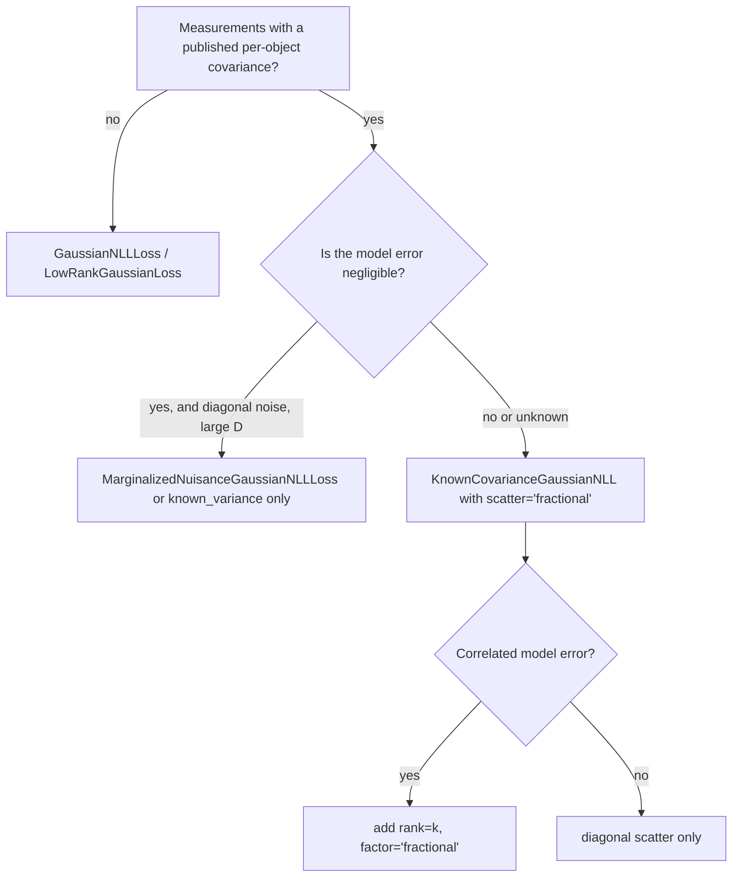

# Known covariance plus learned model covariance

> ← [Linear-Nuisance Marginal Likelihood](linear_nuisance.md) | [Outlier-Resistant Losses](robust.md) →

`known_covariance_gaussian_nll` and `KnownCovarianceGaussianNLL` score a model's
predictions of measurements that come with a **published, per-object noise
covariance** — the coefficient covariance of a spectral fit, a photometric error
budget, an astrometric solution — while learning the part of the residual the
published covariance does not describe: the model's own error. The likelihood is
exact Gaussian with total covariance $C_{\text{known}} + C_{\text{model}}$; one
batched Cholesky factorisation per row, missing dimensions marginalised exactly.

| # | Reference |
|:-:|:----------|
| 1 | Hogg, D. W., Bovy, J. & Lang, D. (2010). *Data analysis recipes: fitting a model to data*. arXiv:1008.4686. (intrinsic scatter added to known errors) |
| 2 | Laroche, A. & Speagle, J. S. (2023). *Closing the stellar labels gap: an unsupervised, generative model for Gaia BP/RP spectra*. arXiv:2307.06378. (learned model scatter for XP spectra) |
| 3 | Zhang, X., Green, G. M. & Rix, H.-W. (2023). *Parameters of 220 million stars from Gaia BP/RP spectra*. MNRAS 524, 1855. (forward model scored with the published XP covariances) |
| 4 | van der Sluis, A. (1969). *Condition numbers and equilibration of matrices*. Numer. Math. 14, 14–23. |
| 5 | Higham, N. J. (2002). *Accuracy and Stability of Numerical Algorithms*, 2nd ed., SIAM, ch. 10. (backward stability of Cholesky) |

→ API: [`known_covariance_gaussian_nll`, `KnownCovarianceGaussianNLL`, `KnownCovarianceGaussianResult`](../api/losses.md#gaussian-heteroscedastic)

---

## Model and objective

For one row with residual $r = y - \hat y \in \mathbb R^D$ and observed dimensions $o$
($n = |o|$),

$$
r \sim \mathcal N\!\left(0,\; C\right),\qquad
C = C_{\text{known}} + \underbrace{\operatorname{diag}(s^2) + UU^\top}_{C_{\text{model}}},
$$

$$
-\log p(r_o) = \tfrac12\Big[\,r_o^\top C_{oo}^{-1} r_o + \log\lvert C_{oo}\rvert + n\log 2\pi\,\Big].
$$

$C_{\text{known}}$ is given per row (`known_covariance`, `[B, D, D]` or shared `[D, D]`)
or as its diagonal (`known_variance`). $C_{\text{model}}$ is the sum of the terms
passed per row (`model_scale` $s$, `model_factor` $U$, e.g. predicted by a network)
and the terms the loss learns itself:

| `scatter` / `factor` | Learned model covariance | Parameters |
|:---------------------|:-------------------------|:-----------|
| `scatter="none"` (default) | — | — |
| `scatter="constant"` | $\operatorname{diag}(b^2)$ | $b = e^{\beta}\in\mathbb R^D_{>0}$ |
| `scatter="fractional"` | $\operatorname{diag}\big((a\odot\hat y)^2 + b^2\big)$ | $a = e^{\alpha}$, $b = e^{\beta}$ |
| `rank=k`, `factor="fractional"` | $UU^\top$, $U = \hat y\odot V$ | $V\in\mathbb R^{D\times k}$ |
| `rank=k`, `factor="constant"` | $UU^\top$, $U = V$ | $V\in\mathbb R^{D\times k}$ |

The fractional diagonal adds an independent multiplicative error ($a$, relative to
the prediction) and an additive one ($b$) **in variance**. It is smooth in $\hat y$,
so second derivatives exist everywhere: Newton-type inference over the model inputs
(for example [`maximize_score`](../methods/likelihood_inference.md)) can use it,
which $a\lvert\hat y\rvert + b$ does not allow at $\hat y = 0$. The fractional factor
$\hat y\odot V$ is the covariance of correlated multiplicative errors
$\hat y_i\,\varepsilon_i$ with $\operatorname{Cov}(\varepsilon) = VV^\top$, e.g. a
calibration error that scales with flux. `learn_floor=False` fixes $b$ at
`init_floor`, which may be 0.

The per-row result (`known_covariance_gaussian_nll`, `KnownCovarianceGaussianNLL.evaluate`)
also carries $\chi^2 = r_o^\top C_{oo}^{-1}r_o$, $\log\lvert C_{oo}\rvert$, $n$ (`dof`)
and, with `return_whitened=True`, the whitened residual $w = L^{-1}r$
($C_{oo} = LL^\top$, original feature order, 0 at masked dimensions). With a correct
model $w\sim\mathcal N(0, I_n)$ and $\chi^2\sim\chi^2_n$: $\chi^2/n$ binned by
signal-to-noise is the calibration diagnostic of the noise model.

!!! warning "Why a learned, fractional term and not a variance floor"
    With model error larger than the noise (bright objects: the model cannot
    reproduce the data to the precision of their errors), weighting by the
    published covariance alone concentrates the loss on the objects and directions
    the model fits worst; generalised least squares with a misspecified covariance
    can be worse than unweighted least squares. A fixed absolute floor
    $C_{\text{known}} + c\,I$ fixes that but erases the noise model wherever the
    published errors are below $c$, which turns the likelihood into a
    constant-weight squared error. Published covariances usually describe random
    errors only; calibration systematics scale with the signal. Learning
    $C_{\text{model}}$ by maximum likelihood, with a fractional term, keeps the
    noise model where it dominates and absorbs the model error where it does not.

### Masks: exact marginalisation

`mask` (`True` = observed, `[B, D]` or `[D]`) marginalises the masked dimensions: the
Gaussian marginal of $r_o$ has covariance $C_{oo}$, the principal submatrix. Rows are
padded to a common size by giving each masked coordinate unit variance, zero
covariance and zero residual in every term; the padded matrix is a permutation of
$\operatorname{blockdiag}(C_{oo}, I)$, so its factor restricted to the observed rows
is the factor of $C_{oo}$ and the padding adds nothing to $\chi^2$ or
$\log\lvert C\rvert$. Values at masked positions (including `NaN`) are ignored and get
zero gradient. A row with nothing observed has `nll = 0` and is left out of the
`"mean"` reduction.

### Numerics and fail-closed conditions

The total covariance is **equilibrated** before factorisation: $C = D^{1/2}RD^{1/2}$
with $D = \operatorname{diag}(C)$, $R$ of unit diagonal (Jacobi scaling, within a
factor $n$ of the optimal diagonal scaling for the condition number; van der Sluis
1969). Cholesky is backward stable on $R$, so the factorisation error depends on the
conditioning of the correlation structure, not on the units of the features: a float32
evaluation of a covariance whose feature scales span $10^{-4}$–$10^{4}$ agrees with
float64 to $10^{-4}$ (tested), and a $10^{12}$-conditioned float64 matrix matches
50-digit arithmetic. Pass `compute_dtype=torch.float64` to factorise float32 inputs in
float64 (not on MPS).

| Condition | Behaviour |
|:----------|:----------|
| `known_covariance` asymmetric beyond $\sqrt{\epsilon}$ of its dtype (per-row max norm) | `ValueError`; within the tolerance one triangle is used |
| non-finite known covariance / variance / model terms on observed entries; negative `known_variance` | `ValueError` |
| non-positive total variance on an observed dimension | `ValueError` |
| $R$ not numerically positive definite, `max_jitter = 0` (default) | `ValueError` |
| same, `max_jitter > 0` | $R + \epsilon I$ for the failing rows only, $\epsilon$ the smallest power of ten in $[\max(16\varepsilon_{\text{mach}}, 10\,\text{jitter}), \text{max\_jitter}]$ that factorises; reported per row in `result.jitter` |
| non-finite residual on an observed dimension | propagates to `NaN` |

All checks of a call share one host synchronisation; the jitter retry adds one per
level tried. A singular known covariance does not need jitter when a model floor
($b > 0$) is present: $C_{\text{known}} + \operatorname{diag}(b^2)$ is positive
definite.

!!! info "Diagonal case and large $D$"
    With only diagonal terms (no dense known covariance, no factor, no whitened
    output) the loss is evaluated elementwise and equals
    [`NoisyTargetGaussianNLL`](uncertain_ground_truth.md) / `GaussianNLLLoss` with
    variance `known_variance + s**2`, summed over features (tested). A diagonal known
    covariance plus a low-rank term is the linear-nuisance marginal with
    $a\sim\mathcal N(0, I)$: for large $D$ use
    [`marginalize_linear_nuisance`](linear_nuisance.md)`(y_pred, target, 1 / (known_variance + s**2), U, prior_precision=1.0)`,
    $O(Dk^2)$ per row instead of $O(D^3)$ (the two agree to $10^{-11}$, tested).

---

## Example: learn the model scatter on top of known noise

```python
import torch

from torchregress.losses import KnownCovarianceGaussianNLL, known_covariance_gaussian_nll

torch.manual_seed(0)
n, d = 2000, 4
x = torch.randn(n, 3)
true_w = torch.randn(3, d)
mu = 5.0 + x @ true_w                                  # true signal

# Per-row known noise covariance (correlated) ...
a = torch.randn(n, d, d) * 0.1
known = a @ a.mT + 0.01 * torch.eye(d)
noise = (torch.linalg.cholesky(known) @ torch.randn(n, d, 1)).squeeze(-1)
# ... plus 5 % fractional model error the published covariance does not describe.
y = mu + noise + 0.05 * mu * torch.randn(n, d)

model = torch.nn.Linear(3, d)
with torch.no_grad():  # warm-start the mean (a variance learned against a bad mean absorbs it)
    design = torch.cat([x, torch.ones(n, 1)], dim=1)
    coef = torch.linalg.lstsq(design, y).solution
    model.weight.copy_(coef[:3].T)
    model.bias.copy_(coef[3])
loss_fn = KnownCovarianceGaussianNLL(d, scatter="fractional", init_fraction=0.01)
opt = torch.optim.Adam([*model.parameters(), *loss_fn.parameters()], lr=0.05)
for _ in range(200):
    opt.zero_grad()
    loss = loss_fn(model(x), y, known_covariance=known)
    loss.backward()
    opt.step()

fraction = torch.exp(loss_fn.log_fraction).detach()
print("learned fractional scatter:", fraction)          # close to 0.05

# Calibration diagnostic: chi2 / dof with and without the model term.
with torch.no_grad():
    pred = model(x)
    variance, _ = loss_fn.model_covariance_terms(pred)
    with_model = known_covariance_gaussian_nll(y - pred, known, model_scale=variance.sqrt())
    known_only = known_covariance_gaussian_nll(y - pred, known)
print("chi2/dof, known + model:", float(with_model.chi2.sum() / with_model.dof.sum()))  # ~1
print("chi2/dof, known only:   ", float(known_only.chi2.sum() / known_only.dof.sum()))  # >> 1
assert abs(float(with_model.chi2.sum() / with_model.dof.sum()) - 1.0) < 0.15
```

Missing measurements are passed as a mask (`loss_fn(..., mask=observed)`), and a
model term predicted by a network is passed per row (`model_scale=head(x)`); it adds
to the learned one.

---

## Computation and scaling

Every row is factorised in one batched `torch.linalg.cholesky_ex` call on the inputs'
device and dtype; the cost is $O(BD^3/3)$ plus $O(BD^2k)$ for a rank-$k$ factor. Forward
+ backward w.r.t. the predictions and the learned scatter, $D = 55$, 10 % masked,
2 CPU threads on a shared 4-CPU host (`tools/benchmark_known_covariance.py`;
comparator: `torch.distributions.MultivariateNormal` on the total covariance assembled
by the caller, which has no masks, no equilibration and no validation):

| $B$ | rank | dtype | rows/s | `MultivariateNormal`, rows/s |
|--:|--:|:--|--:|--:|
| 1 024 | 0 | float32 | 8 900 | 10 900 |
| 1 024 | 2 | float64 | 5 700 | 8 500 |
| 8 192 | 0 | float32 | 7 100 | 12 900 |
| 8 192 | 0 | float64 | 3 300 | 5 700 |
| 8 192 | 2 | float64 | 3 000 | 5 000 |

The overhead over the bare factorisation (about 1.6×) is the padding, the
equilibration and the validation passes over the `[B, D, D]` matrices.

---

## When to use which

| Loss | Covariance | Learned part | Masks | Use for |
|:-----|:-----------|:-------------|:------|:--------|
| `GaussianNLLLoss`, `NoisyTargetGaussianNLL` | diagonal | predicted variance | per element | independent errors |
| `MultivariateGaussianLoss` | full, given | optional diagonal adjustment | whole rows | small $D$, covariance given |
| `LowRankGaussianLoss` | $WW^\top + \operatorname{diag}(d)$, predicted | all of it | whole rows | learned correlated outputs |
| [`MarginalizedNuisanceGaussianNLLLoss`](linear_nuisance.md) | known diagonal $+\,UP^{-1}U^\top$, $U$ given | — | per sample | continuum / baseline marginalisation, large $D$ |
| [`MarginalizedMultiSourceGaussianNLLLoss`](multisource.md) | $R + HLL^\top H^\top$ | latent $L$ | per measurement | several sources of one latent |
| **`KnownCovarianceGaussianNLL`** | known dense or diagonal $+\,\operatorname{diag}(s^2) + UU^\top$ | fractional / constant scatter, low-rank factor | per dimension, exact | published per-object covariances with model error to learn; $\chi^2$ and whitened-residual diagnostics |



!!! tip "Check calibration downstream, not on the training loss"
    A noise-aware likelihood down-weights noisy entries, so it scores worse than an
    unweighted loss on unweighted metrics of noisy targets *by construction*.
    Judge it by $\chi^2/\text{dof}$ of held-out whitened residuals binned by
    signal-to-noise and by the downstream quantities the model is for.
