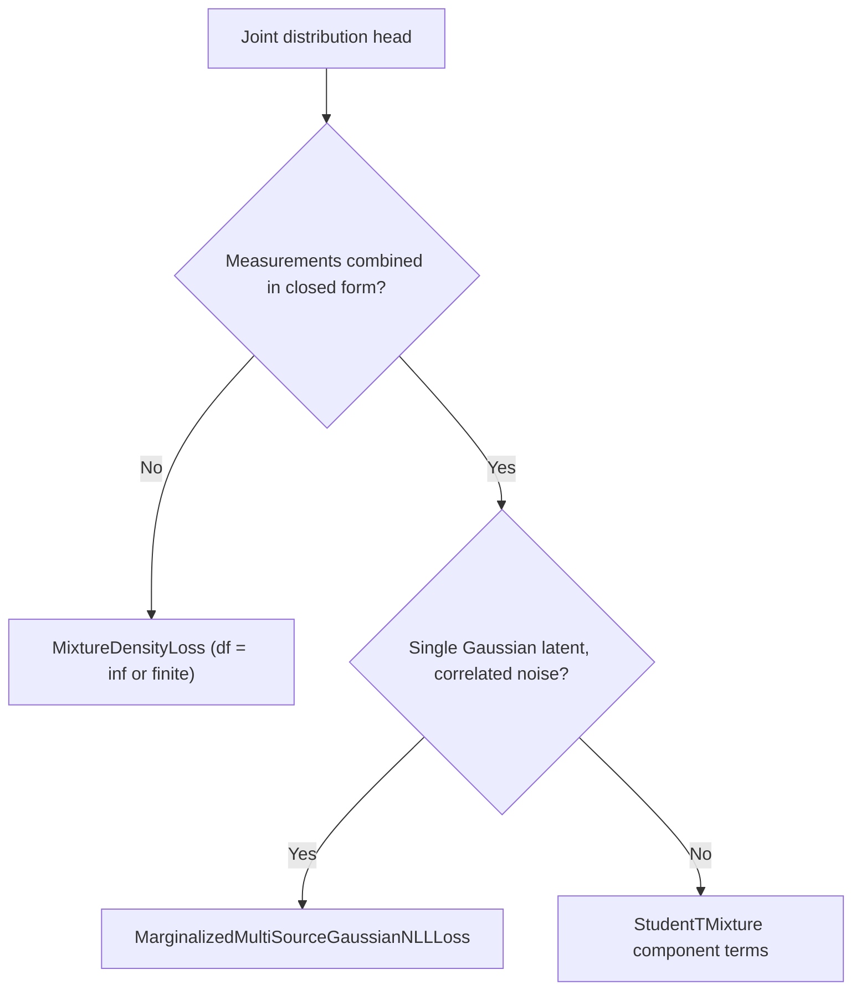

# Student-t Mixtures

> ← [Mixture Density Networks](mdn.md) | [Normalizing Flows](nflows.md) →

`StudentTMixture` is a batch of $K$-component mixtures of multivariate Student-$t$ distributions over a $P$-vector. It is the distribution behind `MixtureDensityLoss` (Gaussian components are its $\nu = \infty$ case, not a separate implementation) and it adds what a closed-form survey likelihood needs: partially observed targets, noisy linear observations, censored limits, conditioning on a measured coordinate, and exact marginal CDFs and quantiles.

!!! abstract "When to use"
    When a network predicts a joint distribution over several labels and that prediction must be combined with noisy, linearly mapped, partially missing or censored measurements in closed form, and a single symmetric (Gaussian or Student-$t$) head is too rigid: skewed, heavy-tailed or bimodal posteriors.

---

## Mathematical Background

The density of one row is

$$
p(x) = \sum_{k=1}^K w_k\, t_{\nu_k}(x \mid \mu_k, \Sigma_k),
$$

$$
t_\nu(x \mid \mu, \Sigma) = \frac{\Gamma\!\left(\frac{\nu+P}{2}\right)}{\Gamma\!\left(\frac{\nu}{2}\right)(\nu\pi)^{P/2}\,|\Sigma|^{1/2}}\left(1 + \frac{(x-\mu)^\top\Sigma^{-1}(x-\mu)}{\nu}\right)^{-\frac{\nu+P}{2}}.
$$

$\Sigma_k$ is the *scale* matrix (the covariance is $\tfrac{\nu}{\nu-2}\Sigma_k$ for $\nu > 2$) and $\nu_k = \infty$ is the Gaussian $\mathcal N(\mu_k, \Sigma_k)$. The $\nu$-dependent normaliser $\log\Gamma(\tfrac{\nu+d}{2}) - \log\Gamma(\tfrac{\nu}{2}) - \tfrac d2\log\tfrac{\nu}{2}$ is evaluated in float64 with a Stirling-difference series for $\nu \ge 100$, so the density converges to the Gaussian as $O(1/\nu)$ without a numerical floor.

The scale matrix can be given in three forms:

| Argument | Meaning | Notes |
|:---------|:--------|:------|
| `scale_tril` | $\Sigma_k = L_k L_k^\top$ | Needed form for $A\Sigma A^\top$; returned by `condition` |
| `precision_tril` | $\Sigma_k^{-1} = T_k T_k^\top$ | `MixtureDensityLoss` full heads; log density linear in $T_k$ |
| `scale_diag` | $\Sigma_k = \mathrm{diag}(s_k^2)$ | $O(P)$ memory per component |

### Partially observed targets

With a boolean mask $o$ per row, the density of the observed coordinates is the exact marginal, a $d$-variate $t_{\nu_k}(\mu_{k,o}, \Sigma_{k,oo})$ with $d = |o|$. Rows with nothing observed contribute exactly $0$.

### Noisy linear observations

For observations $z = A_k x + b_k + e$, $e \sim \mathcal N(0, \mathrm{diag}(n))$, with a design $A_k$ and offset $b_k$ per component (a nonlinear map $f$ linearised at $\mu_k$ has $A_k = J_k$ and $b_k = f(\mu_k) - J_k\mu_k$), each component gives

$$
z \mid k \sim t_{\nu_k}\!\left(A_k\mu_k + b_k,\; A_k\Sigma_k A_k^\top + \mathrm{diag}(n)\right)
$$

over the valid entries of $z$. For $D \le P$ observations this is one $D\times D$ Cholesky per row and component; for $D > P$ it is the information form with one $P\times P$ Cholesky of $I + W^\top W$, $W = \mathrm{diag}(n)^{-1/2} A_k S_k$ ($\Sigma_k = S_k S_k^\top$), whose quadratic form is the sum of squares $\lVert u - W\xi\rVert^2 + \lVert\xi\rVert^2$ rather than a difference of large terms. Invalid entries get zero precision, so padding costs nothing.

!!! warning "Gaussian noise inside the t"
    For finite $\nu$ the formula above treats the noise as sharing the Student-$t$ mixing variable of $x$: the density of $A x + e$ with *independent* Gaussian $e$ is not a Student-$t$. It is exact for $\nu = \infty$ and when the noise is negligible against $A\Sigma A^\top$. When the noise dominates, the exact density is closer to Gaussian and the approximation keeps Student-$t$ tails (more tolerant of outlying measurements).

### Censored limits

A 1-D observation $y = a_k^\top x + b_k + e$ known only to satisfy $y \le \ell$ (upper limit) contributes, under component $k$,

$$
\log P(y \le \ell \mid k) = \log T_{\nu_k}\!\left(\frac{\ell - a_k^\top\mu_k - b_k}{\sqrt{a_k^\top\Sigma_k a_k + n}}\right),
$$

with the exact Student-$t$ log-CDF (regularised incomplete beta, accurate deep in both tails) and $\log\Phi$ for $\nu = \infty$. Lower limits use the symmetric form.

### Combining terms

In a mixture the observations of a row are independent *given the component*, so their log terms are added per component and only then mixed:

$$
\log p(\text{row}) = \log\sum_k w_k \exp\!\Big(\textstyle\sum_{\text{terms}} \log p_k(\text{term})\Big).
$$

This is `mixture_log_prob(component_terms)`; all likelihood methods return per-component terms of shape `[..., K]`.

### Conditioning on a measured coordinate

Observing $y = x_j + e$, $e \sim \mathcal N(0, n)$ (noise inside the $t$), with $s = \Sigma_{jj} + n$, $c = \Sigma_{:,j}$ and $q = (y - \mu_j)^2/s$, gives per component \[1, 2\]

$$
x \mid y, k \sim t_{\nu+1}\!\left(\mu + c\,\frac{y - \mu_j}{s},\; \frac{\nu + q}{\nu + 1}\Big(\Sigma - \frac{c\,c^\top}{s}\Big)\right),
\qquad
w_k' \propto w_k\, t_{\nu_k}\!\big(y \mid \mu_{kj}, \sqrt{s_k}\big).
$$

The conditional Cholesky factor is $L G$, where $G$ is the closed-form Cholesky factor of $I - v v^\top$, $v = L_{j,:}/\sqrt{s}$, built from tail sums $t_i = (n + \sum_{m > i} L_{jm}^2)/s$. No $\Sigma - cc^\top/s$ is formed, so a nearly exact measurement keeps full relative accuracy.

### Marginal CDF and quantiles

The marginal of coordinate $p$ is a univariate mixture with CDF $F_p(x) = \sum_k w_k T_{\nu_k}\big((x - \mu_{kp})/\sigma_{kp}\big)$, $\sigma_{kp} = \sqrt{\Sigma_{k,pp}}$. Quantiles solve $F_p(x) = q$ by safeguarded Newton iteration: a bracket guaranteed by a Student-$t$ tail bound ($T_\nu(-c) \le G_\nu c^{-\nu}$ for $c^2 \ge \nu$) for every component, Newton steps with the exact mixture density, bisection whenever a step leaves the bracket or stalls, and an active set so converged elements stop costing CDF evaluations. Nothing is clipped: probabilities are `logsumexp`s of exact log-CDFs.

---

## Usage

```python
import math

import torch

from torchregress.losses import StudentTMixture

torch.manual_seed(0)
B, K, P = 256, 3, 5
logits = torch.randn(B, K)
loc = torch.randn(B, K, P)
tril = torch.randn(B, K, P, P).tril(-1) * 0.2 + torch.diag_embed(torch.rand(B, K, P) + 0.3)
mix = StudentTMixture(logits, loc, scale_tril=tril, df=5.0)

# Own labels, some missing.
y = torch.randn(B, P)
observed = torch.rand(B, P) > 0.3
own = mix.component_log_prob(torch.where(observed, y, torch.nan), mask=observed)  # [B, K]

# Survey records: z = J_k x + b_k + e, linearised per component, padded to D slots.
D = 8
J = torch.randn(B, K, D, P) / math.sqrt(P)
b = torch.randn(B, K, D)
z = torch.randn(B, D)
noise = torch.full((B, D), 0.05)
valid = torch.rand(B, D) > 0.2
records = mix.component_observation_log_prob(z, J, noise, offset=b, valid=valid)

# One survey reports only an upper limit on a mapped label.
a = torch.zeros(B, 1, 1, P)
a[..., 2] = 1.0
limit = torch.full((B, 1), -2.5)
censored = mix.component_censored_log_prob(limit, a, torch.full((B, 1), 0.01), upper=True)

nll = -mix.mixture_log_prob(own + records + censored).mean()

# Inference: condition on a measured coordinate, then exact marginal quantiles.
posterior = mix.condition(4, value=torch.randn(B), noise_var=torch.full((B,), 0.1))
q16, q50, q84 = posterior.marginal_quantile([0.16, 0.5, 0.84]).unbind(-1)  # [B, P] each
draws = posterior.sample((1000,))  # [1000, B, P]
```

For a network head, `MixtureDensityLoss(..., df=5.0)` builds the same distribution from a flat output vector; `loss_fn.distribution(y_pred)` returns it. See [Mixture Density Networks](mdn.md#student-t-components).

### Methods

| Method | Returns | Semantics |
|:-------|:--------|:----------|
| `component_log_prob(value, mask=None)` | `[..., K]` | $\log t_{\nu_k}$ of full or masked vectors |
| `log_prob(value, mask=None)` | `[...]` | Mixture log density |
| `component_observation_log_prob(value, design, noise_var, *, offset=None, valid=None)` | `[..., K]` | Noisy linear observations, `design` `[..., K or 1, D, P]` |
| `component_censored_log_prob(limit, design, noise_var, *, offset=None, upper=True, valid=None)` | `[..., K]` | Sum of censored 1-D terms, `design` `[..., K or 1, M, P]` |
| `mixture_log_prob(component_log_prob)` | `[...]` | $\log\sum_k w_k e^{c_k}$ |
| `condition(index, value, noise_var)` | `StudentTMixture` | Conditional mixture, `df + 1` on conditioned rows |
| `marginal_cdf(value)` | `[..., P]` | Per-coordinate mixture CDF (grids broadcast, chunked) |
| `marginal_quantile(q, *, tol=1e-12, max_iter=100)` | `[..., P]` or `[..., P, Q]` | Per-coordinate quantiles |
| `sample(sample_shape)` | `sample_shape + [..., P]` | Draws (not reparameterised) |
| `mean`, `variance`, `covariance_matrix` | | Mixture moments (`inf` for $\nu \le 2$, NaN for $\nu \le 1$) |
| `scale_tril`, `component_scale`, `log_weights`, `loc`, `df` | | Parameters |

---

## When to use which

| Need | Use | Why |
|:-----|:----|:----|
| Gaussian MDN head | `MixtureDensityLoss()` | Default; `df=math.inf` |
| Heavy tails / outlying labels in an MDN | `MixtureDensityLoss(df=5.0)` or `learn_df=True` | Student-$t$ components down-weight outliers |
| Joint head combined with noisy, linearly mapped, censored measurements | `StudentTMixture` component terms + `mixture_log_prob` | Closed form per component, batched over $K$ |
| One Gaussian latent, full measurement covariance, jitter control | [`MarginalizedMultiSourceGaussianNLLLoss`](multisource.md) | Gaussian-only, correlated noise |
| Exact quantiles of a mixture head | `marginal_quantile` | No Monte Carlo error |
| Very flexible, non-elliptical shapes | [Normalizing flows](nflows.md) | No closed-form conditioning |



---

## Performance

All operations fold the $K$ components into the batch of the linear algebra (no Python loop over components or rows). CPU timings (4 threads, float32, `tools/benchmark_student_t_mixture.py`), forward + backward of the observation NLL with per-component designs, against a per-component Python loop with a dense $D \times D$ Cholesky:

| $B$ | $K$ | $P$ | $D$ | observations (s) | per-component loop (s) | `log_prob` (s) | `condition` (s) | 3 quantiles × $P$ (s) |
|---:|---:|---:|---:|---:|---:|---:|---:|---:|
| 1,000 | 1 | 5 | 5 | 0.002 | 0.002 | 0.001 | 0.001 | 0.02 |
| 1,000 | 1 | 5 | 20 | 0.004 | 0.006 | 0.001 |  |  |
| 1,000 | 1 | 16 | 5 | 0.002 | 0.002 | 0.002 | 0.002 | 0.09 |
| 1,000 | 1 | 16 | 20 | 0.008 | 0.008 | 0.002 |  |  |
| 1,000 | 3 | 5 | 5 | 0.004 | 0.005 | 0.002 | 0.001 | 0.11 |
| 1,000 | 3 | 5 | 20 | 0.008 | 0.024 | 0.001 |  |  |
| 1,000 | 3 | 16 | 5 | 0.004 | 0.006 | 0.004 | 0.004 | 0.22 |
| 1,000 | 3 | 16 | 20 | 0.019 | 0.018 | 0.003 |  |  |
| 1,000 | 8 | 5 | 5 | 0.009 | 0.013 | 0.002 | 0.002 | 0.16 |
| 1,000 | 8 | 5 | 20 | 0.015 | 0.048 | 0.002 |  |  |
| 1,000 | 8 | 16 | 5 | 0.009 | 0.016 | 0.009 | 0.015 | 0.57 |
| 1,000 | 8 | 16 | 20 | 0.045 | 0.047 | 0.006 |  |  |
| 10,000 | 1 | 5 | 5 | 0.011 | 0.010 | 0.003 | 0.003 | 0.09 |
| 10,000 | 1 | 5 | 20 | 0.017 | 0.065 | 0.003 |  |  |
| 10,000 | 1 | 16 | 5 | 0.021 | 0.011 | 0.007 | 0.011 | 0.31 |
| 10,000 | 1 | 16 | 20 | 0.051 | 0.074 | 0.007 |  |  |
| 10,000 | 3 | 5 | 5 | 0.030 | 0.031 | 0.007 | 0.005 | 0.64 |
| 10,000 | 3 | 5 | 20 | 0.059 | 0.191 | 0.007 |  |  |
| 10,000 | 3 | 16 | 5 | 0.031 | 0.047 | 0.033 | 0.032 | 2.02 |
| 10,000 | 3 | 16 | 20 | 0.178 | 0.186 | 0.022 |  |  |
| 10,000 | 8 | 5 | 5 | 0.075 | 0.091 | 0.015 | 0.011 | 1.80 |
| 10,000 | 8 | 5 | 20 | 0.166 | 0.381 | 0.015 |  |  |
| 10,000 | 8 | 16 | 5 | 0.110 | 0.218 | 0.102 | 0.139 | 5.27 |
| 10,000 | 8 | 16 | 20 | 0.963 | 0.786 | 0.100 |  |  |
| 100,000 | 1 | 5 | 5 | 0.106 | 0.102 | 0.021 | 0.025 | 1.00 |
| 100,000 | 1 | 5 | 20 | 0.213 | 0.740 | 0.018 |  |  |
| 100,000 | 1 | 16 | 5 | 0.136 | 0.145 | 0.117 | 0.156 | 4.74 |
| 100,000 | 1 | 16 | 20 | 0.840 | 0.896 | 0.127 |  |  |
| 100,000 | 3 | 5 | 5 | 0.332 | 0.307 | 0.061 | 0.073 | 6.04 |
| 100,000 | 3 | 5 | 20 | 0.665 | 2.375 | 0.065 |  |  |
| 100,000 | 3 | 16 | 5 | 0.506 | 0.624 | 0.401 | 0.530 | 18.72 |
| 100,000 | 3 | 16 | 20 | 2.268 | 2.576 | 0.351 |  |  |
| 100,000 | 8 | 5 | 5 | 1.018 | 0.976 | 0.237 | 0.254 | 18.99 |
| 100,000 | 8 | 5 | 20 | 2.110 | 6.349 | 0.234 |  |  |
| 100,000 | 8 | 16 | 5 | 1.282 | 2.297 | 1.081 | 1.448 | 51.73 |
| 100,000 | 8 | 16 | 20 | 6.724 | 7.742 | 0.991 |  |  |

Forward + backward for the observation, loop and `log_prob` columns; `condition` and quantiles without gradients (they do not depend on $D$). With $D \le P$ the batched direct form and the loop cost about the same (the loop is already batched over rows); with $D > P$ the information form is 2-3.5x faster at $P = 5$ and on par at $P = 16$. Quantiles: about 2 s for $B = 10^4$, $K = 8$, $P = 5$, against 10 s for a 45-step NumPy/SciPy bisection, with a $10^{-12}$ tolerance instead of $60\sigma/2^{45}$.

!!! tip "Memory"
    The observation term allocates `[B, K, D, max(D, P)]` temporaries; chunk very large inference batches. `marginal_cdf` and `marginal_quantile` chunk internally (about $2^{20}$ Student-$t$ CDF evaluations per chunk).

!!! info "Failure modes"
    Inputs are not floored or jittered. A non-positive-definite observation covariance (e.g. zero noise with a rank-deficient $A\Sigma A^\top$) gives `NaN` for that row and component instead of a silently regularised value. Rows where the conditioning value or noise is not finite are returned unchanged.

---

## Next steps

- [Mixture Density Networks](mdn.md) — the network head, `df` and `learn_df`
- [Multi-source Gaussian](multisource.md) — Gaussian latent with correlated measurement noise
- [Censored regression](censored.md) — censored Gaussian losses for scalar targets
- [API reference](../api/losses.md#quantile-expectile-distributional)

---

## References

| # | Reference |
|:-:|:----------|
| 1 | S. Kotz and S. Nadarajah. *Multivariate t Distributions and Their Applications*. Cambridge University Press, **2004**. |
| 2 | P. Ding. ["On the conditional distribution of the multivariate t distribution."](https://doi.org/10.1080/00031305.2016.1164756) *The American Statistician* 70(3):293–295, **2016**. |
| 3 | K.L. Lange, R.J.A. Little and J.M.G. Taylor. ["Robust statistical modeling using the t distribution."](https://doi.org/10.1080/01621459.1989.10478852) *JASA* 84(408):881–896, **1989**. |
| 4 | C.M. Bishop. ["Mixture Density Networks."](https://publications.aston.ac.uk/id/eprint/373/) NCRG/94/004, **1994**. |
| 5 | W.H. Press et al. *Numerical Recipes*, 3rd ed., §6.4 (incomplete beta) and §9.4 (safeguarded Newton, `rtsafe`). Cambridge University Press, **2007**. |
