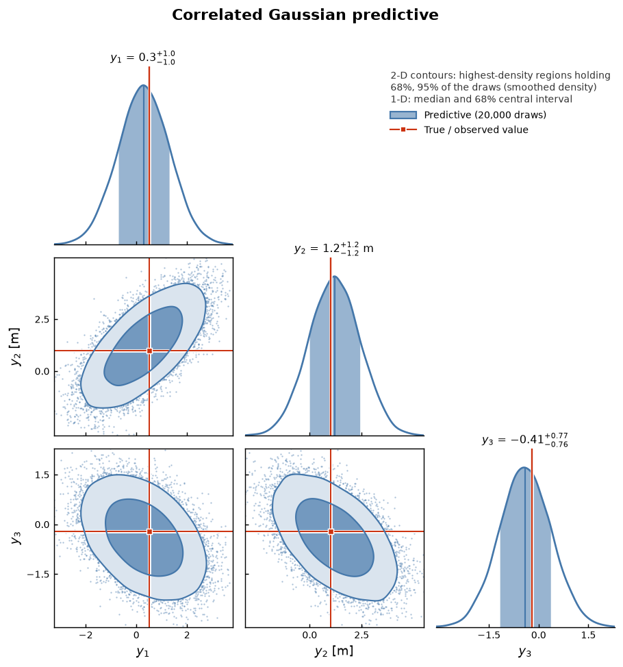
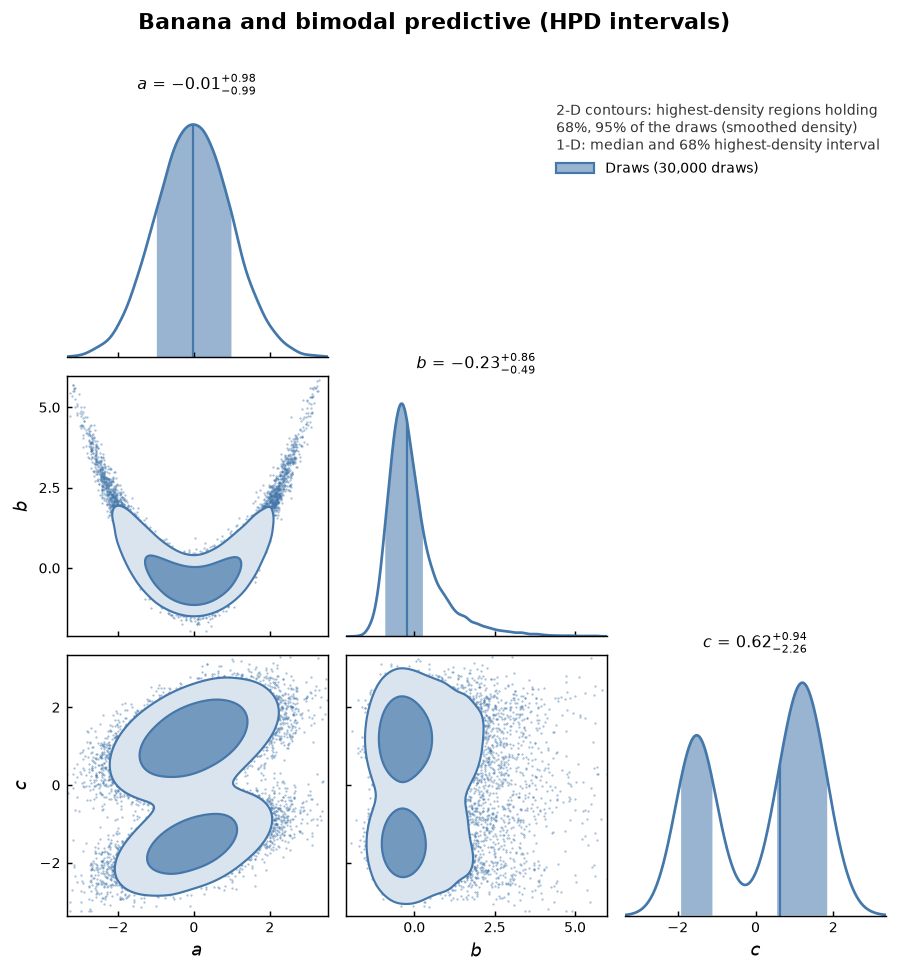
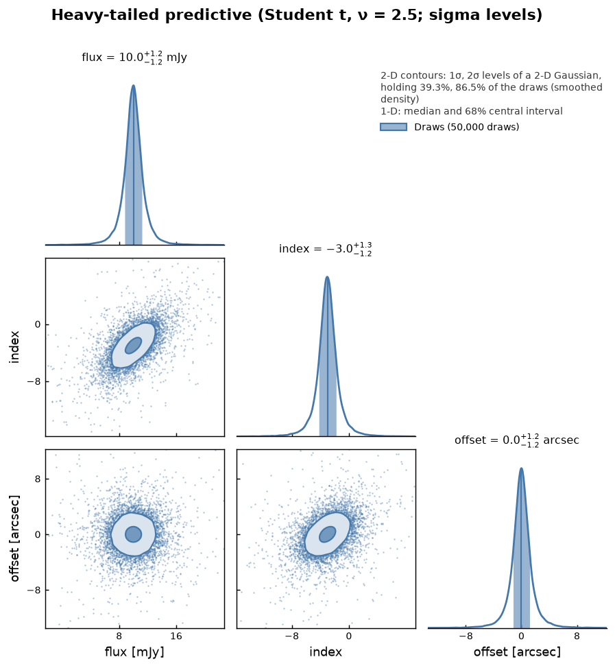
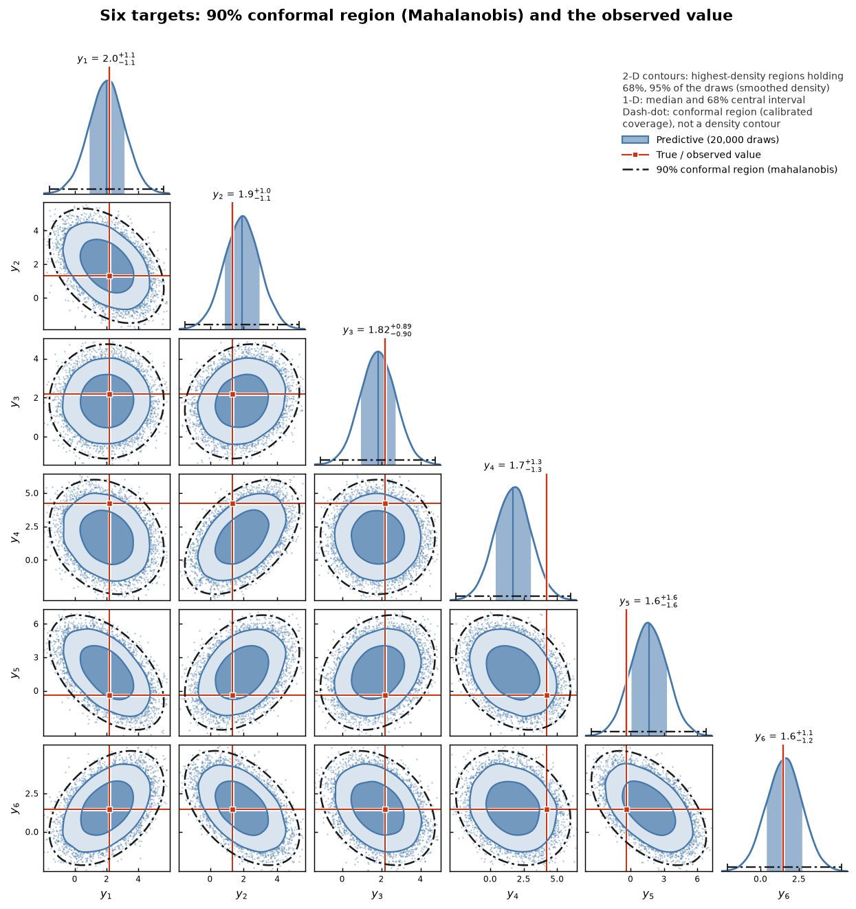
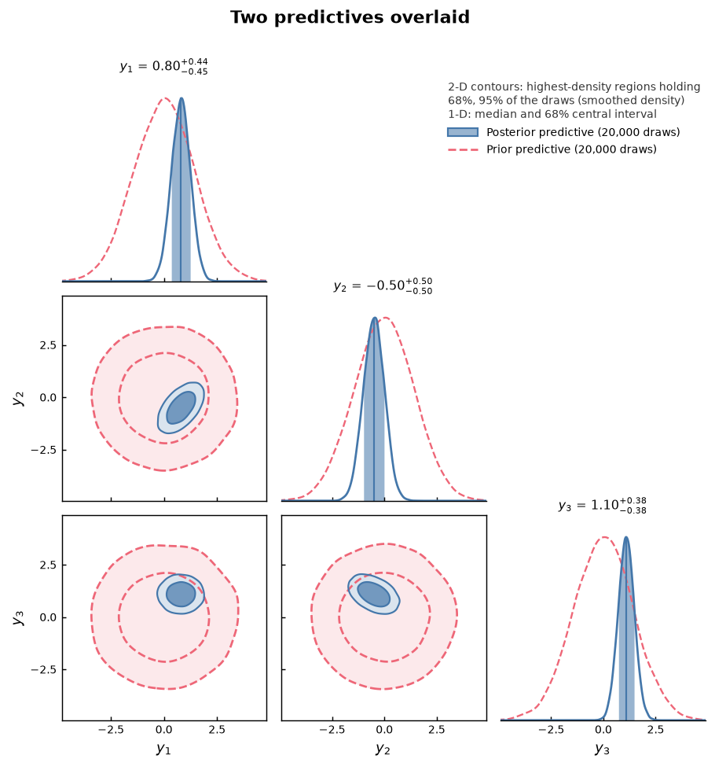
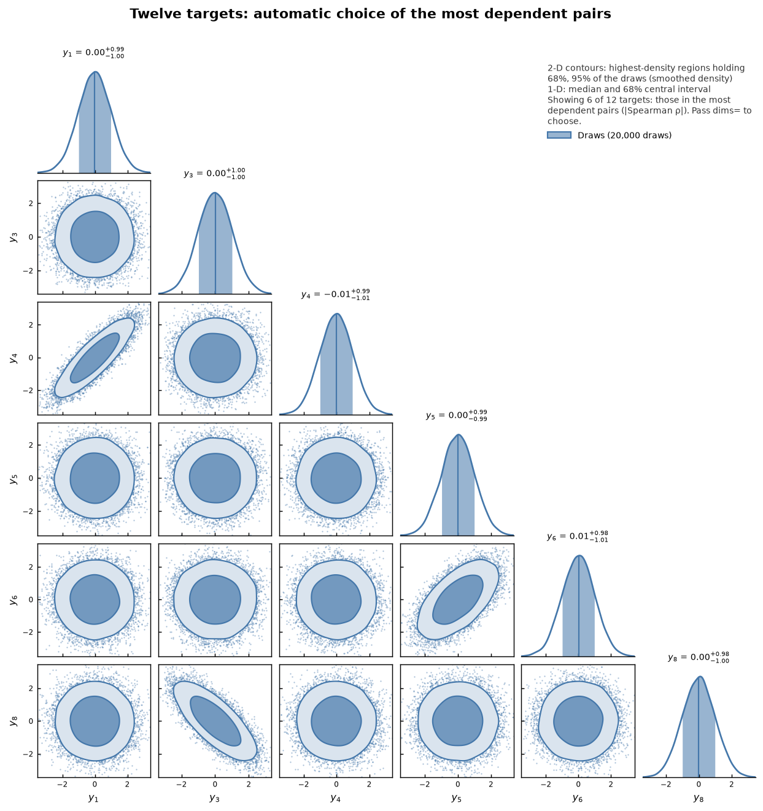
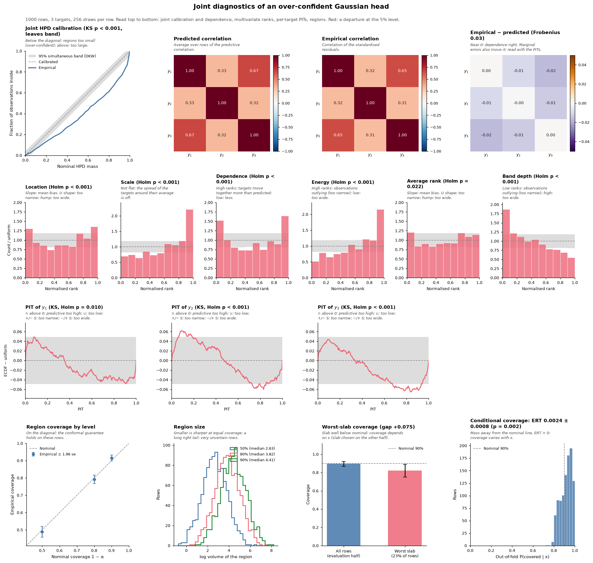

# Visualization & Diagnostics

> ← [PPI Inference](inference.md) | [Methods Overview](index.md) →

→ API: [Visualization API](../api/viz.md). Gallery: [`examples/viz_diagnostic_gallery.py`](../../examples/viz_diagnostic_gallery.py).

torchregress provides **35 exported visualization helpers** (27 plot functions + 8 styling/layout utilities) across five submodules to help you
diagnose models, monitor training, compare results, and style your output.  All functions
work with standard `matplotlib` axes and support the same styling pipeline.

!!! tip "Run the gallery"
    [`examples/viz_diagnostic_gallery.py`](../../examples/viz_diagnostic_gallery.py) demonstrates
    every function on synthetic data and saves the output to `examples/outputs/`.

---

## Quick Start

```python
from torchregress.viz import set_style, save_figure, plot_residuals

set_style()                                    # consistent look
fig = plot_residuals(y_pred, y_true, return_figure=True)
save_figure(fig, "residuals", formats=["png", "pdf"])
```

Every plot function accepts `ax=` (draw on an existing axes), `return_figure=` (return the `Figure`), and `title=`.

---

## 1. Diagnostic Plots (`torchregress.viz.diagnostic`)

Fourteen functions for diagnosing regression models, residuals, and uncertainty calibration.

### Residual Analysis

| Function | What it shows | When to use |
|:---------|:-------------|:------------|
| `plot_residuals` | Residuals vs predictions + uncertainty bands | First-look at heteroscedasticity and bias |
| `plot_residual_histogram` | Histogram of residuals with KDE overlay | Check normality / symmetry of errors |
| `plot_qq_plot` | Quantile-quantile plot against Gaussian | Confirm normality assumption |

```python
from torchregress.viz import plot_residuals, plot_residual_histogram, plot_qq_plot

plot_residuals(y_pred, y_true, y_pred_std=y_pred_std, clip_outliers=True)
plot_residual_histogram(y_pred, y_true, show_kde=True, return_figure=True)
plot_qq_plot(y_pred, y_true, return_figure=True)
```

### Prediction Intervals & Distribution Comparison

| Function | What it shows | When to use |
|:---------|:-------------|:------------|
| `plot_prediction_intervals` | Point predictions with lower/upper bounds | Visual check of interval quality |
| `plot_distribution_comparison` | Full predictive distribution for individual samples | Probabilistic models (ensembles, BNNs, flows) |

```python
from torchregress.viz import plot_prediction_intervals, plot_distribution_comparison

# For 95% Gaussian intervals
plot_prediction_intervals(y_pred, y_pred - 1.96 * std, y_pred + 1.96 * std, y_true)

# For ensemble / Monte Carlo samples — shape [n_samples, batch_size]
plot_distribution_comparison(predicted_samples, y_true, n_samples_to_show=4, credible_interval=0.95)
```

### Calibration Diagnostics

| Function | What it shows | When to use |
|:---------|:-------------|:------------|
| `plot_reliability_diagram` | Observed vs expected quantile coverage | Quantile-based models |
| `plot_gaussian_reliability_diagram` | Same, for Gaussian mean/std predictions | Heteroscedastic / NLL models |
| `plot_pit_histogram` | Probability Integral Transform histogram | Any distributional model |
| `plot_calibration_curve` | Reliability curve for binary probabilities | Binary classification / probability outputs |

```python
from torchregress.viz import (
    plot_reliability_diagram, plot_gaussian_reliability_diagram,
    plot_pit_histogram, plot_calibration_curve,
)

# Quantile reliability
plot_reliability_diagram({0.1: q10, 0.5: q50, 0.9: q90}, y_true)

# Gaussian reliability
plot_gaussian_reliability_diagram(y_pred, y_pred_std, y_true)

# PIT calibration — uniform = perfectly calibrated
plot_pit_histogram(y_pred, y_pred_std, y_true, n_bins=20)

# Binary probability calibration
plot_calibration_curve(y_pred_probs, y_true_binary)
```

### Advanced Diagnostics

| Function | What it shows | When to use |
|:---------|:-------------|:------------|
| `plot_uncertainty_vs_error` | Predicted uncertainty vs absolute error | Check uncertainty quality |
| `plot_binned_metrics` | Metric values binned by a conditioning variable | Region-specific performance |
| `plot_target_density_error_overlap` | Overlap of target density and prediction error | Distributional fit check |
| `plot_conditional_density_slices` | Predictive density slices at fixed x-values | Understand conditional distributions |
| `plot_censored_survival_curves` | Kaplan-Meier survival curves with censoring | Survival / censored regression |

```python
from torchregress.viz import (
    plot_uncertainty_vs_error, plot_binned_metrics,
    plot_target_density_error_overlap, plot_conditional_density_slices,
    plot_censored_survival_curves,
)

# Are confident predictions actually more accurate?
plot_uncertainty_vs_error(y_pred, y_pred_std, y_true)

# RMSE binned by predicted value
plot_binned_metrics(y_pred, y_pred_std, y_true, metric="rmse")

# Overlap of target density and error distribution
plot_target_density_error_overlap(y_true, y_pred)

# Predictive density at selected x-values (density_fn maps (x, y_grid) -> pdf)
plot_conditional_density_slices(density_fn, x_slices, y_grid, y_true_slices=y_true_at_slices)

# Survival curves for censored data
plot_censored_survival_curves(
    predicted_survival, time_grid, observed_times, censoring_indicators
)
```

---

## 2. Training Monitoring (`torchregress.viz.monitoring`)

Four functions for tracking training progress and tuning hyperparameters.

| Function | What it shows | When to use |
|:---------|:-------------|:------------|
| `plot_learning_curves` | Train/val loss and metrics over epochs | Check for overfitting |
| `plot_validation_metrics` | Multi-metric validation history | Track multiple metrics simultaneously |
| `plot_early_stopping` | Train/val loss with early-stopping point | Determine optimal stopping epoch |
| `plot_lr_find_results` | Loss vs learning rate curve | Pick a good learning rate |

```python
from torchregress.viz import (
    plot_learning_curves, plot_validation_metrics,
    plot_early_stopping, plot_lr_find_results,
)

train_hist = {"loss": train_losses, "rmse": train_rmse}
val_hist = {"loss": val_losses, "rmse": val_rmse}

# Combined train/val curves
plot_learning_curves(train_hist, val_hist, log_scale=["loss"], smoothing=0.2)

# Validation-only metrics
plot_validation_metrics(epochs, val_hist, return_figure=True)

# Early stopping — patience=5 finds the minimum before overfitting
plot_early_stopping(train_losses, val_losses, patience=5)

# LR finder — 'valley' picks the steepest descent point
plot_lr_find_results(lr_values, loss_values, suggestion_method="valley")
```

---

## 3. Results & Comparison (`torchregress.viz.results`)

Eight functions for comparing models, analysing hyperparameters, and presenting findings.

| Function | What it shows | When to use |
|:---------|:-------------|:------------|
| `plot_performance_comparison` | Bar, radar, or heatmap comparison | Compare multiple models / methods |
| `plot_parameter_sensitivity` | Metric vs hyperparameter sweep | Tune architecture or training params |
| `plot_feature_importance` | Horizontal bar chart of importance scores | Interpret model decisions |
| `plot_model_ensemble_contributions` | Per-member contribution bars | Analyse ensemble diversity |
| `plot_risk_coverage_curve` | Risk vs coverage tradeoff | Selective prediction / OOD evaluation |
| `plot_causal_uplift_qini` | Qini curve for uplift modelling | Causal inference evaluation |
| `plot_simex_extrapolation` | SIMEX extrapolation plot | Measurement error correction diagnostics |
| `plot_corner_plot` | Corner plot of draws or a joint predictive | Posterior / joint predictive shape (see [section 4](#4-joint-predictive-plots-corner-plots-and-diagnostics)) |

```python
from torchregress.viz import (
    plot_performance_comparison, plot_parameter_sensitivity,
    plot_feature_importance, plot_model_ensemble_contributions,
    plot_risk_coverage_curve, plot_causal_uplift_qini,
    plot_simex_extrapolation,
)

# Bar / radar / heatmap comparison
metrics = {"Model A": {"RMSE": 0.25, "MAE": 0.18}, "Model B": {"RMSE": 0.22, "MAE": 0.16}}
plot_performance_comparison(metrics, plot_type="bar", highlight_best=True)
plot_performance_comparison(metrics, plot_type="radar")

# Sensitivity of RMSE to hidden dimension
param_vals = {"hidden_dim": [32, 64, 128, 256]}
sens_metrics = {"RMSE": [0.55, 0.48, 0.45, 0.46]}
plot_parameter_sensitivity(param_vals, sens_metrics)

# Feature importance (automatically sorts)
plot_feature_importance(feature_names, importance_scores, top_n=10, horizontal=True)

# Ensemble member contributions
plot_model_ensemble_contributions(member_predictions, ensemble_mean)

# Risk-coverage — trade off coverage for lower risk
plot_risk_coverage_curve(y_true, y_pred, rejection_scores)

# Uplift Qini curve
plot_causal_uplift_qini(uplift_scores, treatment, outcome)

# SIMEX extrapolation
plot_simex_extrapolation(lambdas, coefficient_estimates, extrapolated_coef)
```

---

## 4. Joint Predictive Plots (corner plots and diagnostics)

Two functions plot the joint predictive distributions of
[`torchregress.joint`](../guide/joint-regression.md) (any
[`JointPredictive`](../api/joint.md), or plain draws `[S, d]`):

| Function | What it shows | When to use |
|:---------|:-------------|:------------|
| `plot_corner_plot` | 1-D marginals and 2-D highest-density contours of one row; optional true values, conformal region, other predictives | Inspect one prediction: shape, dependence, multimodality, region geometry |
| `plot_joint_diagnostics` | Joint HPD calibration, pre-rank histograms, per-target PITs, correlation error, region coverage, size and conditional coverage | Validate a joint model on held-out rows in one figure |

Images on this page are regenerated by
[`tools/render_joint_figures.py`](../../tools/render_joint_figures.py)
(`pixi run python tools/render_joint_figures.py`).

### Corner plots

```python
import torch
from torchregress.joint import GaussianJoint, JointConformal, MahalanobisScore
from torchregress.viz import plot_corner_plot

torch.manual_seed(0)
d, n = 3, 600
chol = torch.linalg.cholesky(torch.eye(d, dtype=torch.float64) + 0.5)
mean = torch.randn(n, d, dtype=torch.float64)
y = mean + torch.randn(n, d, dtype=torch.float64) @ chol.T
cal, test = GaussianJoint(mean[:300], chol), GaussianJoint(mean[300:], chol)
region = JointConformal(MahalanobisScore(), alpha=0.1).calibrate(cal, y[:300]).region(test)

fig, axes = plot_corner_plot(
    test,                     # a JointPredictive, or draws [S, d]
    row=0, n_samples=20_000,  # which row, how many draws
    true_vals=y[300],         # lines and a marker
    region=region,            # exact ellipse for the Mahalanobis score
    param_names=["$y_1$", "$y_2$ [m]", "$y_3$"],
    return_axes=True,         # axes is the [d, d] array of panels
)
```

**Contours at a stated probability mass.** Each 2-D panel smooths the draws
with a binned Gaussian kernel density estimate $\hat p$ (FFT convolution on a
grid, robust bandwidth, so it costs $O(S + G^2 \log G)$ and stays fast from
$10^3$ to $10^6$ draws). The contour of mass $m$ is drawn at the level $t_m$
that holds a fraction $m$ of the draws,

$$
t_m = \sup\Big\{t : \frac1S \sum_{s=1}^S \mathbf 1\big[\hat p(y_s) \ge t\big] \ge m\Big\},
$$

the sample estimate of the highest-density region of mass $m$. The
calibration is on the draws, not on $\hat p$, so smoothing changes the shape
of a contour but not the fraction of draws it encloses (the tests check this
on the drawn paths). The 1-D panels show a smoothed density (or a step
histogram with `marginal="hist"`), the median, and a shaded central interval
from `quantiles` or a highest-density interval with `interval="hpd"`; each is
titled `name = median (+hi) (−lo)` with two significant digits of the smaller
error.

**Which levels?** Communities disagree on what "1σ and 2σ contours" mean, so the
figure always states the convention in its legend.

| Convention | Levels drawn | Mass enclosed | Default of |
|:-----------|:-------------|:--------------|:-----------|
| `level_convention="mass"` (default here) | `levels=(0.68, 0.95)` | 68%, 95% | `getdist` (68%, 95%); `chainconsumer` 2-D contours use 1-D sigma masses (68.3%, 95.4%) unless `sigma2d=True` |
| `level_convention="sigma"` | `levels=(1, 2)` | $1 - e^{-k^2/2}$: 39.3%, 86.5% | `corner` (its default draws $k = 0.5, 1, 1.5, 2$: 11.8%, 39.3%, 67.5%, 86.5%) |

A $k\sigma$ ellipse of a 2-D Gaussian encloses $1 - e^{-k^2/2}$ of the mass,
not the 1-D value: the 1σ 2-D contour holds 39.3%, not 68.3%.

!!! warning "A conformal region is not a density contour"
    `region=` overlays a [`JointRegion`](../api/joint.md) of the same row with a
    black dash-dot line: the exact ellipse (Mahalanobis score) or box
    (max-residual score) projections, otherwise the outline of the projection of
    accepted draws. Its level is a *calibrated coverage* $P(Y \in R(X)) \ge 1-\alpha$
    over test points, a frequentist guarantee; the shaded contours are the
    model's own highest-density mass for this row. They agree only for a
    well-specified model.

**Comparisons and many targets.** `others={"label": draws_or_predictive}`
overlays further predictives (prior vs posterior, two models, before and after
recalibration) in the colour-blind-safe Paul Tol palette with distinct line
styles, so the figure also reads in greyscale. `dims=` selects targets; above
`max_dims` (8) targets the plot keeps those in the most dependent pairs by
absolute Spearman correlation and says so. Axis limits come from the 0.2% and
99.8% quantiles (padded), so heavy tails do not flatten the panels.

| Case | Figure |
|:-----|:-------|
| Correlated Gaussian ($d = 3$) with a true value |  |
| Banana and bimodal targets, HPD intervals |  |
| Heavy tails (Student $t$, $\nu = 2.5$), sigma levels, units |  |
| Six targets, 90% conformal region, observed value |  |
| Two predictives overlaid |  |
| Twelve targets, automatic choice of dependent pairs |  |

### One-call joint diagnostics

```python
from torchregress.viz import plot_joint_diagnostics

x = torch.randn(300, 2, dtype=torch.float64)  # features of the test rows
fig = plot_joint_diagnostics(test, y[300:], x=x, region=region, return_figure=True)
```



Every statistic comes from [`torchregress.joint`](../api/joint.md); the figure
reads top to bottom, and red marks a departure at the 5% level.

| Panel | Computed by | How to read it |
|:------|:------------|:---------------|
| Joint HPD calibration | `hpd_calibration(predictive.hpd_level(y))` | The fraction of observations inside the HPD region of mass $a$ against $a$, with the simultaneous DKW band $a \pm \sqrt{\log(2/\alpha)/(2n)}$. Below the diagonal: regions too small (over-confident); above: too large. Needs a density. |
| Predicted / empirical correlation and difference | `dependence_error` | Average predictive correlation against the correlation of standardised residuals. Off-diagonal differences are dependence errors, but marginal errors also move them: read with the PITs. |
| Pre-rank histograms | `prerank_histograms` | Rank of the observation among the draws under a pre-rank (location, scale, dependence, energy, average rank, band depth), relative to uniform, with Holm-adjusted $\chi^2$ p-values. Slope: bias; U shape: too narrow; hump: too wide; high dependence ranks: targets move together more than predicted. |
| Per-target PIT | ranks of `prerank_histograms` (one target, `location`), `holm_adjust` | $\widehat F(u) - u$ of the randomised PIT with a DKW band simultaneous over the targets shown. ∩ above 0: predictive too high; ∪: too low; +/− S shape: too narrow; −/+: too wide. |
| Region coverage by level | `JointRegion.contains`, `coverage_by_mask` | Empirical coverage with $\pm 1.96$ standard errors at each $1-\alpha$. On or above the diagonal: the guarantee holds on these rows. |
| Region size | `JointRegion.log_volume` | Distribution of log-volumes per level: smaller is sharper at equal coverage. |
| Worst-slab coverage (`x`) | `worst_slab_coverage` | Coverage of the worst slab of feature space (chosen on one half, evaluated on the other). Far below nominal: coverage depends on $x$. |
| Conditional coverage (`x`) | `conditional_coverage_gap` | Out-of-fold $P(\text{covered} \mid x)$ and the ERT estimate; mass away from the nominal line and ERT > 0 show coverage varying with $x$. |

!!! info "What these checks cannot show"
    All panels test calibration on average over rows (or over slabs of $x$).
    None certifies calibration at an individual $x$.

---

## 5. Utility Functions (`torchregress.viz.utils`)

Eight helper functions for styling, layout, and output.

| Function | Purpose |
|:---------|:--------|
| `set_style` | Apply consistent matplotlib style (seaborn-whitegrid, bold fonts, grid) |
| `create_grid_figure` | Create a multi-panel grid of axes — ideal for diagnostic reports |
| `create_color_palette` | Generate a colorblind-friendly palette from matplotlib colormaps |
| `add_identity_line` | Draw a y=x diagonal reference line |
| `add_annotations` | Add text annotations at specific data points |
| `save_figure` | Save a figure in multiple formats (`png`, `pdf`, `svg`) |
| `enable_latex_rendering` | Toggle LaTeX text rendering (requires LaTeX installation) |
| `format_metric_label` | Convert identifier-style names to readable labels (e.g., `\"expected_calibration_error\"` → `\"Expected Calibration Error\"`) |

```python
from torchregress.viz import (
    set_style, create_grid_figure, create_color_palette,
    add_identity_line, add_annotations, save_figure,
    enable_latex_rendering, format_metric_label,
)

# Global style
set_style()

# Multi-panel diagnostic report
fig, axes = create_grid_figure(n_plots=6, ncols=3, figsize=(18, 12))
plot_residuals(y_pred, y_true, ax=axes[0], title="Residuals")
plot_qq_plot(y_pred, y_true, ax=axes[1], title="Q-Q")
# ... fill remaining axes ...
save_figure(fig, "diagnostic_report", formats=["png", "pdf"])

# Color palette
palette = create_color_palette(5, palette_name="viridis")

# Reference lines
add_identity_line(ax)              # y = x

# Annotations
add_annotations(ax, {"RMSE": 0.45, "PICP": 0.91})

# Format metric names
label = format_metric_label("expected_calibration_error")
print(label)  # "Expected Calibration Error"
```

---

## Complete Diagnostic Gallery

The example script `examples/viz_diagnostic_gallery.py` runs **all 26 plot functions** on synthetic data,
creates a multi-panel report, and saves each plot individually:

```bash
pixi run python examples/viz_diagnostic_gallery.py
```

Outputs are saved to `examples/outputs/` and include:

| File | Content |
|:-----|:--------|
| `diagnostic_gallery.png` | 6-panel grid: residuals, intervals, Q-Q, histogram, PIT, uncertainty vs error |
| `gaussian_reliability.png` | Gaussian reliability diagram |
| `quantile_reliability.png` | Quantile reliability diagram |
| `binned_rmse.png` | Binned RMSE by predicted value |
| `density_error_overlap.png` | Target density vs error overlap |
| `distribution_comparison.png` | Full predictive distribution for 4 samples |
| `conditional_density_slices.png` | Conditional density slices at 5 x-values |
| `censored_survival.png` | Predicted vs empirical survival curves |
| `probability_calibration.png` | Binary probability calibration curve |
| `learning_curves.png` | Train/val loss and RMSE over epochs |
| `validation_metrics.png` | Multi-metric validation history |
| `early_stopping_analysis.png` | Optimal stopping epoch |
| `lr_finder.png` | Learning rate finder curve |
| `performance_comparison_bar.png` | Bar chart of model metrics |
| `performance_comparison_radar.png` | Radar chart of model metrics |
| `parameter_sensitivity.png` | RMSE vs hidden dimension |
| `feature_importance.png` | Feature importance bars |
| `ensemble_contributions.png` | Per-member contribution bars |
| `risk_coverage.png` | Risk-coverage selective prediction curve |
| `causal_uplift_qini.png` | Causal uplift Qini curve |
| `simex_extrapolation.png` | SIMEX extrapolation diagnostics |

---

## Best Practices

!!! tip "Always set a style first"
    Call `set_style()` at the top of your script for consistent, publication-quality output.

!!! tip "Use `create_grid_figure` for diagnostic reports"
    Instead of manual `plt.subplots()`, use `create_grid_figure(n_plots=6, ncols=3)` and fill
    each axis with a different diagnostic.  Pass `save_figure(fig, filename)` to save.

!!! warning "LaTeX rendering is slow"
    `enable_latex_rendering(True)` requires a LaTeX distribution on your system.  Keep it
    disabled during development and enable only for final publication figures.

---

## References

| # | Reference |
|:-:|:----------|
| 1 | Gneiting, T., & Raftery, A. E. [\"Strictly Proper Scoring Rules, Prediction, and Estimation.\"](https://www.tandfonline.com/doi/abs/10.1198/016214506000001437) *JASA*, 2007. |
| 2 | Guo, C. et al. [\"On Calibration of Modern Neural Networks.\"](https://arxiv.org/abs/1706.04599) *ICML*, 2017. |
| 3 | Foreman-Mackey, D. [\"corner.py: Scatterplot matrices in Python.\"](https://doi.org/10.21105/joss.00024) *JOSS*, 2016. |
| 4 | Lewis, A. [\"GetDist: a Python package for analysing Monte Carlo samples.\"](https://arxiv.org/abs/1910.13970) arXiv:1910.13970, 2019. |
| 5 | Hinton, S. R. [\"ChainConsumer.\"](https://doi.org/10.21105/joss.00045) *JOSS*, 2016. |
| 6 | Allen, S., Ziegel, J., Ginsbourger, D. [\"Assessing the calibration of multivariate probabilistic forecasts.\"](https://arxiv.org/abs/2307.05846) *QJRMS*, 2024. |
| 7 | Tol, P. [\"Colour schemes.\"](https://personal.sron.nl/~pault/) SRON technical note, 2021. |

---

## Limitations

1. **Matplotlib dependency**: All viz functions depend on `matplotlib`. Ensure it is installed (`pip install matplotlib`). LaTeX rendering requires a full LaTeX distribution.
2. **Not interactive**: Plots are static `matplotlib` figures. For interactive dashboards, export data to `pandas` and use `plotly` or `bokeh`.
3. **Large-sample performance**: Functions that plot per-sample data (e.g., `plot_residuals`, `plot_uncertainty_vs_error`) may become slow with $N > 10^5$ samples. Subsample before plotting.
4. **Calibration plots assume quantile-access**: `plot_reliability_diagram` and `plot_gaussian_reliability_diagram` require access to predicted quantiles or mean/std. They cannot evaluate a black-box model that only returns point predictions.
5. **Statistical testing**: Most viz functions are visual only. `plot_joint_diagnostics` reports the $p$-values and simultaneous bands computed by `torchregress.joint.diagnostics`; for other plots use `scipy.stats` or `statsmodels` on the data.

## Recommendations

- **Standard diagnostic suite**: For every regression model, generate: residuals plot, Q-Q plot, PIT histogram, and uncertainty-vs-error plot. These four catch most common failure modes.
- **Use `create_grid_figure`** for multi-panel diagnostic reports — it handles layout automatically and produces publication-ready grids.
- **Set style first**: Call `set_style()` at the top of every script for consistent, clean output.
- **LaTeX for publications**: Enable `enable_latex_rendering(True)` for final figures, but keep it disabled during development — it slows rendering significantly.
- **Run the gallery**: [`examples/viz_diagnostic_gallery.py`](../../examples/viz_diagnostic_gallery.py) demonstrates every function and saves output images for reference.

## Next Steps

- [Visualization API Reference](../api/viz.md) — complete function signatures and docstrings
- [Calibration Metrics](../metrics/calibration.md) — metrics evaluated by the diagnostic plots
- [Conformal Prediction](conformal/index.md) — coverage-guaranteed intervals
- [Ensembles for Uncertainty](ensemble/index.md) — models that benefit most from viz diagnostics
